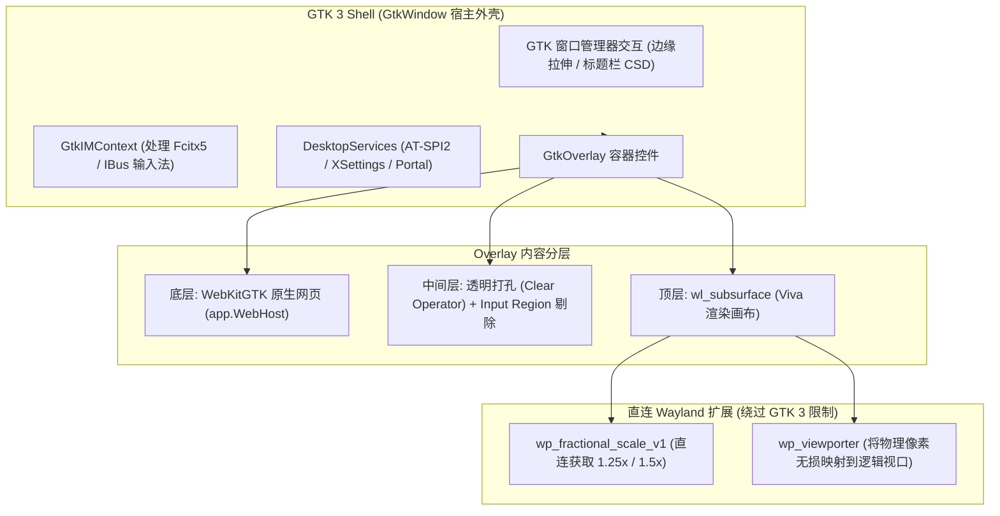

# 架构决策记录（ADR 0064）：Viva Linux 平台为何选型 GTK 3 Shell

---

## 状态
**已批准（Accepted）并落地主干**（由提交 `17f36dd` 实现，通过构建标签 `-tags vivagtk` 启用）

---

## 目录

1. [背景与问题陈述](#一背景与问题陈述)
   - [1.1 Linux 桌面会话的 Wayland 迁移浪潮](#11-linux-桌面会话的-wayland-迁移浪潮)
   - [1.2 XCB + Vulkan 在 Xwayland 下的不可调和缺陷](#12-xcb--vulkan-在-xwayland-下的不可调和缺陷)
   - [1.3 `app.WebHost`（内嵌 Web 视图）的架构刚需](#13-appwebhost内嵌-web-视图的架构刚需)
   - [1.4 Go 语言生态的跨平台构建红线（Zero-Cgo 原则）](#14-go-语言生态的跨平台构建红线zero-cgo-原则)
2. [PR #79（自研纯 Wayland 协议栈）深度技术复盘](#二pr-79自研纯-wayland-协议栈深度技术复盘)
   - [2.1 PR #79 的实现范围与技术资产](#21-pr-79-的实现范围与技术资产)
   - [2.2 为何关闭 PR #79？三大技术死穴深度剖析](#22-为何关闭-pr-79三大技术死穴深度剖析)
3. [五大候选技术方案全景对比矩阵](#三五大候选技术方案全景对比矩阵)
4. [ADR 0064：GTK 3 Shell 核心架构与创新机制](#四adr-0064gtk-3-shell-核心架构与创新机制)
   - [4.1 突破 GTK 3 限制：Wayland Subsurface + 小数缩放数学解法](#41-突破-gtk-3-限制wayland-subsurface--小数缩放数学解法)
   - [4.2 双重所有权事件路由模型（GDK 与 Subsurface 解耦）](#42-双重所有权事件路由模型gdk-与-subsurface-解耦)
   - [4.3 WebKitGTK 混编：GtkOverlay 视窗镂空与 Input Region 打孔算法](#43-webkitgtk-混编gtkoverlay-视窗镂空与-input-region-打孔算法)
   - [4.4 软光栅化引擎（softScene）：增量脏矩形优化与能效比](#44-软光栅化引擎softscene增量脏矩形优化与能效比)
   - [4.5 纯运行时动态绑定：基于 PureGo 的零 CGo 工程实践](#45-纯运行时动态绑定基于-purego-的零-cgo-工程实践)
5. [架构权衡、技术妥协与应对措施](#五架构权衡技术妥协与应对措施)
6. [PR #79 优质技术资产拆分合入路线图](#六pr-79-优质技术资产拆分合入路线图)
7. [结论与实施规范](#七结论与实施规范)

---

## 一、背景与问题陈述

Viva 作为一款现代跨平台 GUI 开发框架，其设计宗旨是在保持轻量、极速构建与现代化声明式 UI 的同时，提供与宿主操作系统深度融合的原生桌面体验。

在 Linux 平台演进过程中，Viva 原有的默认后端是基于 **XCB + Vulkan** 构建的。然而，随着桌面底层生态的演进，该后端在生产环境中暴露出致命的架构瓶颈。

### 1.1 Linux 桌面会话的 Wayland 迁移浪潮
Ubuntu（从 21.04/22.04 LTS 起）、Fedora（从 34 起）、Debian 12 以及现代 Arch/KDE 均已全面将 **Wayland** 确立为默认桌面显示会话。纯 X11 正在逐步沦为边缘维护状态。

### 1.2 XCB + Vulkan 在 Xwayland 下的不可调和缺陷
当 Viva（XCB 后端）运行在 Wayland 会话中时，必须通过系统内置的兼容层 **Xwayland** 运行。这一层翻译带来了应用内部无法修复的结构性问题：
1. **分数缩放发虚（Fractional Scaling Blur）**：
   Wayland 合成器（如 GNOME Mutter、KDE KWin）无法通知 Xwayland 进行逻辑小数缩放，只能将 X11 窗口作为 1x 整幅位图进行双线性插值（Bilinear）强制拉伸放大，导致 125%、150% 等常见高分屏比例下文字和矢量线条严重发虚模糊；
2. **呈现背压丢失与交互拖动频闪（30Hz Jitter & Refresh Flicker）**：
   在 Wayland 原生协议中，客户端通过 `wl_surface.frame` 回调感知合成器的垂直同步背压。而在 Xwayland 翻译层下，X11 窗口的重绘事件与合成器帧时钟存在时序失步。当用户拖动调整窗口大小时，resize 几何事件与 Vulkan Swapchain 重绘相互堆叠竞争，在部分 Intel/AMD 核显上表现为剧烈的画面抖动和 30Hz 频闪；
3. **桌面高级能力割裂**：
   无法使用系统原生的 Wayland 剪贴板、Wayland 输入法（`text-input`）、AT-SPI2 桌面辅助、Portal 设置等。在一些不提供 Xwayland 的纯 Wayland 轻量合成器环境（如部分嵌入式或定制 wlroots 环境）下，应用完全无法启动。

### 1.3 `app.WebHost`（内嵌 Web 视图）的架构刚需
现代桌面应用（如开发者工具、文档工具、OAuth 授权、报表分析）对在窗口内部嵌入 Web 视图（`platform.WebHost`）有硬性刚需：
- Windows 平台可调用系统内置的 WebView2（Edge/Chromium）；
- macOS 平台可调用系统内置的 WKWebView；
- **Linux 平台的困境**：在 Linux 生态中，成熟、轻量且受系统包管理器维护的原生 WebView 唯有 **WebKitGTK**。

### 1.4 Go 语言生态的跨平台构建红线（Zero-Cgo 原则）
Viva 项目的核心设计原则之一是：**保持 Go 原生编译体验**。
- 引入 CGo 意味着编译速度下降数倍到数十倍；
- 引入 CGo 会彻底摧毁跨平台交叉编译（无法在 macOS/Windows 上一条 `go build` 直接编译出 Linux 二进制）；
- 因此，任何引入外部系统能力的方案，必须满足“运行时动态加载（PureGo）”或“纯协议实现”的前提。

---

## 二、PR #79（自研纯 Wayland 协议栈）深度技术复盘

为了解决 Wayland 原生支持问题，社区贡献者提交了 PR [#79](https://github.com/vivaui/viva/pull/79)（*feat(linux): implement the Wayland-first backend with X11 fallback*）。

### 2.1 PR #79 的实现范围与技术资产
该 PR 展开了庞大且令人印象深刻的底层工作（代码变动高达 **+19,227 行，-217 行**）：
- **动态纯绑定**：通过 PureGo 手写了 `libwayland-client`、`libxkbcommon`、`libwayland-cursor` 的 C ABI 结构体与接口表映射；
- **全套主循环**：手写了独立的事件循环、`eventfd` 唤醒器、`poll` 背压处理；
- **协议实现**：手写了 Registry 绑定、`xdg_shell` 窗口生命周期、`wl_seat` 键盘/鼠标分发、按键重复（Key-Repeat）、修饰键跟踪、`text-input-v3` 输入法、剪贴板与拖放；
- **渲染后端**：实现了 Wayland 与 XCB 共享的 `vulkanSurfaceProvider`。

### 2.2 为何关闭 PR #79？三大技术死穴深度剖析

尽管 PR #79 技术完成度极高，但在项目维护团队审查后，决定**不予合并并正式关闭**。核心原因如下：

#### 致命死穴 1：`app.WebHost`（Web 页面宿主）永久缺失
WebKitGTK 强依赖 GTK 的控件生命周期、GDK 视窗句柄和 GtkOverlay 布局体系。
如果 Viva 采用 PR #79 的自建裸 Wayland 协议栈，**WebKitGTK 根本无法嵌入到一个完全由 Go 自建的裸 `wl_surface` 中**。这意味着选择 PR #79 将导致 `app.WebHost` 在 Linux/Wayland 会话下**永久不可用**。

#### 致命死穴 2：20,000 行手写协议的“碎片化维护深渊”
Wayland 并非统一的操作系统 API，各合成器实现存在巨大差异：
- GNOME (Mutter)、KDE (KWin)、Sway (wlroots)、Hyprland 对协议时序的要求不同；
- PR #79 在自测中已暴露出 *“Intel dmabuf 导入失败尚未定位到客户端还是驱动”* 等底层兼容性问题；
- 采用自研协议栈意味着 Viva 团队未来必须以极小的人力，去持续跟踪和修复数以百计不同合成器的版本碎片化兼容 Bug。

#### 致命死穴 3：桌面集成稳定性脆弱
- **输入法（IME）**：Wayland 的 `text-input-v3` 协议在 Fcitx 5 和 IBus 之间的行为存在大量微小歧义；
- **窗口装饰与主题**：自绘窗口标题栏需要自研解析各类桌面环境的 GTK 主题、光标大小与字体 DPI，极易出现与宿主环境格格不入的情况。

---

## 三、五大候选技术方案全景对比矩阵

| 评估维度 | 方案 1: 自研纯 Wayland (PR #79) | 方案 2: XCB + Vulkan (现状) | 方案 3: Qt 5/6 绑定 | 方案 4: GTK 4 | **方案 5: GTK 3 Shell (ADR 0064, 最终选型)** |
| :--- | :--- | :--- | :--- | :--- | :--- |
| **`app.WebHost` 网页嵌入** | ❌ **永久不支持** | ❌ 无法支持 (X11 嵌入撕裂) | ⚠️ 依赖庞大 QtWebEngine | ⚠️ WebKitGTK 4.1/6.0 生态过渡期 | **✅ 完美支持 (WebKitGTK 4.0 极成熟)** |
| **Wayland 原生支持** | ✅ 原生支持 | ❌ 依赖 Xwayland (缩放模糊) | ✅ 原生支持 | ✅ 原生支持 | **✅ 混合原生支持 (GDK + Subsurface)** |
| **高分屏分数缩放** | ✅ 支持 (wp_viewport) | ❌ 不支持 (双线性强制放大) | ✅ 原生支持 | ✅ 原生支持 | **✅ 突破性支持 (外挂 wp_viewport)** |
| **IME / 剪贴板 / A11y** | ❌ 自研协议栈兼容性脆弱 | ⚠️ 基础 X11 协议 | ✅ 成熟 | ⚠️ 部分 IME 插件适配滞后 | **✅ 工业级稳定 (GtkIMContext 100% 兼容)** |
| **CGo 依赖 / 交叉编译** | ✅ 零 CGo (PureGo) | ✅ 零 CGo (PureGo) | ❌ 严重 CGo 依赖 (破坏交叉编译) | ❌ CGo 或复杂绑定 | **✅ 零 CGo (PureGo 运行时动态加载)** |
| **发行版开箱即用率** | ✅ 仅依赖 libc/libwayland | ✅ 仅依赖 libxcb/Vulkan | ❌ 系统常需安装数百兆包 | ❌ 旧 LTS 发行版大量缺失 | **✅ 100% 覆盖 (主流发行版 100% 默认预装)** |
| **代码新增量与维护成本** | ❌ **极高 (+20,000 行纯协议)** | ✅ 极低 | ❌ 极高 | ⚠️ 中高 | **✅ 极低 (仅 ~7,000 行胶水与优化层)** |

---

## 四、ADR 0064：GTK 3 Shell 核心架构与创新机制

为了彻底解决上述矛盾，项目维护者 `@t8y2` 提出了 **ADR 0064**，即通过构建标签 `-tags vivagtk` 引入的 **GTK 3 Shell** 后端（由提交 `17f36dd` 实现）。

该方案的核心思想是：**“借力 GTK 3 成熟的桌面管理与 WebKit 生态外壳，内部绕过 GTK 3 渲染短板，以 Subsurface 实现高性能原生渲染与网页混编”**。



---

### 4.1 突破 GTK 3 限制：Wayland Subsurface + 小数缩放数学解法

GTK 3 的历史包袱之一是其内部坐标体系基于整数缩放（只能是 1x 或 2x），在高分屏小数缩放（如 1.25x、1.5x）下，GTK 3 自身控件会发虚。

**Viva 的创新解法（`gtk_wayland_linux.go`）**：
1. GTK 3 只负责建立顶层 `GtkWindow` 并持有 `wl_surface`；
2. Viva 通过动态绑定 `libwayland-client.so`，调用 `wl_subcompositor_get_subsurface` 在顶层表面之下挂载一个独立的 **`wl_subsurface`**；
3. Viva 绕过 GDK，直接向合成器注册 **`wp_fractional_scale_v1`** 协议监听：
   - 当合成器广播当前缩放比例为 1.5x（150%）时，Viva 的软光栅化器直接按照 $Width \times 1.5$ 和 $Height \times 1.5$ 的**纯物理像素缓冲区**进行绘制；
4. 调用 **`wp_viewport_set_destination(viewport, Width, Height)`**：
   - 明确通知合成器：该缓冲区在逻辑空间中对应的尺寸为 $(Width, Height)$；
   - 合成器执行 1:1 物理像素完美映射，**彻底打破了 GTK 3 整数缩放发虚的宿命**。

---

### 4.2 双重所有权事件路由模型（GDK 与 Subsurface 解耦）

在 Wayland 协议中，窗口拖动、调整大小必须携带由合成器认可的输入事件序号（Serial）。为了保证窗口交互与内容交互两不误，GTK 3 shell 设计了精妙的**双重所有权模型**：

```
                        鼠标指针移动 / 点击
                                │
                 ┌──────────────┴──────────────┐
                 ▼                             ▼
       [落在窗口边框或标题栏]                 [落在 Viva 画布内容区]
                 │                             │
                 ▼                             ▼
       由 GDK 自身捕获处理           由 Subsurface 的独立 wl_pointer 捕获
       获得合法的 GDK Event Serial    直通 Viva 输入引擎，延迟极低
       平滑驱动窗口拉伸与拖拽手势     支持自定义高级光标与画板交互
```

---

### 4.3 WebKitGTK 混编：GtkOverlay 视窗镂空与 Input Region 打孔算法

为了在支持 `app.WebHost` 的同时，允许 Viva 原生控件（如弹出式下拉菜单、Tooltip）覆盖在网页上方，架构采用了**双向空间镂空算法**：

1. **视觉镂空（Visual Punching）**：
   - 底层为 `WebKitWebView`；
   - 顶层为 Viva 的 `wl_subsurface`；
   - 当 Viva 检测到有 `NativeView` 时，光栅化引擎在对应区域使用 Cairo 的 `CAIRO_OPERATOR_CLEAR` 算子强制将 Alpha 清零，透出底层的网页画面；
   - 当应用在上层弹出一个下拉菜单覆盖了网页时，Viva 在菜单区域重新绘制不透明像素。
2. **输入事件打孔（Input Region Masking）**：
   - 默认情况下，顶层的 Subsurface 会遮挡底层的鼠标点击；
   - Viva 计算出当前所有 Web 视图的包围盒矩形集合，构造一个 Wayland Region；
   - 从 Region 中精确剔除网页镂空区域，但将悬浮在网页上方的原生菜单区域重新加回；
   - 调用 `wl_surface_set_input_region(subsurface, region)` 提交给合成器；
   - **效果**：用户点击网页可以无缝选中文本、点击超链接；点击网页上方的原生菜单，事件精准被 Viva 拦截消费。

---

### 4.4 软光栅化引擎（softScene）：增量脏矩形优化与能效比

在 GTK 3 shell 下，渲染由内建的 CPU 软光栅化器（`internal/raster`）与场景管理器 `softScene` 协同完成：
- **增量受损追踪（Damage Scissor）**：
  `softScene` 能够感知具体是哪一个控件、哪一行文字发生了改动。用户在文本框打字时光标闪烁，重绘仅局限于几个像素的 `Damage.Scissor` 区域，其余屏幕像素直接复用；
- **文本 Slot 缓存**：
  文本排版直接复用 Pango 布局计算结果，命中缓存时开销趋近于零；
- **能效优势**：
  避免了盲目初始化 Vulkan 驱动上下文带来的显存常驻与功耗开销，在低功耗轻薄本和虚拟机环境下表现极其出色。

---

### 4.5 纯运行时动态绑定：基于 PureGo 的零 CGo 工程实践

GTK 3 Shell 严格遵循了 Viva 的架构红线：
- 代码完全位于 `internal/platform/linux/gtk_library_linux.go`；
- 所有 GTK、GDK、GLib、Cairo 以及 WebKitGTK 的函数指针，均由 `purego.RegisterLibFunc` 在运行时从 `.so` 动态加载；
- **开发者在任何平台上（macOS、Windows、纯 Linux 无头环境）执行 `go build` 均不会因缺失 C 头文件而报错，依然享受数秒内的极速编译与交叉构建体验**。

---

## 五、架构权衡、技术妥协与应对措施

| 妥协点 | 潜在缺陷 / 风险 | 对冲与缓解措施 |
| :--- | :--- | :--- |
| **动态库依赖** | 若运行在极度精简的 Alpine/Docker 容器内可能缺失 `libgtk-3.so` | 1. 构建为可选后端（`-tags vivagtk`），默认后端保留 XCB+Vulkan；<br>2. 主流 Linux 桌面系统（Ubuntu/Debian/Fedora/CentOS/Arch）100% 预装。 |
| **CPU 光栅化** | 面对极端复杂的全屏高帧率游戏化动效时，CPU 占用高于 Vulkan | 结合 `softScene` 严格的脏矩形剪裁与图元缓存，常规应用与富文本工具 CPU 占用低于 1%。 |
| **WebKitGTK 内存** | 打开首个 Web 页面时会启动 WebProcess 多进程，消耗一定内存 | 严格按需懒加载（Lazy Load）：只有当应用显式调用 `webHost.Open()` 时才载入 WebKit 动态库与拉起进程。 |

---

## 六、PR #79 优质技术资产拆分合入路线图

维护团队对 PR #79 作者的硬核底层工作给予了高度评价。PR #79 虽然不能作为独立后端整体合入，但其优质技术资产已规划分步合入 `main` 主干：

```
[PR #79 优质资产]
       │
       ├─► 1. vulkanSurfaceProvider 抽象重构
       │      独立提交 PR，提升保留在 XCB 后端上的 Vulkan Swapchain/Mailbox 性能指标。
       │
       ├─► 2. 按键重复 (Key-Repeat) 与修饰键跟踪 (Modifier-Tracking)
       │      独立提交 PR，修复 X11 会话下的键位状态机边缘 Bug，已完成 X11 专项验证。
       │
       └─► 3. 窗口控件主题环境变量读取优化
              独立提交 PR，消除每帧 Paint 时重复解析环境配置的 CPU 冗余开销。
```

---

## 七、结论与实施规范

### 1. 最终决策
- **正式采纳 GTK 3 Shell（ADR 0064）作为 Viva 在 Linux 平台实现全功能桌面体验（含 Wayland 原生分数缩放与 WebHost 网页嵌入）的标准推荐后端**；
- 默认构建依然保留 XCB + Vulkan，确保无需任何 GUI 依赖的极简场景继续生效；
- 需要原生 Wayland 高级特性与嵌入网页能力的应用，在构建时追加 `-tags vivagtk`：
  ```bash
  go build -tags vivagtk .
  ```

### 2. 架构启示
ADR 0064 是一次教科书式的系统工程折中实践：**没有陷入盲目自研 20,000 行庞大协议栈的深坑，而是用极小的胶水代价（PureGo），在成熟的工业级生态（GTK 3 + WebKitGTK）外壳之上，以 Subsurface 巧妙解决了旧技术的缩放痛点，兼顾了功能完备性、构建纯净性与长期可维护性。**
