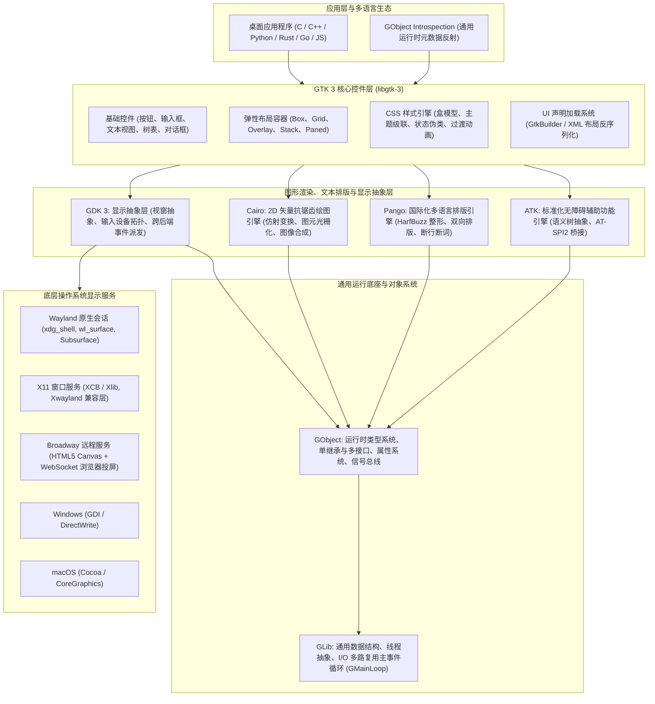

# GTK 3 技术全景与宏观系统架构深度解析

---

## 目录

1. [技术定位与工业级设计哲学](#一技术定位与工业级设计哲学)
2. [总体分层架构全景图](#二总体分层架构全景图)
3. [核心基础支撑组件宏观解析](#三核心基础支撑组件宏观解析)
   - [3.1 GLib：通用系统底座与事件驱动反应堆](#31-glib通用系统底座与事件驱动反应堆)
   - [3.2 GObject：纯 C 构建的面向对象与信号总线](#32-gobject纯-c-构建的面向对象与信号总线)
   - [3.3 GDK：多后端视窗与输入设备抽象层](#33-gdk多后端视窗与输入设备抽象层)
   - [3.4 Cairo：设备无关的 2D 矢量图形渲染引擎](#34-cairo设备无关的-2d-矢量图形渲染引擎)
   - [3.5 Pango：国际化排版与复杂文本整形系统](#35-pango国际化排版与复杂文本整形系统)
   - [3.6 ATK：标准化无障碍辅助功能引擎](#36-atk标准化无障碍辅助功能引擎)
4. [GTK 3 控件体系与界面运行机制](#四gtk-3-控件体系与界面运行机制)
   - [4.1 控件生命周期流转模型](#41-控件生命周期流转模型)
   - [4.2 两阶段几何尺寸协商算法模型](#42-两阶段几何尺寸协商算法模型)
   - [4.3 递归绘制流水线、增量脏矩形与双缓冲](#43-递归绘制流水线增量脏矩形与双缓冲)
   - [4.4 现代 CSS 3 盒模型、选择器特异度与样式级联](#44-现代-css-3-盒模型选择器特异度与样式级联)
   - [4.5 响应式弹性布局哲学与容器系统](#45-响应式弹性布局哲学与容器系统)
5. [关键桌面集成机制宏观模型](#五关键桌面集成机制宏观模型)
   - [5.1 现代输入法系统（GtkIMContext）交互流程](#51-现代输入法系统gtkimcontext交互流程)
   - [5.2 剪贴板协议（GtkClipboard）与多格式惰性传输](#52-剪贴板协议gtkclipboard与多格式惰性传输)
   - [5.3 拖拽系统（Drag and Drop）全生命周期模型](#53-拖拽系统drag-and-drop全生命周期模型)
   - [5.4 桌面环境设置热同步机制](#54-桌面环境设置热同步机制)
6. [嵌入式 Web 生态：WebKitGTK 架构协作](#六嵌入式-web-生态webkitgtk-架构协作)
   - [6.1 多进程沙箱隔离架构](#61-多进程沙箱隔离架构)
   - [6.2 原生 UI 与 Web 视图的混合层叠与交互路由](#62-原生-ui-与-web-视图的混合层叠与交互路由)
7. [多语言生态与 GObject Introspection 哲学](#七多语言生态与-gobject-introspection-哲学)
   - [7.1 统一元数据反射仓库设计](#71-统一元数据反射仓库设计)
   - [7.2 非侵入式动态调用与运行时绑定原理](#72-非侵入式动态调用与运行时绑定原理)
8. [技术演进：GTK 3 与 GTK 4 架构全景对比](#八技术演进gtk-3-与-gtk-4-架构全景对比)
9. [宏观总结与工业级选型指引](#九宏观总结与工业级选型指引)

---

## 一、技术定位与工业级设计哲学

**GTK 3**（GIMP Toolkit 3）是开源世界中历经十余年工业级检验的跨平台图形用户界面（GUI）技术栈，也是 **GNOME 桌面环境、Xfce、MATE、Cinnamon** 以及数以万计 Linux 桌面软件的系统级底座。

在宏观架构设计上，GTK 3 树立了三个核心的设计哲学：

### 1. 纯 C 语言构建的极致面向对象抽象
GTK 并没有采用 C++，而是通过纯 C 语言结合内存对齐与函数指针，设计出完备的运行时对象系统（GObject）。这一决策带来了关键的系统级优势：
- **无 C++ ABI 碎片化负担**：不同编译器、不同标准库版本的二进制完全兼容；
- **全语言 FFI 友好的生态顶峰**：纯 C 导出的平坦符号表，使得 Python、Rust、Go、JavaScript、C# 等任意语言均可以近乎零成本实现无缝绑定与动态反射。

### 2. 严密的职责解耦与分层设计
GTK 并非一个大而全的单体库，而是自底向上拆分为六个高内聚、低耦合的独立子系统：
- 事件反应堆与通用工具（**GLib**）；
- 类型系统与信号总线（**GObject**）；
- 视窗与输入硬件抽象（**GDK**）；
- 2D 矢量抗锯齿绘图（**Cairo**）；
- 国际化多语言文本排版（**Pango**）；
- 辅助功能与无障碍通信（**ATK**）。

### 3. 数据驱动与声明式样式
彻底摒弃传统 GUI 硬编码像素坐标与硬编码外观的做法，全面引入类似于现代 Web 的 **CSS 3 盒模型、状态伪类和层叠继承规则**，将视觉外观与业务逻辑彻底解耦。

---

## 二、总体分层架构全景图



---

## 三、核心基础支撑组件宏观解析

### 3.1 GLib：通用系统底座与事件驱动反应堆

GLib 是整个架构的心脏，扮演着跨平台系统能力抽象与事件中枢的双重角色。

#### 1. Reactor 反应堆事件循环体系
GUI 应用本质上是一个长期处于事件驱动循环的有限状态机。GLib 的 **`GMainContext`** 实现了经典的反应堆模式（Reactor Pattern）：
- **全事件源统一归一化**：将底层的网络 Socket、管道、IPC 描述符、定时器、用户硬件击键、空闲任务统一抽象为“事件源（GSource）”；
- **四阶段迭代状态机**：
  1. **Prepare（准备阶段）**：遍历全部事件源，查询就绪状态并计算出全局最小等待超时时间；
  2. **Poll（多路复用轮询）**：调用操作系统内核的多路复用机制（Linux 下为 `poll`/`epoll`），在超时时间内阻塞等待事件就绪；
  3. **Check（检查阶段）**：操作系统唤醒后，校验各文件描述符的实际就绪掩码；
  4. **Dispatch（分发阶段）**：依据严格的优先级队列，依次调用就绪事件的回调处理逻辑。
- **动态优先级调度**：区分高优先级硬件输入、正常绘制任务与低优先级后台空闲任务，保证界面响应永不卡顿；
- **跨线程安全唤醒通道**：当后台工作线程计算完毕需要更新 UI 时，通过内核的事件通知机制（如 `eventfd`）将任务投递至主事件循环并打断阻塞，保证 UI 线程绝对的数据安全性。

---

### 3.2 GObject：纯 C 构建的面向对象与信号总线

GObject 为纯 C 语言赋予了完备的企业级面向对象架构：

#### 1. 运行时类型系统（GType）与对象内存模型
- **平坦单继承与多接口**：类体系清晰划分为单一继承链（基类 `GtkWidget` 逐级派生），同时允许类挂载多个独立能力接口（如可构建接口、可滚动接口）；
- **虚函数表（VTable）单例隔离**：将每一个对象实例的“状态数据”与所属类的“虚函数方法表”物理分离，类方法表在全局仅加载一份，极大降低内存占用；
- **浮动引用（Floating Reference）机制**：针对树形控件容器量身定制的所有权转移设计。新创建的子控件在加入父容器的一瞬间，所有权自动转移给父级，当父容器销毁时级联析构整棵子树，从机制上杜绝内存泄漏。

#### 2. 信号总线与发布-订阅系统（GSignal）
- **类型安全的事件总线**：控件无需直接依赖外部调用方，通过发射具名信号（如 `clicked`、`destroy`）广播状态变化；
- **多阶段生命周期拦截**：信号传播严格区分默认处理阶段、用户回调阶段、后置清理阶段；
- **事件消费短路机制**：事件回调可返回布尔状态，告知信号分发系统“该事件是否已被当前节点完全消费”，若已消费则自动中止后续节点的冒泡传播。

#### 3. 动态属性系统（GParamSpec 与 GValue）
- 每一个属性均挂载类型、范围、读写权限的元数据定义；
- 支持属性变更自动发出变更通知，构成现代声明式数据绑定（Data Binding）的物理底座。

---

### 3.3 GDK：多后端视窗与输入设备抽象层

GDK 彻底隔绝了具体操作系统视窗协议的复杂性，为上层控件体系呈现高度统一的世界观。

#### 1. 视窗抽象与连接拓扑
- **`GdkDisplay`**：封装与底层显示服务器（Wayland 合成器、X11 Server 等）的通信上下文；
- **`GdkScreen`**：封装物理显示器布局、DPI 分辨率与多屏扩展；
- **`GdkWindow`**：屏幕表面画布的通用句柄，统一代表 Wayland 表面、X11 窗口、Windows HWND 或 macOS NSWindow。

#### 2. 设备拓扑：Master 与 Slave 统一设备模型
- **Master Device（逻辑设备）**：向应用呈现单一的聚焦光标与键盘焦点；
- **Slave Device（物理设备）**：多只实体鼠标、触控板、数位板外设的数据自动汇聚，并统一解算为平滑滚动（Smooth Scrolling）、多点触控与笔压感信号。

#### 3. 多后端运行时动态自适应
同一个应用二进制具备自适应能力：
- 启动时自动探测环境变量，优先在 **Wayland** 原生会话下以最高能效运行；
- 若检测到传统环境，自动平滑降级至 **X11**；
- 支持纯 Web 网络后端（**Broadway**），直接将图形渲染指令流转为 HTML5 + WebSocket，在远端浏览器中免安装运行。

---

### 3.4 Cairo：设备无关的 2D 矢量图形渲染引擎

Cairo 承担了 GTK 3 整个视窗体系的全部 2D 绘图与矢量栅格化工作。

#### 1. 上下文状态机与仿射变换
- 绘图基于命令式上下文进行，具备独立的状态保存与回滚能力（状态栈）；
- **用户逻辑坐标与物理设备像素分离**：内置二维仿射变换矩阵（CTM），平移、旋转、缩放指令直接在矩阵层完成运算，使得矢量控件在高分屏下能够天然以物理像素精细排布。

#### 2. 路径构建与抗锯齿栅格化
- 支持点、线段、三次贝塞尔曲线构建任意复合闭合区域；
- 采用先进的扫描线算法将复杂非凸多边形高速分解为梯形几何集合；
- 采用亚像素面积覆盖率算法计算边缘 Alpha 渐变，彻底消弭几何图形的阶梯状毛刺与锯齿。

#### 3. 图像合成模型（Compositing）
- 完整支持图形学经典的 **Porter-Duff 12 种图像合成算子**（覆盖、混合、打孔、剪影等）；
- 为复杂图层重叠、透明磨砂、局部阴影与镂空提供了直接的数学支持。

---

### 3.5 Pango：国际化排版与复杂文本整形系统

文字排版是 GUI 体系中最庞杂的技术高地。Pango 为 GTK 3 提供了覆盖全球已知所有人类语言的排版能力。

```
[原始 UTF-8 字符序列]
         │
         ▼
 1. 分词与段落分析 (依据语言属性与双向文本规则拆分文本块)
         │
         ▼
 2. 字体匹配与级联选择 (Fontconfig 按规则匹配系统物理字体，处理缺字 fallback)
         │
         ▼
 3. 复杂文本整形 (HarfBuzz 解析 OpenType 特性表，完成上下文连字与形变)
         │
         ▼
 4. 双向重排与断行求解 (Unicode UAX #9 BiDi 镜像重排 + UAX #14 自动避头尾断行)
         │
         ▼
 5. 富文本跨度修饰 (叠加颜色、字号、下划线、字重等排版属性)
         │
         ▼
 6. 最终光栅化输出 (交由 Cairo 将字形轮廓渲染至像素表面)
```

- **HarfBuzz 深度结合**：完美支持阿拉伯语词首/词中/词尾连写变形、印度系文字辅音元音重组定位、以及现代西文连字（Ligatures）；
- **双向排版（BiDi）支持**：当阿拉伯语（从右向左）与英文/数字（从左向右）混合排版时，严格遵循 Unicode 规范完成段落内局部空间重排。

---

### 3.6 ATK：标准化无障碍辅助功能引擎

- **可访问性接口树**：为每一个可视控件赋予标准化的语义角色（按钮、文本框、列表项、单选框）和动态状态（聚焦、选中、展开、禁用）；
- **AT-SPI2 系统桥接**：将控件语义树通过 Linux D-Bus 系统总线广播给辅助工具（如 Orca 屏幕阅读器），确保盲人、视障用户及自动化测试工具能够准确探测与控制界面。

---

## 四、GTK 3 控件体系与界面运行机制

### 4.1 控件生命周期流转模型

一个控件从内存诞生到最终映射呈现，经历严密的状态推进：

```
[实例化创建阶段]
       │
       ▼
[Realize (具现化) 阶段]
申请操作系统视窗资源，建立对应的 GdkWindow 绘图表面。
       │
       ▼
[Map (映射) 阶段]
加入可视渲染树，向显示服务器或窗口管理器声明为可见（Visible）。
       │
       ▼
[Draw (绘制) 阶段]
响应系统或应用的重绘事件，分配 Cairo 绘图上下文进行画面填充。
       │
       ▼
[Unmap / Unrealize / Destroy 阶段]
从可视树移除，归还系统视窗表面，最终级联释放内存。
```

---

### 4.2 两阶段几何尺寸协商算法模型

GTK 3 彻底放弃固定像素坐标定位，界面尺寸采用**自底向上测量与自顶向下分配的两阶段递归算法**：

```
 Phase 1: 尺寸测量 (自底向上 - Bottom-Up)
   - 每个子控件根据内部内容（文本长短、内边距、图标大小）计算两个关键指标:
     * 最小尺寸 (Minimum Size): 控件正常可用不可再压缩的下限阈值;
     * 自然尺寸 (Natural Size): 控件最舒服优美的视觉期望尺寸。
   - 父容器逐级汇总子控件诉求，向上报告容器整体尺寸。

 Phase 2: 空间分配 (自顶向下 - Top-Down)
   - 顶层窗口根据屏幕物理空间与用户拉伸状态，确定最终可用矩形空间;
   - 父容器依据可用空间、布局约束算法与伸展权重（Expand/Fill 属性），
     计算并正式赋予每个子控件最终的几何矩形坐标 (x, y, width, height)。
```

- **高度随宽度变化（Height-for-Width）**：原生支持文字排版特性，容器给的宽度越宽，所需的高度自适应减少，极大提升响应式界面的排版质感。

---

### 4.3 递归绘制流水线、增量脏矩形与双缓冲

为了保证动画与交互的绝对流畅并杜绝频闪，GTK 3 建立了严格的重绘流水线：
1. **增量受损追踪（Damage Tracking）**：当某个控件状态发生改变时，仅将该控件占据的屏幕区域标记为“受损（Invalidated）”；
2. **脏矩形合并（Coalescing）**：在一个帧时钟周期内，系统自动将所有重叠、相交的受损区域合并为一个最小外包矩形集合；
3. **强制双缓冲（Double Buffering）**：系统在内存中开辟离屏后台表面，设置好剪裁边界后，仅调用受损区域内部控件的绘制逻辑，屏幕未变动区域跳过重绘；
4. **原子帧提交（Atomic Present）**：在垂直同步时隙（V-Sync），一次性将离屏画面整幅提交给合成器，从原理上消除画面撕裂与拖动白屏。

---

### 4.4 现代 CSS 3 盒模型、选择器特异度与样式级联

GTK 3 拥有一套完整的 DOM 树抽象——**CSS 节点树（`GtkCssNode`）**：
- **经典盒模型**：每个控件均拥有完整的外边距（Margin）、边框（Border）、内边距（Padding）和内容区（Content Area）；
- **类 Web 语法定制**：通过 CSS 语法定义背景渐变、圆角半径（`border-radius`）、阴影（`box-shadow`）以及过渡动画（`transition`）；
- **层叠特异度计算（Cascade Specificity）**：遵循 W3C 标准，按照内联样式、ID 选择器、Class 选择器、元素标签名的权重级联仲裁，支持全局深色模式（Dark Mode）毫秒级无缝热切换。

---

### 4.5 响应式弹性布局哲学与容器系统

GTK 3 提倡流式弹性布局，核心容器各司其职：
- **`GtkBox`**：水平或垂直流式容器，支持子元素权重自适应伸展；
- **`GtkGrid`**：二维网格矩阵容器，支持单元格跨行、跨列合并对齐，是复杂表单界面的首选；
- **`GtkOverlay`**：层叠浮动容器，允许将浮动工具栏、水印或状态控件覆盖在主视窗或多媒体层之上；
- **`GtkStack`**：卡片式多页面切换容器，支持滑动、交叉渐变等原生平滑切换动画。

---

## 五、关键桌面集成机制宏观模型

### 5.1 现代输入法系统（GtkIMContext）交互流程

Linux 桌面环境下的中文拼音、日文等复杂输入法体系由 `GtkIMContext` 全权代理：
- **按键过滤与抢占**：硬件按键事件优先送达输入法框架（Fcitx / IBus）处理；
- **光标跟随协议**：控件实时向输入法同步光标插入点的绝对坐标，确保候选字弹窗永远精准对齐当前输入位置；
- **预编辑状态反馈（Pre-edit）**：处理拼音串下划线高亮显示，待用户最终确认选词后，通过提交信号（Commit）将文字送入文本缓冲区。

### 5.2 剪贴板协议（GtkClipboard）与多格式惰性传输

- **多 MIME 类型协商**：复制动作触发时，应用并不立即进行繁重的数据序列化，而是向系统广播其能够提供的格式清单（如纯文本、HTML 富文本、PNG 图像）；
- **按需惰性交付（Lazy Delivery）**：当且仅当目标软件发起粘贴动作并选定某种数据格式时，源软件才按需生成对应格式数据流，大幅节约内存与 IPC 开销。

### 5.3 拖拽系统（Drag and Drop）全生命周期模型

GTK 3 完整实现了 X11 XDND 与 Wayland Data Device 规范：
- 拖拽发起（抓取快照并生成半透明跟随图标） $\rightarrow$ 经过目标窗口探测（验证是否支持接收该数据格式并高亮目标边框） $\rightarrow$ 释放确认 $\rightarrow$ 跨进程安全数据流传输 $\rightarrow$ 拖拽结束状态回收。

### 5.4 桌面环境设置热同步机制

- 监听系统根窗口 XSettings 广播与 Freedesktop Portal 信号；
- 实时无感知感知系统全局 DPI 缩放微调、字体平滑抗锯齿配置切换以及全局深色/浅色外观切换，无需重启应用程序。

---

## 六、嵌入式 Web 生态：WebKitGTK 架构协作

在现代客户端开发中，内嵌网页视图（WebView）是不可或缺的关键能力。在 Linux 生态中，**WebKitGTK** 是事实上的行业标准。

### 6.1 多进程沙箱隔离架构

```
┌────────────────────────────────────────────────────────┐
│ UI Process (应用程序主进程)                             │
│ 管理主窗口、布局容器与输入事件分发                      │
└───────────────────────────┬────────────────────────────┘
                            │ (Unix Domain Socket / IPC)
           ┌────────────────┴────────────────┐
           ▼                                 ▼
┌───────────────────────────┐    ┌───────────────────────────┐
│ WebProcess (渲染与执行沙箱)│    │ NetworkProcess (网络沙箱) │
│ 负责 HTML5 排版、CSS 渲染  │    │ 独立处理 HTTP/2 请求、    │
│ 与 JavaScriptCore 引擎执行│    │ Cookie 存储、缓存与安全   │
└───────────────────────────┘    └───────────────────────────┘
```
多进程架构确保即使某个网页因异常耗尽内存或崩溃，UI 宿主进程依然稳固运行。

### 6.2 原生 UI 与 Web 视图的混合层叠与交互路由

通过 `GtkOverlay` 容器机制：
- 底层承载原生的 WebKit 页面控件；
- 顶层覆盖应用的自绘制原生组件（如弹出式菜单、快捷工具栏）；
- **视觉图层透明打孔**：在顶层原生画面中开辟透明区域，透出底层的 Web 画面；
- **事件穿透路由**：通过区域掩码调整，使得点击网页区域时事件直达 WebKit，点击浮动原生控件时事件由原生层优先消费，实现原生与 Web 的无缝融合。

---

## 七、多语言生态与 GObject Introspection 哲学

### 7.1 统一元数据反射仓库设计

传统 C/C++ 库为不同语言编写绑定需要巨大的人力维护胶水代码。GTK 体系提出了开创性的 **GObject Introspection（GI）**：
- 构建系统自动分析头文件注释与类型定义，生成标准化的机器可读元数据（GIR XML 与紧凑二进制 Typelib）；
- 任何现代编程语言只需实现一个通用的 Typelib 解释引擎，即可在运行时自动映射调用 GTK 的全部类、方法、信号与枚举，且完全同步上游 API 更新。

### 7.2 非侵入式动态调用与运行时绑定原理

在诸如 Go 语言等注重轻量与跨平台编译的技术栈中：
- 无需在开发机上安装庞大的 C 开发头文件和交叉工具链；
- 通过运行时动态链接（`dlopen`/`dlsym`）直接定位系统自带的动态链接库（`libgtk-3.so.0`）；
- 实现了彻底摒弃 CGo 编译门槛的“**纯动态符号绑定（PureGo）**”架构，赋予应用极速交叉编译与开箱即用的交付体验。

---

## 八、技术演进：GTK 3 与 GTK 4 架构全景对比

| 架构维度 | GTK 3 (长期维护稳定版) | GTK 4 (新一代架构) | 架构变动深层技术原因 |
| :--- | :--- | :--- | :--- |
| **底层渲染引擎** | **Cairo 纯 CPU 软件绘制**（GPU 辅助混合） | **GSK (GTK Scene Graph)**，默认 Vulkan / OpenGL | GTK 4 采用保留模式场景图，复杂粒子与阴影动效性能极致，但对显卡驱动要求更严苛。 |
| **高分屏分数缩放** | 原生基于整数坐标（1x, 2x），小数缩放需靠合成器拉伸或外接子表面处理 | 原生深度支持 **浮点分数缩放**（Fractional Scale） | GTK 4 内部坐标系统全面重构为浮点数。 |
| **事件处理机制** | 控件直接承载事件虚函数与信号 | 引入 **`GtkEventController`**（事件控制器模式） | 彻底解耦视图绘制与事件监听，使手势识别等高级交互能够任意自由插拔。 |
| **容器模型** | 严格区分为 `GtkWidget` 与 `GtkContainer` | **废除 `GtkContainer`**，任何 Widget 自身天然支持挂载子节点 | 简化了面向对象继承树，但自定义容器需完全重构。 |
| **控件绘制机制** | 立即模式（Immediate Mode）：重写 `draw` 获取绘图上下文直接画 | 保留模式（Retained Mode）：重写 `snapshot` 向渲染树录制节点 | 利于 GPU 自动执行遮挡剔除与批次合并。 |
| **发行版覆盖率** | **100% 覆盖**（从老旧 LTS 到最新版均默认内置） | 仅在现代 Linux 系统上普及，旧环境存在缺失 | GTK 3 在企业级生产软件分发时具备无可撼动的零依赖优势。 |
| **WebKitGTK 稳定性** | WebKitGTK 4.0 极为成熟稳定 | WebKitGTK 处于向 4.1/6.0 迁移期，接口变动相对频繁 | 很多混合架构软件首选 GTK 3 作为 Web 宿主底座。 |
| **API/ABI 状态** | **彻底冻结**，零破坏性变更，维护成本趋近于零 | 处于演进迭代期，部分内部接口仍有微调变动 | 适合稳健型长期基础设施选型。 |

---

## 九、宏观总结与工业级选型指引

### 选型决策路径

```
                         你的 Linux 客户端架构诉求
                                     │
                 ┌───────────────────┴───────────────────┐
                 ▼                                       ▼
       追求极致高帧率 3D / 复杂动效？           追求最大化跨发行版开箱即用兼容性？
                 │                                       │
                 ▼                                       ▼
             [GTK 4]                                  [GTK 3]
       (GSK 全 GPU 场景图)                     (工业级稳定 / 100% 覆盖)
                                                         │
                                         ┌───────────────┴───────────────┐
                                         ▼                               ▼
                                需要嵌入原生网页？              需要极速交叉构建？
                                         │                               │
                                         ▼                               ▼
                                依托成熟 WebKitGTK              结合 PureGo 动态绑定
                                (生态最成熟坚固的基石)           (保持纯净零 CGo 构建)
```

**宏观结论**：GTK 3 不是旧时代的妥协，而是一座经过了十余年开源工业界千锤百炼的**成熟技术灯塔**。它以清晰的分层解耦、标准化的事件循环、工业级的多语言文本排版以及绝对的操作系统开箱即用占有率，为现代跨平台桌面软件提供了坚如磐石的系统级支撑。
