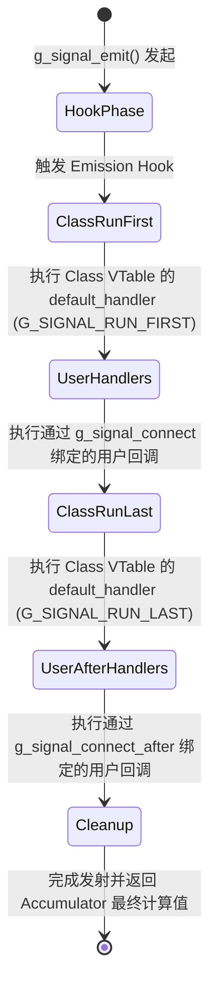
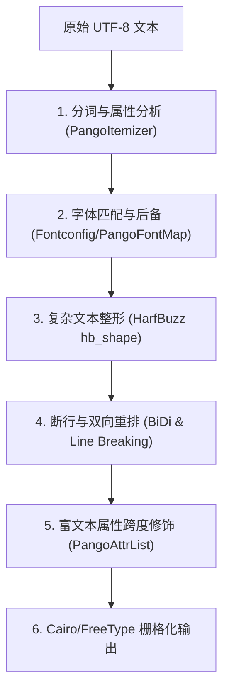
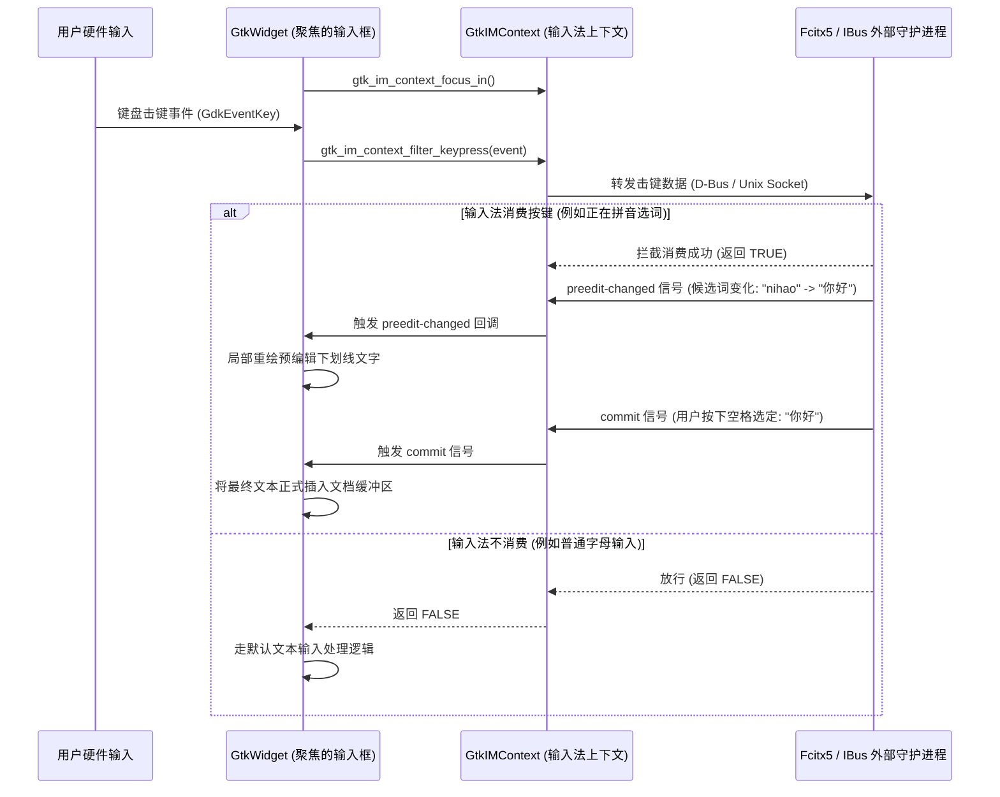

# GTK 3 工业级底层架构与实现原理深度技术手册

---

## 目录

1. [工业级设计哲学与演进史](#一工业级设计哲学与演进史)
2. [GLib 事件驱动中枢源码级解析](#二glib-事件驱动中枢源码级解析)
   - [2.1 核心数据结构内存拓扑（GMainContext、GSource、GPollFD）](#21-核心数据结构内存拓扑gmaincontextgsourcegpollfd)
   - [2.2 事件循环四阶段迭代状态机完整源码追踪](#22-事件循环四阶段迭代状态机完整源码追踪)
   - [2.3 唤醒机制与线程安全任务投递（Wakeup & Cross-thread Invocation）](#23-唤醒机制与线程安全任务投递wakeup--cross-thread-invocation)
3. [GObject 类型系统与面向对象运行时](#三gobject-类型系统与面向对象运行时)
   - [2.1 内存模型与虚函数表（GTypeInstance 与 GTypeClass 物理对齐）](#31-内存模型与虚函数表gtypeinstance-与-gtypeclass-物理对齐)
   - [2.2 类型注册树与类型安全转换系统（GType）](#32-类型注册树与类型安全转换系统gtype)
   - [2.3 浮动引用（Floating Reference）机制与生命周期级联释放](#33-浮动引用floating-reference机制与生命周期级联释放)
   - [2.4 信号（GSignal）发射引擎内部状态机与闭包调用（GClosure）](#34-信号gsignal发射引擎内部状态机与闭包调用gclosure)
   - [2.5 属性系统、GParamSpec 元数据与 GValue 泛型变体](#35-属性系统gparamspec-元数据与-gvalue-泛型变体)
4. [视窗抽象层：GDK 3 体系与事件流水线](#四视窗抽象层gdk-3-体系与事件流水线)
   - [4.1 GDK 对象层次拓扑结构](#41-gdk-对象层次拓扑结构)
   - [4.2 设备拓扑：Master/Slave 指针与键盘座位抽象（GdkSeat）](#42-设备拓扑masterslave-指针与键盘座位抽象gdkseat)
   - [4.3 GDK 底层事件过滤、队列缓冲与路由流水线](#43-gdk-底层事件过滤队列缓冲与路由流水线)
   - [4.4 Wayland 后端内部实现（xdg-shell、wl_surface、wl_subsurface）](#44-wayland-后端内部实现xdg-shellwl_surfacewl_subsurface)
   - [4.5 X11 后端实现（XCB/Xlib 连接、PropertyNotify 与 Atom 通信）](#45-x11-后端实现xcbxlib-连接propertynotify-与-atom-通信)
5. [矢量渲染核心：Cairo 图形管线与算法](#五矢量渲染核心cairo-图形管线与算法)
   - [5.1 渲染上下文状态栈与仿射变换矩阵（CTM）数学推导](#51-渲染上下文状态栈与仿射变换矩阵ctm数学推导)
   - [5.2 路径三角剖分（Tessellation）与梯形分解（Trapezoidation）算法](#52-路径三角剖分tessellation与梯形分解trapezoidation算法)
   - [5.3 亚像素抗锯齿光栅化数学模型](#53-亚像素抗锯齿光栅化数学模型)
   - [5.4 Porter-Duff 12 种图像合成算子与 Blend 混合数学公式](#54-porter-duff-12-种图像合成算子与-blend-混合数学公式)
6. [多语言排版引擎：Pango 国际化架构](#六多语言排版引擎pango-国际化架构)
   - [6.1 Pango 处理管线六大阶段源码级演进](#61-pango-处理管线六大阶段源码级演进)
   - [6.2 HarfBuzz 复杂文本整形与 OpenType 表解析](#62-harfbuzz-复杂文本整形与-opentype-表解析)
   - [6.3 Unicode UAX #9 双向排版（BiDi）与 UAX #14 断行算法](#63-unicode-uax-9-双向排版bidi与-uax-14-断行算法)
   - [6.4 字体级联后备系统（Fontconfig + FreeType）](#64-字体级联后备系统fontconfig--freetype)
7. [无障碍系统：ATK 与 AT-SPI2 协议](#七无障碍系统atk-与-at-spi2-协议)
   - [7.1 AtkObject 角色-状态模型与核心接口树](#71-atkobject-角色-状态模型与核心接口树)
   - [7.2 D-Bus IPC 树状广播通信协议](#72-d-bus-ipc-树状广播通信协议)
8. [GTK 3 控件树与界面生命周期](#八gtk-3-控件树与界面生命周期)
   - [8.1 GtkWidget 状态机（Realize、Map、Expose）](#81-gtkwidget-状态机realizamapexpose)
   - [8.2 两阶段几何尺寸协商算法（Size Negotiation）数学求解](#82-两阶段几何尺寸协商算法size-negotiation数学求解)
   - [8.3 绘制管线：双缓冲、脏矩形合并（Damage Coalescing）与剪裁](#83-绘制管线双缓冲脏矩形合并damage-coalescing与剪裁)
   - [8.4 现代 CSS 样式引擎：选择器特异度与 GtkCssNode 级联树](#84-现代-css-样式引擎选择器特异度与-gtkcssnode-级联树)
   - [8.5 响应式容器布局算法（GtkBox、GtkGrid、GtkOverlay）](#85-响应式容器布局算法gtkboxgtkgridgtkoverlay)
9. [关键桌面集成协议深度剖析](#九关键桌面集成协议深度剖析)
   - [9.1 输入法系统（GtkIMContext）状态机与时序图](#91-输入法系统gtkimcontext状态机与时序图)
   - [9.2 剪贴板（GtkClipboard）惰性提供与多 MIME 协商](#92-剪贴板gtkclipboard惰性提供与多-mime-协商)
   - [9.3 拖拽（Drag and Drop）全生命周期协议交互](#93-拖拽drag-and-drop全生命周期协议交互)
   - [9.4 桌面环境热同步（XSettings 与 XDG Desktop Portal）](#94-桌面环境热同步xsettings-与-xdg-desktop-portal)
10. [嵌入式 Web 方案：WebKitGTK 深度混编](#十嵌入式-web-方案webkitgtk-深度混编)
    - [10.1 WebKit 多进程沙箱与架构模型](#101-webkit-多进程沙箱与架构模型)
    - [10.2 视窗镂空打孔（Transparent Hole）与 Wayland Input Region 算法](#102-视窗镂空打孔transparent-hole与-wayland-input-region-算法)
11. [多语言绑定与 PureGo 零 CGo 架构范式](#十一多语言绑定与-purego-零-cgo-架构范式)
    - [11.1 GObject Introspection（GIR / Typelib）元数据生成机制](#111-gobject-introspectiongir--typelib元数据生成机制)
    - [11.2 PureGo 动态运行时绑定与 ABI 内存安全规范](#112-purego-动态运行时绑定与-abi-内存安全规范)
12. [GTK 3 vs GTK 4 架构全景对比与技术选型推演](#十二gtk-3-vs-gtk-4-架构全景对比与技术选型推演)

---

## 一、工业级设计哲学与演进史

GTK（GIMP Toolkit）诞生于 1997 年，最初是 Peter Mattis 等人为图像处理软件 GIMP 打造的 GUI 库。在随后被选为 GNOME 桌面环境的核心后，GTK 演进为整个 Unix/Linux 生态事实上的桌面标准基础设施。

### 1.1 核心设计哲学
1. **纯 C 语言实现极致面向对象**：在不依赖 C++ 编译器和复杂运行时（RTTI/异常机制）的前提下，通过内存对齐和虚表指针构建了一套严格类型安全、支持单继承与多接口的面向对象系统（GObject）。这使得 GTK 拥有几乎所有现代编程语言中最顶级的 FFI（外部函数接口）兼容性。
2. **多层解耦架构**：将事件循环（GLib）、对象模型（GObject）、视窗抽象（GDK）、矢量绘图（Cairo）、文本排版（Pango）、无障碍（ATK）彻底拆分为独立库，各层可单独升级替换。
3. **数据驱动与声明式样式**：摒弃硬编码绘制，全面拥抱类 Web 的 CSS 3 盒模型、状态伪类与 DOM 节点树。

---

## 二、GLib 事件驱动中枢源码级解析

GUI 程序的本质是一个非阻塞的 I/O 多路复用事件反应堆（Reactor Pattern）。GLib 的 `GMainContext` 是这个反应堆的核心中枢。

### 2.1 核心数据结构内存拓扑（GMainContext、GSource、GPollFD）

```c
/* GSource 核心虚函数表定义 (glib/gmain.h) */
struct _GSourceFuncs {
    gboolean (*prepare)  (GSource *source, gint *timeout_);
    gboolean (*check)    (GSource *source);
    gboolean (*dispatch) (GSource *source, GSourceFunc callback, gpointer user_data);
    void     (*finalize) (GSource *source);
};

/* GSource 实例结构体 */
struct _GSource {
    gpointer             callback_data;
    GSourceCallbackFuncs *callback_funcs;
    const GSourceFuncs   *source_funcs;
    guint                ref_count;
    GMainContext         *context;
    gint                 priority;        /* 调度优先级：数值越小优先级越高 */
    guint                flags;
    guint                source_id;
    GSList               *poll_fds;       /* 挂载到该 Source 上的 GPollFD 链表 */
    GSource              *prev;
    GSource              *next;
};

/* 轮询文件描述符 (对系统 pollfd 的跨平台封装) */
struct _GPollFD {
    gint    fd;          /* 文件描述符 (Linux 下为 int，Windows 下为 SOCKET) */
    gushort events;      /* 期望监听的事件掩码 (G_IO_IN, G_IO_OUT, G_IO_ERR) */
    gushort revents;     /* 内核实际返回的就绪事件掩码 */
};
```

内存拓扑关系：

```
       ┌────────────────────────────────────────────────────────┐
       │                      GMainContext                      │
       │  - mutex: 互斥锁                                        │
       │  - cond: 条件变量 (用于多线程唤醒)                        │
       │  - sources: 优先级排序的 GSource 双向链表                │
       │  - poll_records: GPollFD 聚合数组                      │
       │  - wake_up_pipe: [read_fd, write_fd] (或 eventfd)      │
       └───────────────────────────┬────────────────────────────┘
                                   │
              ┌────────────────────┴────────────────────┐
              ▼                                         ▼
   ┌───────────────────────┐                 ┌───────────────────────┐
   │ GSource (Priority: 0) │                 │GSource (Priority: 100)│
   │ - Idle / Network      │                 │ - Window Draw / Redraw│
   │ - poll_fds: [fd: 7]   │                 │ - poll_fds: []        │
   └───────────────────────┘                 └───────────────────────┘
```

---

### 2.2 事件循环四阶段迭代状态机完整源码追踪

每次执行 `g_main_context_iteration(context, may_block)`，底层会严格执行 `g_main_context_iterate()`，其核心逻辑由四个严格的时序阶段组成：

```
 [调用 g_main_context_iterate]
               │
               ▼
   ┌───────────────────────┐
   │ 阶段 1: Prepare 准备  │
   └───────────┬───────────┘
               │ 遍历所有可用 Source，调用 source_funcs->prepare(source, &source_timeout)
               │ 计算全局最小超时时间：timeout = MIN(all source_timeouts)
               ▼
   ┌───────────────────────┐
   │ 阶段 2: Query 查询    │
   └───────────┬───────────┘
               │ 收集所有活跃 Source 关联的 GPollFD，填充为线性数组
               │ 确定是否需要阻塞：block = may_block && (timeout != 0)
               ▼
   ┌───────────────────────┐
   │ 阶段 3: Poll 内核轮询 │
   └───────────┬───────────┘
               │ 释放 Context 锁 (避免阻塞其他线程投递任务)
               │ 调用系统内核多路复用：n_ready = poll(poll_fds, n_fds, timeout)
               │ 重新获取 Context 锁
               ▼
   ┌───────────────────────┐
   │ 阶段 4: Check 检查    │
   └───────────┬───────────┘
               │ 遍历 Source，对比 GPollFD 的 revents 与 events
               │ 调用 source_funcs->check(source)，将就绪 Source 加入 dispatch 待分发队列
               ▼
   ┌───────────────────────┐
   │ 阶段 5: Dispatch 分发 │
   └───────────┬───────────┘
               │ 按优先级从小到大（数值越小优先级越高）排序
               │ 调用 source_funcs->dispatch(source, callback, user_data)
               │ 若回调返回 FALSE，则调用 g_source_destroy() 自动注销
```

---

### 2.3 唤醒机制与线程安全任务投递（Wakeup & Cross-thread Invocation）

GUI 体系中，GTK 并非线程安全，任何后台工作线程（Worker Goroutine/Thread）绝不能直接修改控件。跨线程交互的标准链路如下：

1. **唤醒通道初始化**：
   在 Linux 平台上，`GMainContext` 初始化时通过 `eventfd(0, EFD_CLOEXEC | EFD_NONBLOCK)` 创建一个非阻塞事件通知句柄（若内核较老则 fallback 到 `pipe2()` 自管道）。该句柄的读端作为内部 `GPollFD` 永远挂载在上下文上。
2. **异步投递（`g_main_context_invoke` / `g_idle_add`）**：
   - 工作线程获取 `context` 的锁，将待执行的任务闭包（Closure）插入 Context 的就绪队列；
   - 工作线程调用 `write(wake_up_pipe.write_fd, &buffer, 8)` 写入一个 64 位整数；
   - 此时主 UI 线程正阻塞在内核的 `poll()` 系统调用上，内核检测到描述符可读，瞬间打断 `poll()` 阻塞唤醒主线程；
   - 主线程在接下来的 Dispatch 阶段执行工作线程投递的回调函数，并在主线程安全更新 UI。

---

## 三、GObject 类型系统与面向对象运行时

### 3.1 内存模型与虚函数表（GTypeInstance 与 GTypeClass 物理对齐）

C 语言没有 `class` 关键字，GObject 通过结构体首部物理内联（Header Inlining）实现了单继承多态。

#### 1. 实例内存布局（Instance Layout）
任何 GObject 派生实例在堆内存中的分配布局均严格遵循“父类前置”原则：

```
GtkButton 实例的物理内存分布：
┌────────────────────────────────────────────────────────┐ 0x0000
│ GTypeInstance (持有指向 GtkButtonClass 的 g_class 指针) │
├────────────────────────────────────────────────────────┤ 0x0008
│ GObject 基础数据 (ref_count 引用计数, qdata 动态数据指针) │
├────────────────────────────────────────────────────────┤ 0x0018
│ GtkWidget 成员变量 (priv 私有指针, 状态标志位)           │
├────────────────────────────────────────────────────────┤ 0x0030
│ GtkContainer 成员变量 (子控件链表指针等)                │
├────────────────────────────────────────────────────────┤ 0x0040
│ GtkBin 成员变量 (单一子控件 child 指针)                  │
├────────────────────────────────────────────────────────┤ 0x0050
│ GtkButton 自身私有数据 (GtkButtonPrivate *priv)         │
└────────────────────────────────────────────────────────┘
```
**指针强转数学原理**：由于 `GtkWidget`、`GObject` 都在结构体偏移 `0x0000` 处对齐，因此：
`(GtkWidget*)btn == (GObject*)btn == (GTypeInstance*)btn`，完全消除类型转换的内存偏移开销。

#### 2. 类与虚函数表内存布局（Class Layout / VTable）
类结构体在进程生命周期内是单例的，保存了面向对象的虚函数指针：

```c
struct _GtkWidgetClass {
    GInitiallyUnownedClass parent_class; /* 内联父类虚表 */

    /* 核心虚函数指针 (子类可在 class_init 中重写) */
    void (*show)                (GtkWidget *widget);
    void (*realize)             (GtkWidget *widget);
    void (*map)                 (GtkWidget *widget);
    void (*size_allocate)       (GtkWidget *widget, GtkAllocation *allocation);
    gboolean (*draw)            (GtkWidget *widget, cairo_t *cr);
    gboolean (*button_press_event) (GtkWidget *widget, GdkEventButton *event);
    /* ... 超过 80 个虚函数指针 */
};
```

---

### 3.2 类型注册树与类型安全转换系统（GType）

`GType` 本质上是一个 `gsize`（与机器字长相同的无符号整数），用于在全局类型注册表中唯一标识一个类型。

- **基本类型（Fundamental Types）**：系统预设的不可再分类型，如 `G_TYPE_INT`、`G_TYPE_STRING`、`G_TYPE_OBJECT`、`G_TYPE_INTERFACE`。
- **安全向下转型宏（Safe Downcasting）**：
  ```c
  #define GTK_BUTTON(obj) (G_TYPE_CHECK_INSTANCE_CAST ((obj), GTK_TYPE_BUTTON, GtkButton))
  ```
  在开发调试模式下，该宏会调用 `g_type_check_instance_cast()`，递归向上检查实例的 `GTypeClass` 是否派生自 `GTK_TYPE_BUTTON`。如果发生非法类型强转，会打印堆栈警告并返回安全指针，避免非法内存访问导致段错误（SIGSEGV）。

---

### 3.3 浮动引用（Floating Reference）机制与生命周期级联释放

在传统的引用计数中，创建对象 `ref_count = 1`，放入容器 `ref_count = 2`，必须手动释放一次所有权。为了简化 GUI 树形结构的编写，GObject 引入了 **`GInitiallyUnowned`**：

```
1. 创建控件:
   GtkWidget *button = gtk_button_new();
   [状态]: ref_count = 1, is_floating = TRUE

2. 添加进父容器:
   gtk_container_add(GTK_CONTAINER(box), button);
   内部执行: g_object_ref_sink(button)
   [状态]: ref_count = 1, is_floating = FALSE (所有权正式被 box 剥离接管)

3. 销毁父容器:
   gtk_widget_destroy(box);
   内部执行: 递归遍历子控件链表，调用 g_object_unref(button)
   [状态]: ref_count 降为 0，触发 GObject 的 finalize() 析构函数并释放堆内存
```

---

### 3.4 信号（GSignal）发射引擎内部状态机与闭包调用（GClosure）

信号是 GObject 实现的高级观察者模式。一次完整的信号发射（Signal Emission）内部状态流转如下：



- **返回值收集器（Accumulator）**：
  许多信号需要汇总所有回调的返回值（例如 `draw` 或 `button_press_event`）。Accumulator 函数在每个 Handler 执行完毕后被调用，如果某个 Handler 返回 `TRUE`（事件已被消费），Accumulator 可以指示信号分发引擎提前中止后续 Handler 的执行（短路机制）。
- **`GClosure` 闭包**：
  信号系统底层使用 `GClosure` 进行解耦调用。闭包把函数指针、执行环境与销毁通知（Destroy Notify）打包，使得 Python、Rust、Go 等宿主语言可以安全地把自身的闭包包装成 GClosure，注入到 GTK 信号系统中，而不会引起内存泄漏。

---

### 3.5 属性系统、GParamSpec 元数据与 GValue 泛型变体

- **`GValue` 结构体**：
  ```c
  struct _GValue {
      GType  g_type;
      union {
          gint    v_int;
          guint   v_uint;
          gint64  v_int64;
          gfloat  v_float;
          gdouble v_double;
          gpointer v_pointer;
      } data[2];
  };
  ```
  `GValue` 可以在运行时以类型安全的方式装载任何基础数据类型或 GObject 指针，是 GTK 属性读写（`g_object_set_property` / `g_object_get_property`）的通用变体传输载体。
- **`GParamSpec`**：
  对象的每一个属性都由一个 `GParamSpec` 描述其元数据（属性名、缩写提示、取值边界范围、读写控制权限）。当调用 `g_object_set()` 时，属性系统会自动比对新旧值，若发生变化则触发 `notify::property-name` 信号，驱动界面自动刷新。

---

## 四、视窗抽象层：GDK 3 体系与事件流水线

**GDK（GIMP Drawing Kit）** 屏蔽了底层 X11、Wayland、Windows、macOS 视窗系统的巨大鸿沟，向下对接系统协议，向上为 GTK 提供统一的绘图表面与事件队列。

### 4.1 GDK 对象层次拓扑结构

```
              ┌───────────────────────────┐
              │     GdkDisplayManager     │ (单例：管理所有的物理/网络显示连接)
              └─────────────┬─────────────┘
                            │
              ┌─────────────▼─────────────┐
              │        GdkDisplay         │ (代表一个物理连接：如 Wayland Display, X11 Display)
              └─────────────┬─────────────┘
                            │
          ┌─────────────────┴─────────────────┐
          ▼                                   ▼
┌───────────────────┐               ┌───────────────────┐
│     GdkScreen     │               │      GdkSeat      │ (输入座位：设备组合)
│ (多显示器/逻辑屏幕)│               └─────────┬─────────┘
└─────────┬─────────┘                         │
          │                         ┌─────────┴─────────┐
          ▼                         ▼                   ▼
┌───────────────────┐     ┌───────────────────┐┌───────────────────┐
│     GdkWindow     │     │Master Pointer 设备││Master Keyboard 设备│
│ (视窗表面 Surface) │     └───────────────────┘└───────────────────┘
└───────────────────┘
```

---

### 4.2 设备拓扑：Master/Slave 指针与键盘座位抽象（GdkSeat）

现代计算机支持多种输入外设协同工作，GDK 3 提出了现代化的设备拓扑模型：
- **Master Device（主逻辑设备）**：系统在逻辑上呈现给应用的一个鼠标光标和键盘焦点。
- **Slave Device（物理从属设备）**：实际插在主机上的硬件（如罗技鼠标、手写板、ThinkPad 小红点）。当硬件产生运动时，系统将数据合并送入对应的 Master Device。
- **扩展事件特性**：原生支持精确到浮点数的双向滚动增量（Smooth Scrolling）、压感触控笔倾角与压力数据。

---

### 4.3 GDK 底层事件过滤、队列缓冲与路由流水线

系统底层消息到达 UI 控件经历以下严格流水线：

```
[内核驱动 / 硬件外设]
       │
       ▼ (Unix Domain Socket / 协议数据包)
[GDK 后端驱动层] (如 gdkevents-wayland.c / gdkevents-x11.c)
       │
       ▼ (协议反序列化解析)
[产生 GdkEvent 联合体] (键盘、鼠标、进入/离开、窗口重绘、关闭请求)
       │
       ▼ (调用 gdk_event_put 压入环形队列)
[GDK 内部事件队列]
       │
       ▼ (主事件循环在 G_PRIORITY_DEFAULT 检查到队列就绪)
[gdk_event_dispatch 分发]
       │
       ▼ (调用应用级事件处理钩子: gtk_main_do_event)
[GTK 控件树分发与事件冒泡] (gtk_widget_event)
```

---

### 4.4 Wayland 后端内部实现（xdg-shell、wl_surface、wl_subsurface）

在 Wayland 会话下，GDK 3 充当原生的 Wayland 客户端：
- **顶级窗口映射**：向合成器申请 `xdg_wm_base.get_xdg_surface`，并创建 `xdg_toplevel` 角色处理窗口最小化、最大化与全屏；
- **呈现管线**：通过 `wl_compositor_create_surface` 获取底层 `wl_surface`，绘图完成后调用 `wl_surface_attach` 提交像素缓冲区，并挂载 `wl_surface.frame` 回调实现垂直同步（V-Sync）背压控制。
- **子表面机制（`wl_subsurface`）**：允许将多个独立的 `wl_surface` 在合成器端合成到同一个窗口中，这是实现混合渲染与 WebView 嵌入的核心基础。

---

### 4.5 X11 后端实现（XCB/Xlib 连接、PropertyNotify 与 Atom 通信）

在 X11 环境下：
- 使用 `XCB` 或 `Xlib` 与 X Server 进行异步通信；
- 利用 **X11 Atoms** 进行无类型字符串到全局整数 ID 的映射（如 `_NET_WM_STATE`、`WM_DELETE_WINDOW`、`CLIPBOARD`）；
- 依靠 `PropertyNotify` 和 `ClientMessage` 协议实现与窗口管理器（WM）的生命周期状态同步。

---

## 五、矢量渲染核心：Cairo 图形管线与算法

### 5.1 渲染上下文状态栈与仿射变换矩阵（CTM）数学推导

Cairo 的绘制上下文 `cairo_t` 维护着当前渲染状态。坐标转换基于一个 $3 \times 3$ 的仿射变换矩阵（CTM）：

$$\begin{bmatrix} x' \\ y' \\ 1 \end{bmatrix} = \begin{bmatrix} xx & yx & x0 \\ xy & yy & y0 \\ 0 & 0 & 1 \end{bmatrix} \begin{bmatrix} x \\ y \\ 1 \end{bmatrix}$$

其中：
- $\begin{bmatrix} x & y \end{bmatrix}^T$ 为用户逻辑坐标；
- $\begin{bmatrix} x' & y' \end{bmatrix}^T$ 为屏幕物理设备像素坐标；
- $xx, yy$ 控制水平/垂直缩放比例（Scale）；
- $yx, xy$ 控制旋转与剪切（Rotate / Shear）；
- $x0, y0$ 控制原点平移偏移量（Translate）。

调用 `cairo_scale(cr, s, s)` 即可让所有后续绘图矢量指令在硬件高分屏上以物理像素点自动缩放，无需改变业务坐标。

---

### 5.2 路径三角剖分（Tessellation）与梯形分解（Trapezoidation）算法

复杂的几何路径（贝塞尔曲线、多边形）无法被 CPU 直接填充。Cairo 采用了经典的 **Bentley-Ottmann 扫面线算法**：

```
[原始复杂矢量轮廓]
         │
         ▼ (曲线转换为微小折线段逼近)
[多边形顶点集合]
         │
         ▼ (通过水平扫描线沿 Y 轴自上而下扫描)
[梯形分解: Trapezoid Decomposition]
   ┌─────────── top ───────────┐
  /│                           │\
 / │                           │ \
/  │                           │  \
───┴────────── bottom ─────────┴───
 每个梯形具备顶界 (top)、底界 (bottom)、左边界线段 (left) 与右边界线段 (right)
```

分解为水平梯形集合后，光栅化器只需沿水平扫描线执行跨度扫描（Span Generation），极大加快了光栅化速度。

---

### 5.3 亚像素抗锯齿光栅化数学模型

在边缘像素的绘制中，Cairo 采用亚像素面积相交覆盖率算法（Area Coverage Percentage）：
- 将一个物理像素网格划分为 $8 \times 8$ 或 $16 \times 16$ 个子样本采样点（Sub-pixel Grid）；
- 计算几何边缘切割像素内部时，落在闭合区域内的子样本数量比例 $\alpha \in [0.0, 1.0]$；
- 最终将计算出的 $\alpha$ 作为 Alpha 透明度通道，与底色执行 Porter-Duff 混合，从而消除阶梯状锯齿。

---

### 5.4 Porter-Duff 12 种图像合成算子与 Blend 混合数学公式

Cairo 实现了完备的图像合成算子（源像素记为 $S$，目标像素记为 $D$）：

| 算子（`cairo_operator_t`） | 目标结果颜色 $C_{result}$ 数学公式 | 常见工程应用场景 |
| :--- | :--- | :--- |
| **`CLEAR`** | $0$ | 区域打孔、清空透明通道 |
| **`SOURCE`** | $S$ | 无视底色，纯覆写（用于高性能贴图） |
| **`OVER` (默认)** | $S + D \times (1 - \alpha_S)$ | 标准半透明图层覆盖叠加 |
| **`IN`** | $S \times \alpha_D$ | 剪影效果（只在目标有内容处显示源） |
| **`OUT`** | $S \times (1 - \alpha_D)$ | 遮罩反选剪切 |
| **`ATOP`** | $S \times \alpha_D + D \times (1 - \alpha_S)$ | 在原有物体表面附着纹理 |
| **`ADD`** | $\min(1, S + D)$ | 发光效果、粒子系统混合叠加 |

---

## 六、多语言排版引擎：Pango 国际化架构

### 6.1 Pango 处理管线六大阶段源码级演进



---

### 6.2 HarfBuzz 复杂文本整形与 OpenType 表解析

在很多复杂文字体系中，输入码点与最终显示的字形之间不是一一对应关系。Pango 依靠 **HarfBuzz** 解析字体的 OpenType 高级排版表：
- **GSUB（Glyph Substitution，字形替换表）**：
  - 处理阿拉伯语上下文形变（连写变换）；
  - 处理连字（Ligatures，如将 `f` + `i` 替换为单一的 `fi` 字形码点）。
- **GPOS（Glyph Positioning，字形定位表）**：
  - 处理字距微调（Kerning，如缩小 `V` 与 `A` 之间的视觉空隙）；
  - 处理辅音与元音音调标号在垂直与水平方向上的精确定位对齐。

---

### 6.3 Unicode UAX #9 双向排版（BiDi）与 UAX #14 断行算法

- **双向排版算法（Unicode Standard Annex #9）**：
  在同一个段落中混合阿拉伯语（RTL，从右向左）与英语/数字（LTR，从左向右）时，Pango 赋予每个字符一个双向嵌入级别（Embedding Level，偶数代表 LTR，奇数代表 RTL），并在完成整形后按照可视顺序（Visual Order）重新对字符点位进行空间镜像重排。
- **自动换行算法（Unicode Standard Annex #14）**：
  依据字符类别属性（强制换行符 BK、空格 SP、连字符 HY、禁止断行标点符号 CL 等），在不截断不可分割词素的前提下求解最优折行断点。

---

## 七、无障碍系统：ATK 与 AT-SPI2 协议

### 7.1 AtkObject 角色-状态模型与核心接口树

GTK 控件树与无障碍辅助设备通过 **ATK（Accessibility Toolkit）** 建立语义映射：

```
                    ┌─────────────────────────┐
                    │        AtkObject        │ (通用语义节点基类)
                    │ - role: ATK_ROLE_BUTTON │
                    │ - state: FOCUSED/CHECKED│
                    └────────────┬────────────┘
                                 │
     ┌───────────────────────────┼───────────────────────────┐
     ▼                           ▼                           ▼
┌──────────────┐          ┌──────────────┐          ┌──────────────┐
│  AtkAction   │          │   AtkText    │          │   AtkValue   │
│ (执行点击等动作)│          │ (读取文本与光标)│          │ (数值进度调节)│
└──────────────┘          └──────────────┘          └──────────────┘
```

### 7.2 D-Bus IPC 树状广播通信协议

在 Linux 桌面中，运行着全局辅助守护进程 `at-spi2-registryd`：
- GTK 进程加载 `gtk-a11y` 模块，注册到 D-Bus 会话总线；
- 当控件状态发生改变（如菜单弹出、文本被选中），应用通过 D-Bus 异步发送 `org.a11y.atspi.Event` 广播；
- 屏幕阅读器（如 Orca）实时消费事件并驱动语音朗读引擎，实现盲人无障碍辅助。

---

## 八、GTK 3 控件树与界面生命周期

### 8.1 GtkWidget 状态机（Realize、Map、Expose）

控件的内部生命周期包含三个关键阶段：

```
[实例化创建] -> gtk_widget_new()
     │
     ▼
[Realize 阶段] -> gtk_widget_realize()
     │ 申请 GdkWindow 视窗句柄，绑定底层 XWindow 或 wl_surface
     ▼
[Map 阶段] -> gtk_widget_map()
     │ 纳入可视渲染树，向 Compositor / X Server 标记为可见 (Visible)
     ▼
[Draw 阶段] -> gtk_widget_draw()
     │ 接收绘制信号，执行 cairo 绘制指令渲染到缓冲区
     ▼
[Unmap / Unrealize / Destroy]
       释放 GdkWindow 并析构内存
```

---

### 8.2 两阶段几何尺寸协商算法（Size Negotiation）数学求解

尺寸协商决定了窗口中每个控件的最终大小与摆放坐标，分为两个严密阶段：

```
Phase 1: 自底向上尺寸测量 (Size Measurement)
   每个控件向父容器报告:
   - Minimum Size (绝对不可缩减的最小阈值)
   - Natural Size (最舒展优美的自然期望尺寸)

Phase 2: 自顶向下空间分配 (Size Allocation)
   父容器根据整体窗口分配到的总尺寸，按照约束方程分配各子控件的实际几何矩形。
```

#### GtkBox 布局空间分配数学推导
设容器可用总宽度为 $W$，包含 $n$ 个子控件。第 $i$ 个子控件的最小宽度为 $m_i$，自然宽度为 $n_i$，是否设置了 `expand` 标志位为 $e_i \in \{0, 1\}$：

1. **基础分配**：首先为每个子控件分配最小宽度：
   $$W_{base} = \sum_{i=1}^n m_i$$
   剩余可分配空间：$R = W - W_{base}$。若 $R < 0$，窗口触发强制剪裁溢出。
2. **满足自然宽度**：若 $R > 0$，优先填补各子控件从 $m_i$ 到 $n_i$ 的差距：
   $$gap_i = n_i - m_i$$
   按比例分配直到满足所有控件的 Natural 诉求。
3. **扩展剩余空间**：若填满 Natural 之后仍有剩余空间 $R_{extra}$，则在所有标记了 $e_i = 1$ 的子控件之间均分：
   $$w_i = n_i + \frac{R_{extra}}{\sum_{k=1}^n e_k}$$

---

### 8.3 绘制管线：双缓冲、脏矩形合并（Damage Coalescing）与剪裁

为了保证帧率并防止重绘撕裂，GTK 3 采用了严密的重绘流水线：
1. **标记受损（Invalidate）**：调用 `gtk_widget_queue_draw_area(x, y, w, h)`，在当前窗口的受损区域表（`cairo_region_t`）中追加一个矩形；
2. **合并优化（Coalescing）**：重绘循环执行前，对所有相交、相邻的受损矩形进行布尔合并，消除重复绘制；
3. **建立离屏表面（Offscreen Surface）**：开辟临时后台缓冲区，将其作为 Cairo Target；
4. **递归裁剪绘制**：在调用各子控件的 `draw` 虚函数时，Cairo 上下文预先应用了剪裁路径（`cairo_clip`），超出受损区域的绘制指令直接在几何阶段快速剔除；
5. **帧提交（Flip/Present）**：在 V-Sync 垂直同步周期到达时，一次性提交给显示服务器。

---

### 8.4 现代 CSS 样式引擎：选择器特异度与 GtkCssNode 级联树

GTK 3 的每个控件内部都映射为一个 **`GtkCssNode`**。其样式计算完全遵循 W3C CSS 规范：

#### 选择器特异度（Specificity）计算规则
特异度由一个四元元组 $(a, b, c, d)$ 表示：
- $a$：内联样式属性（优先级最高）；
- $b$：ID 选择器数量（如 `#submit-button`）；
- $c$：Class 类名、伪类选择器数量（如 `.primary:hover`）；
- $d$：元素节点标签名数量（如 `button`、`entry`）。

当多个 CSS 规则冲突时，按字典序自左向右逐项比对 $(a, b, c, d)$，数值大者胜出并应用。

---

## 九、关键桌面集成协议深度剖析

### 9.1 输入法系统（GtkIMContext）状态机与时序图

`GtkIMContext` 是连接应用程序与 Fcitx/IBus 的桥梁：



---

### 9.2 剪贴板（GtkClipboard）惰性提供与多 MIME 协商

为防止复制大文件或巨幅图像时阻塞内存，GTK 3 严格遵循**惰性传输规范（Lazy Delivery）**：
1. **声明所有权**：复制时不拷贝数据本体，只向剪贴板管理器注册支持的 Target 列表（`text/plain;charset=utf-8`、`image/png`、`text/html`）；
2. **按需提供**：当且仅当目标程序请求粘贴特定 MIME 类型时，源程序的回调函数才被触发，实时完成格式转换并序列化写入 IPC 管道。

---

### 9.3 拖拽（Drag and Drop）全生命周期协议交互

支持完整的 XDND 与 Wayland Data Device 协议族：
- `drag_begin`：抓取当前快照，生成半透明跟随浮动图标；
- `drag_motion`：实时探测目标窗口是否允许释放（Drop），返回 `GDK_ACTION_COPY`、`GDK_ACTION_MOVE` 或拒绝；
- `drag_drop` / `drag_data_received`：双向确认，完成跨进程安全数据投递。

---

### 9.4 桌面环境热同步（XSettings 与 XDG Desktop Portal）

GTK 3 应用能够实时感知系统环境变动，无需重启进程：
- **XSettings 协议**：监听根窗口属性变动，动态感知系统 DPI 缩放比例、字体抗锯齿模式（Subpixel Rendering / Hinting）变动；
- **XDG Desktop Portal**：通过 D-Bus 监听 `org.freedesktop.portal.Settings` 的 `SettingChanged` 信号，实时响应系统**深色/浅色外观模式（Dark/Light Mode）**切换。

---

## 十、嵌入式 Web 方案：WebKitGTK 深度混编

### 10.1 WebKit 多进程沙箱与架构模型

```
┌────────────────────────────────────────────────────────┐
│ UI Process (Viva / GTK 3 主宿主进程)                   │
│ - 持有 GtkWindow、WebKitWebView                        │
│ - 监听 GDK 事件，派发给 WebKit                         │
└───────────────────────────┬────────────────────────────┘
                            │ (Unix Domain Socket IPC)
           ┌────────────────┴────────────────┐
           ▼                                 ▼
┌───────────────────────────┐    ┌───────────────────────────┐
│ WebProcess (渲染与 JS 沙箱)│    │ NetworkProcess (网络服务) │
│ - WebCore HTML5 排版渲染  │    │ - HTTP/2、WebSocket 通信  │
│ - JavaScriptCore 引擎执行 │    │ - Cookie、Storage、缓存   │
└───────────────────────────┘    └───────────────────────────┘
```

---

### 10.2 视窗镂空打孔（Transparent Hole）与 Wayland Input Region 算法

当需要在 Web 视图上方覆盖原生 UI（如原生下拉菜单）时，混合渲染架构需执行双向打孔：

```
1. 视觉图层打孔 (Visual Hole):
   在顶层 Subsurface 对应的像素区域，使用 Cairo 执行 CLEAR 操作:
   cairo_set_operator(cr, CAIRO_OPERATOR_CLEAR);
   cairo_rectangle(cr, hole_x, hole_y, hole_w, hole_h);
   cairo_fill(cr);
   使底层的 WebKitWebView 原生画面透出。

2. 输入事件区域剔除 (Input Region Masking):
   Wayland 合成器根据 wl_surface 的 input_region 决定鼠标事件派发给谁。
   - 创建全窗口区域: region = wl_compositor_create_region()
   - 添加整体窗口: wl_region_add(region, 0, 0, win_w, win_h)
   - 扣除网页镂空区域: wl_region_subtract(region, hole_x, hole_y, hole_w, hole_h)
   - 补回上层菜单覆盖区域: wl_region_add(region, menu_x, menu_y, menu_w, menu_h)
   - 提交合成器: wl_surface_set_input_region(surface, region)
```
通过该算法，鼠标点击菜单直接归属原生 Viva 控件，点击网页空白区直接穿透至 WebKit 进程。

---

## 十一、多语言绑定与 PureGo 零 CGo 架构范式

### 11.1 GObject Introspection（GIR / Typelib）元数据生成机制

1. **扫描解析**：`g-ir-scanner` 解析 C 源码及注释，提取函数签名、结构体字段对齐、内存所有权（`transfer-ownership`）元数据；
2. **生成 XML（.gir）**：生成标准化机器可读的接口模型文件；
3. **编译二进制（.typelib）**：`g-ir-compiler` 转化为内存紧凑的二进制格式，供动态运行时快速 mmap 加载。

---

### 11.2 PureGo 动态运行时绑定与 ABI 内存安全规范

在 Go 语言中摆脱 CGo 编译负担的终极方案是利用 **PureGo** 直接进行运行时符号绑定：

```go
package linux

import (
    "github.com/ebitengine/purego"
)

type gtkLib struct {
    initCheck func(argc *int32, argv uintptr) int32
    windowNew func(kind int32) uintptr
    main      func()
    mainQuit  func()
}

func loadGTK() (*gtkLib, error) {
    // 运行时动态加载系统原生库，完全脱离编译期 C 头文件与 GCC
    handle, err := purego.Dlopen("libgtk-3.so.0", purego.RTLD_LAZY|purego.RTLD_GLOBAL)
    if err != nil {
        return nil, err
    }

    lib := &gtkLib{}
    purego.RegisterLibFunc(&lib.initCheck, handle, "gtk_init_check")
    purego.RegisterLibFunc(&lib.windowNew, handle, "gtk_window_new")
    purego.RegisterLibFunc(&lib.main, handle, "gtk_main")
    purego.RegisterLibFunc(&lib.mainQuit, handle, "gtk_main_quit")
    return lib, nil
}
```

#### 内存安全核心规范：
- **Go GC 与 C 内存隔离**：传入 C 动态库的 Go 内存块必须通过 `runtime.Pinner` 或通过 `C.malloc` / 手动分配在堆外，严防 Go 运行时垃圾回收和协程栈扩容移动导致野指针崩溃；
- **ABI 结构体物理对齐**：手写的 Go 结构体必须严格对齐 C 语言的 64 位内存 padding（如 `uintptr`、`int32` 留白）。

---

## 十二、GTK 3 vs GTK 4 架构全景对比与技术选型推演

| 核心维度 | GTK 3 (长期维护稳定版) | GTK 4 (新一代架构) | 架构变动深层技术原因 |
| :--- | :--- | :--- | :--- |
| **底层渲染引擎** | **Cairo 纯 CPU 软件绘制**（GPU 仅辅助混合） | **GSK (GTK Scene Graph)**，默认 Vulkan / OpenGL | GTK 4 引入全场景图 RenderNode 树，复杂动画和阴影滤镜具备极致 60/120 FPS 流畅度。 |
| **高分屏分数缩放** | 原生仅支持**整数缩放**（1x, 2x），小数需靠合成器或外接 Subsurface | 原生深度支持 **浮点分数缩放**（Fractional Scaling） | GTK 3 底层坐标系统基于整数，GTK 4 重构为全面浮点数坐标。 |
| **事件响应架构** | 控件直接重写虚函数（如 `button_press_event`） | 引入 **`GtkEventController`**（手势控制器组合模式） | 解耦视图绘制与事件监听，使多点触控与手势识别能够自由挂载到任意控件。 |
| **容器模型** | 严格区分为 `GtkWidget` 与 `GtkContainer` | **完全废除 `GtkContainer`**，每个 Widget 都能挂载子节点 | 简化类继承层级，彻底消除传统中间层容器的代码包装包袱。 |
| **控件绘制机制** | 重写 `draw` 虚方法，获得 `cairo_t*` 立即模式绘制 | 重写 `snapshot` 虚方法，向渲染节点树录制指令 | 采用保留模式（Retained Mode），使得 GPU 能够自动合并批次并剔除不可见绘制。 |
| **发行版普及度** | **100% 覆盖**（从老旧 LTS 到最新发行版系统均开箱即用） | 仅在现代 Linux 系统上普及，旧环境存在缺失 | GTK 3 具备企业级软件分发“零动态库依赖”的天然优势。 |
| **WebKit 生态** | **WebKitGTK 4.0 极为成熟稳定** | WebKitGTK 4.1/6.0 处于过渡期，API 变动频繁 | 很多生产环境 WebView 首选 GTK 3 底座。 |
| **API/ABI 状态** | **彻底冻结**，绝对零破坏性变更，维护成本为零 | 仍处于活跃演进期，内部 API 仍存在微调 | 适合稳健长期基础设施选型。 |

---

> [!TIP]
> **终极选型总结**：
> - 如果你的产品是**重度 3D 渲染、游戏化界面或极致手势动画应用**，毫无疑问应选择 **GTK 4**；
> - 如果你的产品是**追求极度稳健的生产力工具、桌面客户端、需跨海量 Linux 发行版极速分发、或强依赖成熟 WebKitGTK 混编**，**GTK 3** 凭借其经过十余年工业级沉淀的架构底蕴、完备的输入法生态和绝对的系统预装覆盖率，依然是当前最成熟、最可靠的黄金基石。
