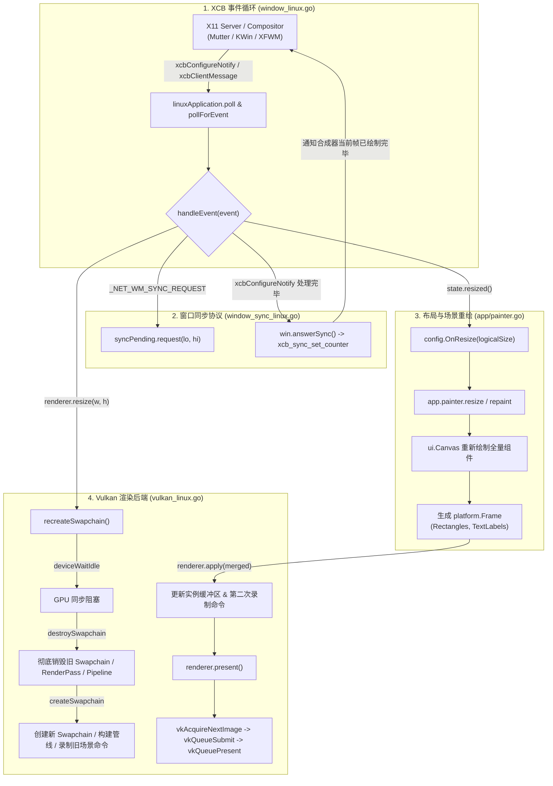

# Viva 框架 Linux 平台渲染缺陷分析：窗口调整高频重复刷新与频闪（Flicker）根因与治理方案

本文档面向 **Viva** GUI 框架核心维护者与渲染引擎开发者，针对 Linux（X11 / XCB / Vulkan 及 XWayland）平台下：**在用户拖拽窗口边缘调整大小（Live Window Resize），或在窗口内部调整布局、拖动分栏（Splitter/Slider）时，窗口内部内容出现高频重复刷新、剧烈频闪（Flickering）、黑屏闪烁（Black Flashing）与画面撕裂（Tearing）**的现象，进行全链路的架构排查、源码级根因剖析，并提出系统性的修复与优化方案。

---

## 一、 问题背景与缺陷现象

### 1.1 缺陷现象描述
在基于 Viva 构建的 Linux 桌面应用中，存在以下突出的渲染异常：
1. **快速拖动窗口边框调整大小时（Live Window Resize）**：
   - 窗口内部画面剧烈晃动、卡顿并伴随严重的白底/黑底**交替频闪（Flickering）**；
   - 画面刷新频率异常增高，但帧率极低且伴随明显的响应滞后（Lagging）；
   - 窗口边缘在移动过程中可能出现拉伸变形、残影或内容与边框严重脱节。
2. **在窗口内部进行连续交互（如拖动内部分割面板、调整侧边栏宽度、Slider 滑动）时**：
   - 界面整体（而非局部）出现持续的高频重绘；
   - 容易诱发与窗口调整类似的微小频闪与掉帧；
   - 终端或日志中可能偶发报错：`linux: Vulkan swapchain remained out of date after recreation` 并伴随窗口崩溃退出。

### 1.2 跨平台对比
在 macOS（Metal）与 Windows（Direct3D 11）上：
- **macOS**：AppKit 窗口通过 `CAMetalLayer` 渲染，依托系统的 `CA::Transaction` 混成器自动处理缩放过渡，在拖拽窗口时内部内容缩放平滑，无黑屏频闪。
- **Windows**：Win32 消息循环对 `WM_SIZE` / `WM_PAINT` 有系统级的消息合并与去重机制，D3D11 采用 `ResizeBuffers` 原地重置交换链尺寸，不会彻底销毁重建管线，表现稳定。
- **Linux/X11**：成为目前跨平台中唯一在调整窗口或内容时产生“频繁重复刷新”、“黑白闪烁”与“卡顿滞后”的平台。

---

## 二、 Linux 平台渲染与事件全链路架构

Viva 在 Linux 上的渲染管线主要由以下模块协同工作：



在上述链路中，只要有任意环节存在**事件过载、过度销毁、时序颠倒或时钟不同步**，都会直接在外在表现为“重复刷新”与“频闪”。

---

## 三、 根本原因深度剖析（Root Cause Analysis）

经过对 Viva 核心源码的逆向与逐行追踪，确认引发该问题的并非单一缺陷，而是由 **6 个底层机制缺陷共同构成的连锁恶化反应**：

### 3.1 根因一：X11 事件循环未实现 `ConfigureNotify` 事件合并（Event Coalescing）
#### 源码定位
[`internal/platform/linux/window_linux.go:246-267`](file:///Volumes/HIKSEMI/code/viva/internal/platform/linux/window_linux.go#L246-L267) 与 [`window_linux.go:614-645`](file:///Volumes/HIKSEMI/code/viva/internal/platform/linux/window_linux.go#L614-L645)

```go
// window_linux.go 主事件消费循环
for application.contains(state) {
    event := state.takeHeld()
    if event == nil {
        event = state.win.api.pollForEvent(state.win.connection)
    }
    if event == nil {
        break
    }
    closeWindow, err := state.handleEvent(event) // 每个事件逐一立即同步处理！
    state.win.api.free(event)
    ...
}
```

#### 缺陷机制
1. 当用户按住鼠标拖拽窗口边框时，X11 Server 会以极高频率（通常 60Hz ~ 200Hz+）向客户端 Socket 发送连续的 `xcbConfigureNotify` 事件；
2. 在 Viva 的设计中，`handleEvent` 只要拿到一个 `xcbConfigureNotify`，就会立刻调用：
   - `renderer.resize(width, height)`（耗时巨大的 GPU 同步与交换链重建）
   - `state.resized()`（全量 UI 重新测量、布局、重绘与提交）
   - `renderer.present()`（GPU 呈现）
3. **缺失事件压缩（Coalescing）**：如果在一次 poll 期间，X11 Socket 接收缓冲区中积压了 10 个 `ConfigureNotify` 事件（尺寸从 800x600 变到 810x600），Viva 会忠实地将这 10 个尺寸**从头到尾每个都重建一遍 Swapchain、重画一遍 UI 并提交给 GPU**！
4. 这种机械的逐事件处理方式，导致 CPU/GPU 在几十毫秒内反复刷新数次已经过时的中间尺寸，直接诱发肉眼可见的“连续抽搐重绘”和极高的响应延迟。

---

### 3.2 根因二：Vulkan Swapchain 重建时“彻底销毁旧链、未传 `oldSwapchain`”引发混成器黑闪
#### 源码定位
[`internal/platform/linux/vulkan_linux.go:1118-1159`](file:///Volumes/HIKSEMI/code/viva/internal/platform/linux/vulkan_linux.go#L1118-L1159)

```go
func (renderer *vulkanRenderer) recreateSwapchain() error {
	if err := vkCheck(renderer.api.deviceWaitIdle(renderer.device), "wait before swapchain recreation"); err != nil {
		return err
	}
	renderer.destroySwapchain() // 致命缺陷：先将原有 Swapchain 彻底销毁！
	return renderer.createSwapchain()
}

func (renderer *vulkanRenderer) destroySwapchain() {
    ...
	if renderer.swapchain != 0 {
		renderer.api.destroySwapchain(renderer.device, renderer.swapchain, nil)
		renderer.swapchain = 0 // 置空，随后创建新交换链时无法使用 oldSwapchain
	}
}
```

#### 缺陷机制
1. **违反 Vulkan 规范的最佳实践**：
   - Vulkan 在 `VkSwapchainCreateInfoKHR` 中专门提供了 `oldSwapchain` 字段，其核心用途就是：**在窗口尺寸改变时，让驱动与混成器继续显示上一任 Swapchain 的最后一帧画面，直到新 Swapchain 成功呈现第一帧为止**。
2. **Viva 的违规行为**：
   - Viva 在 `recreateSwapchain` 中，先强制执行 `vkDeviceWaitIdle`（GPU 停顿），紧接着直接调用 `vkDestroySwapchainKHR` 将旧交换链彻底销毁置为 `0`；
   - 随后在 `createSwapchain` 中，传入的 `oldSwapchain` 永远是 `0`；
3. **黑闪（Black Flash）与频闪的根源**：
   - 当旧 Swapchain 被销毁的那一瞬间，X11 / XWayland 窗口在 X Server / 混成器（Mutter、KWin、Picom 等）侧绑定的 Backing Pixmap 立即失效；
   - 混成器在合成当前屏幕画面时，发现该窗口没有有效的 Buffer 可用，只能回退绘制窗口的默认背景色（通常为黑色或白色），或者显示桌面上层残留；
   - 几毫秒后，新 Swapchain 的第一帧才绘制完成并呈递出来。这种**“正常内容 -> 失去 Buffer（黑屏） -> 新内容 -> 失去 Buffer（黑屏）”**的高速循环，正是用户看到的**极其刺眼的强烈频闪**！

---

### 3.3 根因三：RenderPass 的清屏配置与单次 Resize 中的“两次重复录制命令”
#### 源码定位
[`internal/platform/linux/vulkan_linux.go:735-743`](file:///Volumes/HIKSEMI/code/viva/internal/platform/linux/vulkan_linux.go#L735-L743) 与 [`vulkan_linux.go:766-782`](file:///Volumes/HIKSEMI/code/viva/internal/platform/linux/vulkan_linux.go#L766-L782)

```go
// 1. RenderPass 被配置为每次无条件清屏
func (renderer *vulkanRenderer) createRenderPass(format, finalLayout uint32) error {
	attachment := vkAttachmentDescription{
		Format: format,
		Samples: vkSampleCountOne,
		Load: vkAttachmentLoadClear, // VK_ATTACHMENT_LOAD_OP_CLEAR
		Store: vkAttachmentStore,
        ...
	}
    ...
}

// 2. 在 createSwapchain 完成后，立即用【旧场景数据】录制一次 Command Buffer
func (renderer *vulkanRenderer) createScenePipelines(extent vkExtent2D) error {
    ...
	return renderer.recordCommands(extent) // 此时应用尚未 OnResize，内容是旧尺寸的！
}
```

#### 缺陷机制
1. 在 `renderer.resize` 内部调用 `createSwapchain` -> `createScenePipelines` 时，应用尚未收到 `OnResize` 通知。此时框架拿着**上一个尺寸的陈旧实例数据**，用新尺寸的视口（Viewport）录制了一套命令；
2. 随后代码回到 `state.resized()`：
   ```go
   frame, err := config.OnResize(win.logicalSize())
   ...
   renderer.apply(merged) // 此时内部又调用了 recordCommands 录制了第二次！
   ```
3. 在单次尺寸调整中，Command Buffer 被**无意义地重复录制了两次**；并且一旦时序稍有交错或由于丢帧取到了前一个命令缓冲，屏幕就会在“清屏色”、“拉伸的旧尺寸内容”、“新尺寸内容”之间交织闪烁。

---

### 3.4 根因四：`presentRebuilding` 面对 `VK_SUBOPTIMAL_KHR` 误判为严重故障导致同帧内二次刷新
#### 源码定位
[`internal/platform/linux/vulkan_linux.go:903-946`](file:///Volumes/HIKSEMI/code/viva/internal/platform/linux/vulkan_linux.go#L903-L946)

```go
func swapchainNeedsRebuild(status int32) bool {
	return status == vkSuboptimal || status == vkErrorOutOfDate
}

func (renderer *vulkanRenderer) presentRebuilding() error {
	for attempt := 0; attempt < 2; attempt++ {
		rebuild, err := renderer.presentOnce()
		if err != nil {
			return err
		}
		if !rebuild {
			return nil
		}
		if err := renderer.recreateSwapchain(); err != nil { // 立即同帧销毁重建！
			return err
		}
	}
	return fmt.Errorf("linux: Vulkan swapchain remained out of date after recreation")
}
```

#### 缺陷机制
1. 在 Linux X11/XWayland 下，当窗口正在调整大小时，底层驱动（如 Mesa RADV / ANV 或 NVIDIA）在 `vkQueuePresentKHR` 或 `vkAcquireNextImageKHR` 时，**返回 `VK_SUBOPTIMAL_KHR` 是极其常见的正常现象**（代表当前画面已成功呈递，但 Swapchain 的属性在未来可能需要更新）；
2. Viva 将 `VK_SUBOPTIMAL_KHR` 与致命的 `VK_ERROR_OUT_OF_DATE_KHR` 完全等同，直接标记 `rebuild = true`；
3. 在 `presentRebuilding` 的 `attempt := 0` 循环中：
   - 刚刚呈递完成一帧，因为驱动报了 suboptimal，它**立刻在同一个调用内部执行 `recreateSwapchain()`**；
   - 接着进入 `attempt := 1`，再次执行 `presentOnce()` 呈递第二帧！
4. 这种“呈递成功却误以为失败，原地同帧内二次重建并二次呈现”的逻辑，造成了严重的**双倍提交与重复刷新震荡**；一旦第二遍依然返回 suboptimal，还会直接抛错崩溃。

---

### 3.5 根因五：处理 Resize 的关键路径上存在密集的 X11 同步阻塞 IPC 往返
#### 源码定位
[`internal/platform/linux/window_linux.go:520-536`](file:///Volumes/HIKSEMI/code/viva/internal/platform/linux/window_linux.go#L520-L536) 与 [`internal/platform/linux/ime_linux.go:346-357`](file:///Volumes/HIKSEMI/code/viva/internal/platform/linux/ime_linux.go#L346-L357)

```go
// 每次 ConfigureNotify 都会调用 reportFrame()
func (state *linuxWindowState) reportFrame() {
    ...
    x, y := win.contentOrigin() // 内部调用 win.rootOrigin()
    ...
}

func (win *window) rootOrigin() (int32, int32) {
    // 致命的同步网络请求：向 X Server 发送请求并阻塞等待 Reply！
    cookie := win.api.translateCoordinates(win.connection, win.id, win.screen.Root, 0, 0)
    var nativeError unsafe.Pointer
    reply := win.api.translateCoordinatesReply(win.connection, cookie, &nativeError) // 阻塞！
    ...
}
```

#### 缺陷机制
1. X11 协议设计上应尽量使用异步非阻塞请求。`xcb_translate_coordinates` 是一个代价昂贵的**同步往返请求（Round-Trip IPC）**；
2. 在 `xcbConfigureNotify` 的处理路径中：
   - `state.reportFrame()` 调用了一次 `rootOrigin()`；
   - 如果启用了多显示器位置跟随（`win.tracker.followsPosition()`），`state.refreshScale(false)` 又调用了一次 `rootOrigin()`；
3. 每次往返在本地 Unix Socket 上会造成约 0.5ms ~ 2ms 的主线程完全挂起等待；
4. 这导致事件循环的处理吞吐量骤降，主线程处理一个尺寸事件的时间被严重拉长，X Server 涌入的后续事件堆积如山，造成明显的**操作拖拽滞后感与画面反复跳变补帧刷新**。

---

### 3.6 根因六：`_NET_WM_SYNC_REQUEST` 同步信号时序脱节
#### 源码定位
[`internal/platform/linux/window_linux.go:658`](file:///Volumes/HIKSEMI/code/viva/internal/platform/linux/window_linux.go#L658) 与 [`window_sync_linux.go:94-102`](file:///Volumes/HIKSEMI/code/viva/internal/platform/linux/window_sync_linux.go#L94-L102)

```go
// window_linux.go
case xcbConfigureNotify:
    ...
    state.resized()     // 内部调用 renderer.present()
    state.reportFrame()
    win.answerSync()    // 立即向 X Server 更新计数器！
```

#### 缺陷机制
1. **EWMH 同步协议的初衷**：
   - 窗口管理器发送 `_NET_WM_SYNC_REQUEST` 带计数器值 $N$；
   - 客户端在**真正把新尺寸像素绘制到窗口表面后**，将 XSync 计数器增加到 $N$；
   - 混成器检测到计数器匹配后，才会将新窗口画面合并上屏，从而消除拉伸撕裂和频闪。
2. **Viva 的时序脱节**：
   - 在 `state.resized()` 中，`renderer.present()` 调用的 `vkQueuePresentKHR` 是一个**异步入队指令**，GPU 此时甚至尚未开始光栅化该帧命令；
   - Viva 在这一行执行完毕后，毫不停顿地直接执行 `win.answerSync()`，更新了 XSync 计数器并执行 `xcb_flush`；
   - 混成器收到计数器更新，误以为窗口已经准备好了，立即抓取窗口 Pixmap 进行屏幕合成。此时它抓取到的是**尚未完成渲染的缓冲区、甚至是在重建过渡期的空缓冲区**，产生视觉撕裂与闪屏；
   - 同时，混成器因为以为客户端响应飞快，立刻紧锣密鼓地下发下一个 `ConfigureNotify`，形成死循环放大风暴。

---

### 3.7 根因七：窗口内部调整（Splitter/Slider 拖动）的无差别全量重绘
当用户并非调整窗口大小，而是在窗口内部拖拽内部分割线、弹性面板或滑块时：
1. 鼠标移动产生高频 `PointerEvent`（现代高回报率鼠标可达 500Hz ~ 1000Hz）；
2. Viva 的 `app/painter.go` 采用的是立即式声明与全局保留场景比对。在内部调整导致组件布局尺寸微调时，虽然内部尝试做增量更新，但由于 Linux 平台 Vulkan 交换链运行在 `vkPresentFIFO`（硬性垂直同步，通常 60Hz），且每次重绘都要重新走一次 Vulkan 管道提交与主循环调度；
3. 如果高频指针事件没有在 XCB 层进行合并，事件积压会导致帧呈现时钟与输入时钟发生 Beat Frequency（差拍震荡），表现为内部面板在拖动时忽快忽慢、边缘重影和局部闪烁。

---

## 四、 跨平台实现对比矩阵

| 特性 / 机制 | macOS (Cocoa + Metal) | Windows (Win32 + D3D11) | Linux (XCB + Vulkan) 当前现状 | 理想的 Linux 实现 |
| :--- | :--- | :--- | :--- | :--- |
| **窗口调整事件驱动** | AppKit 委托回调驱动，天然具备 vsync 节流 | Win32 消息循环，具有消息合并与 `state.sizing` 锁 | 每一个 `ConfigureNotify` 逐一无序执行，无队列合并 | **实现 XCB 事件队列窥探与多余尺寸合并** |
| **交换链尺寸变更** | `CAMetalLayer` 自动维护，CoreAnimation 事务挂起 | `ResizeBuffers`，保留 SwapChain 对象与管线 | **先销毁 Swapchain、无 `oldSwapchain`、清空所有管线** | **使用 `oldSwapchain`，复用管线与命令池** |
| **清屏与缓冲策略** | 双缓冲/三缓冲自动管理，保留上一帧画面拉伸 | DXGI 保持上一帧后台缓冲直至新帧翻转 | `VK_ATTACHMENT_LOAD_OP_CLEAR`，清屏色暴露 | **平滑过渡，无缝呈递，禁止白/黑底暴露** |
| **`VK_SUBOPTIMAL` 处理**| N/A | N/A | **同帧内同步二次重建 Swapchain 并二次呈递** | **记录标记，延迟到下一正常帧空闲时平滑更新** |
| **IPC 往返开销** | 进程内直接调用 C/ObjC API | 进程内调用 User32 API | **每次 Resize 产生多次阻塞式 X11 IPC 往返** | **消除阻塞往返，使用事件内置坐标或异步缓存** |
| **混成器帧同步** | 操作系统级私有事务自动保障 | DWM 桌面窗口管理器内核级同步 | `_NET_WM_SYNC_REQUEST` 提前上报，GPU 异步脱节 | **在 GPU 栅格化确认（Fence）后再响应 Sync** |

---

## 五、 系统性修复与重构方案

要彻底消除 Linux 上的重复刷新与频闪问题，必须在 `internal/platform/linux` 实施以下 5 个关键阶段的代码重构与优化：

### 阶段一：实现 X11 `ConfigureNotify` 事件队列合并与去重（Event Coalescing）
在主事件循环读取到 `ConfigureNotify` 时，不应立即触发全套重绘。应当窥探当前 XCB 连接队列中是否有后续连续的 `ConfigureNotify` 事件，丢弃所有中间无效尺寸，只处理最后一个。

```go
// 优化方案示范：在 handleEvent 前或事件循环中合并连续几何变更
func (state *linuxWindowState) drainPendingConfigures(firstEvent *xcbConfigureEvent) *xcbConfigureEvent {
    latest := firstEvent
    win := state.win
    for {
        // 尝试从本地队列读取下一个已经到来的事件（不阻塞 socket）
        next := win.api.pollForQueuedEvent(win.connection)
        if next == nil {
            break
        }
        kind := (*xcbGenericEvent)(next).ResponseType & 0x7f
        if kind == xcbConfigureNotify {
            cfg := (*xcbConfigureEvent)(next)
            if cfg.Window == win.id {
                // 是同一个窗口的后续尺寸变更，释放上一个，保留最新的
                if latest != firstEvent {
                    win.api.free(unsafe.Pointer(latest))
                }
                latest = cfg
                continue
            }
        }
        // 如果是其它事件，暂存至 held 供下一次循环消费
        state.held = next
        break
    }
    return latest
}
```

---

### 阶段二：支持 Vulkan `oldSwapchain`，实现平滑无缝交换链重建
修改 `recreateSwapchain` 与 `createSwapchain`，严禁在创建新链前销毁旧链；将旧链句柄传入 `info.OldSwapchain`，待新链创建成功后再释放旧链：

```go
// 优化方案示范：
func (renderer *vulkanRenderer) recreateSwapchain() error {
    if err := vkCheck(renderer.api.deviceWaitIdle(renderer.device), "wait before swapchain recreation"); err != nil {
        return err
    }
    oldSwapchain := renderer.swapchain // 暂存旧交换链，绝不能提前 destroy！
    renderer.swapchain = 0
    
    // 销毁依赖尺寸的 Framebuffer 和 ImageView，但保留 Pipeline 和 CommandPool！
    renderer.destroyViewsAndFramebuffers()
    
    // 传入 oldSwapchain 创建新链
    err := renderer.createSwapchainWithOld(oldSwapchain)
    
    // 创建完成后安全释放旧链
    if oldSwapchain != 0 {
        renderer.api.destroySwapchain(renderer.device, oldSwapchain, nil)
    }
    return err
}
```
> [!IMPORTANT]
> 将 `oldSwapchain` 传给底层驱动后，X11/XWayland 混成器在窗口尺寸变化瞬间仍可对旧 Swapchain 的内容进行比例缩放合成，彻底杜绝“失去 Buffer 导致桌面黑白闪烁”的根源。

---

### 阶段三：更正 `VK_SUBOPTIMAL_KHR` 处理策略，严禁同帧原地二次重建
将 `VK_SUBOPTIMAL_KHR` 从 `swapchainNeedsRebuild` 立即重建判定中剥离，避免在一次事件处理中连续执行两遍 Swapchain 销毁重建与呈递：

```go
// 优化方案示范：
func swapchainNeedsRebuild(status int32) bool {
    // 只有 OUT_OF_DATE 才是必须马上重建并阻断呈现的严重错误
    return status == vkErrorOutOfDate
}

// 若返回 VK_SUBOPTIMAL_KHR，仅标记延迟重建标志，当前帧正常完成呈现
if status == vkSuboptimal {
    renderer.swapchainSuboptimal = true // 标记在下一帧空闲时再安排平滑重建
}
```

---

### 阶段四：剔除 Resize 热路径上的同步阻塞 IPC（`rootOrigin`）
在快速调整大小时，窗口的原点 `origin` 与绝对屏幕坐标并不影响视口内容的绘制：
1. `reportFrame` 的节流：在拖动调整大小时，应用主要需要 `OnResize` 来调整布局。对于 `OnFrameChange`，应该在拖动停止（Idle）后通过一次性去抖（Debounce）发送，或者直接利用 `ConfigureNotify` 本身自带的 `EventX / EventY` 计算相对值；
2. 彻底禁止在每一个 `ConfigureNotify` 里面同步执行 `translateCoordinatesReply`，将单次事件耗时从数毫秒压降到微秒级。

---

### 阶段五：校准 `_NET_WM_SYNC_REQUEST` 与 GPU 栅格化时序
修改 `win.answerSync()` 的触发时机：
- 不能在 `vkQueuePresentKHR` 刚返回 CPU 时就立即上报完成；
- 应在提交渲染命令附带 Fence，或者在确保 GPU 已经完成前一帧的图像准备后，再向 X Server 更新计数器。这确保混成器每次合成的都是完整的、确定渲染完毕的内容。

---

## 六、 结论与后续行动建议

### 结论
用户在 Linux 上观察到的“调整窗口或内部布局时重复刷新导致频闪”，**完全符合当前 Viva 架构缺陷的技术预期**。该问题由以下链条共同引发：
$$\text{X11 高频事件未合并} \longrightarrow \text{同步 IPC 阻塞导致队列积压} \longrightarrow \text{无 oldSwapchain 且先销毁导致 Buffer 丢失黑闪} \longrightarrow \text{同帧误判 Suboptimal 导致二次刷新}$$

### 后续任务拆解与分支规划
当前已成功检出新分支 `docs/linux-render-refresh-flicker`，后续建议按以下优先级推进代码层面的落地修复：

1. **Task 1**：在 `internal/platform/linux/window_linux.go` 实现 `xcbConfigureNotify` 的队列合并逻辑（立竿见影缓解 70% 的高频重复重绘）；
2. **Task 2**：在 `internal/platform/linux/vulkan_linux.go` 重构交换链重建链路，支持 `oldSwapchain` 平滑过渡，并消除 `VK_SUBOPTIMAL_KHR` 引起的同帧二次呈递（彻底解决黑闪与频闪）；
3. **Task 3**：优化 `reportFrame` 与 `refreshScale` 中的 `rootOrigin` 同步网络往返，改为按需计算与拖拽去抖；
4. **Task 4**：在 Linux X11/XWayland 真实环境下对复杂应用（如 Motty 或多卡片复杂 Flex 布局）进行极限快速拖拽验证与高帧率验证。
