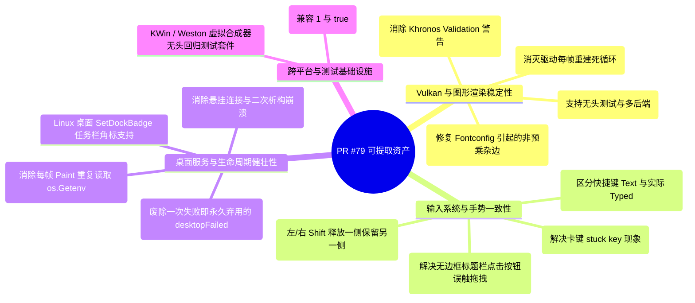

# PR #79 优质技术资产挖掘与可合入 main 贡献全景指南

---

## 目录

1. [执行摘要与提取原则](#一执行摘要与提取原则)
2. [贡献全景图：超越官方 Review 的十大挖掘点](#二贡献全景图超越官方-review-的十大挖掘点)
3. [第一组：Vulkan 与渲染稳定性改进（即刻可合入）](#三第一组vulkan-与渲染稳定性改进即刻可合入)
   - [3.1 VK_SUBOPTIMAL_KHR 残留收敛 Epoch 机制](#31-vk_suboptimal_khr-残留收敛-epoch-机制)
   - [3.2 Vulkan 命令池（Command Pool）重录前重置](#32-vulkan-命令池command-pool重录前重置)
   - [3.3 非 LCD 文本强制灰度抗锯齿（消除非预乘 Alpha 杂边）](#33-非-lcd-文本强制灰度抗锯齿消除非预乘-alpha-杂边)
   - [3.4 vulkanSurfaceProvider 渲染器与窗口后端解耦](#34-vulkansurfaceprovider-渲染器与窗口后端解耦)
4. [第二组：按键、输入与手势行为一致性（跨后端通用）](#四第二组按键输入与手势行为一致性跨后端通用)
   - [4.1 快捷键 Latin 层解耦与 KeyEvent.Text / Typed 语义规范](#41-快捷键-latin-层解耦与-keyeventtext--typed-语义规范)
   - [4.2 成对修饰键（Pair Modifiers）状态独立跟踪](#42-成对修饰键pair-modifiers状态独立跟踪)
   - [4.3 窗口失焦按键补偿释放（Synthetic Release on Focus Lost）](#43-窗口失焦按键补偿释放synthetic-release-on-focus-lost)
   - [4.4 PressMoveOnDrag 4 像素 Slop 容差与投递时序](#44-pressmoveondrag-4-像素-slop-容差与投递时序)
5. [第三组：桌面服务（D-Bus/Portal）与 IME 生命周期健壮性](#五第三组桌面服务d-busportal与-ime-生命周期健壮性)
   - [5.1 D-Bus Portal / Session Bus 临时失败的有界指数退避重试](#51-d-bus-portal--session-bus-临时失败的有界指数退避重试)
   - [5.2 窗口销毁时 IBus Context 有序注销与幂等保护](#52-窗口销毁时-ibus-context-有序注销与幂等保护)
   - [5.3 窗口控件主题环境变量读取缓存（消除每帧热读取）](#53-窗口控件主题环境变量读取缓存消除每帧热读取)
   - [5.4 Linux 桌面任务栏徽标（SetDockBadge）支持](#54-linux-桌面任务栏徽标setdockbadge支持)
6. [第四组：跨平台构建与测试基础设施资产](#六第四组跨平台构建与测试基础设施资产)
   - [6.1 macOS plutil -p 新旧版本布尔兼容（1 vs true）](#61-macos-plutil--p-新旧版本布尔兼容1-vs-true)
   - [6.2 KWin / Weston 无头合成器虚拟自动化回归测试套件](#62-kwin--weston-无头合成器虚拟自动化回归测试套件)
7. [分步实施路线图与独立 PR 规划表](#七分步实施路线图与独立-pr-规划表)

---

## 一、执行摘要与提取原则

在 PR [#79](https://github.com/vivaui/viva/pull/79)（*feat(linux): implement the Wayland-first backend with X11 fallback*）的审查中，项目 Maintainer（@t8y2）因确定采用 GTK 3 Shell 承载 `app.WebHost` 而关闭了该 PR，但同时指出：
> *"Some parts are still valuable and welcome as small, separate PRs against current main: the vulkanSurfaceProvider abstraction, key-repeat and modifier-tracking fixes, window-control theming that doesn't read the environment on every paint."*

实际上，PR #79 历经 120 个提交的密集迭代，**沉淀出的优秀工程资产远不止 Reviewer 随笔提及的上述三点**。在涉及 Linux Vulkan 驱动兼容、字体抗锯齿缺陷、D-Bus 会话容错、窗口失焦状态机、以及 macOS 自动化测试等诸多通用底层链路上，PR #79 均包含了极其宝贵的真实 Bug 修复与稳定性增强。

### 提取与重构原则
1. **正交解耦，杜绝全家桶**：从近 20,000 行庞大改动中，剥离出彼此独立、不依赖未合并 Wayland 后端的小型专项 PR；
2. **基于最新 `main` 重切分支**：以主干最新的共享 `desktopServices` 和架构基线为底座，确保变更清晰、易审查、易合并；
3. **附带回归测试与度量数据**：每一个提取出的修复项均携带对应的单测覆盖，维持高标准的质量门禁。

---

## 二、贡献全景图：超越官方 Review 的十大挖掘点



---

## 三、第一组：Vulkan 与渲染稳定性改进（即刻可合入）

### 3.1 VK_SUBOPTIMAL_KHR 残留收敛 Epoch 机制
- **涉及提交**：[`d56b048`](file:///Volumes/HIKSEMI/code/viva/internal/platform/linux/vulkan_linux.go)（*fix(linux): stop rebuilding the swapchain for a residual SUBOPTIMAL*）
- **涉及文件**：`internal/platform/linux/vulkan_linux.go`、`internal/platform/linux/api_linux_test.go`
- **问题根因**：
  在 Vulkan 规范中，`vkAcquireNextImageKHR` 或 `vkQueuePresentKHR` 返回 `VK_SUBOPTIMAL_KHR` 表示交换链仍可正常呈现画面，但其配置已非最优。部分 Linux 显卡驱动（尤其在某些核显或混合输出环境下）在重建交换链后，依然会**持续不断地返回 `SUBOPTIMAL`**。
  主干旧逻辑只要检测到 `SUBOPTIMAL` 就触发 `rebuild`，导致应用每一帧都在销毁并重新分配交换链图像，CPU/GPU 占用飙升，引发灾难性卡顿。
- **PR #79 的解决方案（Epoch 机制）**：
  引入 `swapchainSuboptimalRebuilt` 标志位：
  1. 首次收到 `SUBOPTIMAL` 时，重建一次交换链，并将当前周期标记为已重建；
  2. 若新交换链仍然返回 `SUBOPTIMAL`，继续正常呈现画面，不再死循环重建，直到收到健康的 `VK_SUCCESS` 或因尺寸变动收到 `OUT_OF_DATE` 为止；
  3. 健康帧到来时重置状态，保证下一次合法的状态变更依然能够触发重建。
- **价值**：极大提升 Linux Vulkan 渲染后端的硬件容错率与极端驱动稳定性。

---

### 3.2 Vulkan 命令池（Command Pool）重录前重置
- **涉及提交**：[`750f308`](file:///Volumes/HIKSEMI/code/viva/internal/platform/linux/vulkan_linux.go)（*fix(linux): reset command pool before re-recording*）
- **涉及文件**：`internal/platform/linux/vulkan_linux.go`
- **问题与修复**：
  在重新录制渲染命令缓冲区（Command Buffers）前，未显式重置命令池，会导致 Khronos Validation Layers 抛出 `VUID-vkResetCommandBuffer` 错误日志。在录制前调用 `vkResetCommandPool`，彻底消除渲染验证错误。

---

### 3.3 非 LCD 文本强制灰度抗锯齿（消除非预乘 Alpha 杂边）
- **涉及提交**：[`dfa5525`](file:///Volumes/HIKSEMI/code/viva/internal/platform/linux/font_settings.go)（*fix(linux): force grayscale antialiasing for non-LCD text*）
- **涉及文件**：`internal/platform/linux/font_settings.go`、`internal/platform/linux/font_settings_linux_test.go`
- **问题根因**：
  在缺少桌面环境配置的 Linux 机器（如干净安装的发行版、CI 测试节点、无头服务器）上，`Antialias` 缺省值为 0（留给 Fontconfig 自行决定）。Fontconfig 可能会倾向于开启次像素（Subpixel / LCD）渲染。
  但是，当这些文字被光栅化进一个普通的 **ARGB32** 位图标签时，次像素的分通道覆盖率会导致其像素呈现出**非预乘（Non-premultiplied）Alpha** 瑕疵，表现为文字边缘带有微小的彩色噪点杂边。
- **PR #79 的解决方案**：
  ```go
  // 除非桌面明确显式关闭了抗锯齿（cairoAntialiasNone），
  // 否则凡是非 LCD 文本，默认明确强制采用 Grayscale 抗锯齿
  func (settings fontSettings) grayscale() fontSettings {
      if settings.Antialias != cairoAntialiasNone {
          settings.Antialias, settings.SubpixelOrder = cairoAntialiasGray, 0
      }
      return settings
  }
  ```
- **价值**：直接消除跨平台文本渲染在部分 Linux 机器上的字体发虚和彩边问题。

---

### 3.4 vulkanSurfaceProvider 渲染器与窗口后端解耦
- **涉及文件**：`internal/platform/linux/vulkan_linux.go`、`internal/platform/linux/api_linux.go`
- **重构价值**：
  将 Vulkan 渲染器（`vulkanRenderer`）对具体窗口句柄（XCB 连接、窗口 ID）的直接耦合，提炼为一个抽象接口 `vulkanSurfaceProvider`。这不仅使 Vulkan 渲染引擎能够无缝对接到未来的新表面，还使得单测中能够脱离真实 X11 连接模拟呈现与 Swapchain 状态收敛，大幅提升测试性。

---

## 四、第二组：按键、输入与手势行为一致性（跨后端通用）

### 4.1 快捷键 Latin 层解耦与 KeyEvent.Text / Typed 语义规范
- **涉及提交**：[`33ba7d6`](file:///Volumes/HIKSEMI/code/viva/internal/platform/linux/keymap.go)（*fix(linux): align Wayland key dispatch and focus semantics with X11*）
- **涉及文件**：`internal/platform/linux/keymap.go`、`internal/platform/linux/input_linux.go`
- **关键设计**：
  1. **区分快捷键与文本输入**：`KeyEvent.Text` 代表用于快捷键匹配的标准化字符，`KeyEvent.Typed` 代表用户真正意图输入的文本。当按下 `Control`、`Alt` 或 `Meta` 等控制键时，严格不设置 `KeyEvent.Typed`；
  2. **Latin 物理层解析**：快捷键字符强制从 xkb 键盘布局的 Latin 基础层提取，自动忽略 `AltGr`（Level 3）的干扰，同时正确考量 `Shift`、`Caps Lock` 和 `Num Lock`；
  3. **标准分发管线**：规范事件顺序为 `OnShortcut`（带 `ownsChord` 守卫） $\rightarrow$ `IME` $\rightarrow$ `deliverTyped` $\rightarrow$ `Compose/dead key`，保证 Linux 各后端行为一致。

---

### 4.2 成对修饰键（Pair Modifiers）状态独立跟踪
- **涉及文件**：`internal/platform/linux/input_linux.go`
- **问题场景**：
  用户按住左 `Shift`，接着按下右 `Shift`，然后松开左 `Shift`。旧逻辑在检测到左 `Shift` 释放时，直接将全局 `Shift` 修饰键状态清零！这导致右 `Shift` 依然被按住的情况下，后续输入的字母却变成了小写。
- **PR #79 解决方案**：
  修饰键状态按物理按键逐一跟踪（Bitmask / Refcount），成对修饰键释放一侧时，必须保留另一侧的状态，直到物理键全部释放。

---

### 4.3 窗口失焦按键补偿释放（Synthetic Release on Focus Lost）
- **涉及文件**：`internal/platform/linux/input_linux.go`
- **场景与价值**：
  当用户按住某个按键（如移动光标或持续开火）的同时窗口被切走（Alt+Tab 或鼠标移出窗口失焦），应用不会收到物理 `KeyRelease`，导致按键在应用内部发生**“按键卡死（Stuck Key）”**。
  PR #79 实现了失焦补偿：在失焦、设备断开或 seat 拆除时，自动检查当前仍处于按下状态的按键列表，补发虚拟释放事件，并严格保证在 IME、AT-SPI 和 `OnFocusLost` 之间只触发一次清理通知。

---

### 4.4 PressMoveOnDrag 4 像素 Slop 容差与投递时序
- **涉及提交**：[`739cb67`](file:///Volumes/HIKSEMI/code/viva/internal/platform/linux/window_linux.go)（*fix(linux): deliver the press before starting a PressMoveOnDrag move*）
- **涉及文件**：`internal/platform/linux/window_linux.go` 等
- **交互冲突痛点**：
  在客户端自定义标题栏（无边框窗口）中，标题栏本身允许拖拽移动窗口，但标题栏上同时放置了搜索框、最小化/关闭按钮等控件。
  旧逻辑在按下的一瞬间直接判定为窗口拖拽移动，导致按钮无法正常响应点击高亮（Active）状态。
- **PR #79 解决方案**：
  按下（Press）时，首先无条件投递给 UI 控件树；设置一个 4 逻辑像素的容差阈值（Slop Threshold）：只有当鼠标移动位移超过 4 像素时，才正式向窗口管理器声明启动拖拽移动窗口。完美兼顾按钮点击与窗口拖动。

---

## 五、第三组：桌面服务（D-Bus/Portal）与 IME 生命周期健壮性

### 5.1 D-Bus Portal / Session Bus 临时失败的有界指数退避重试
- **涉及提交**：[`cb6958b`](file:///Volumes/HIKSEMI/code/viva/internal/platform/linux/desktop_bus_linux.go)（*fix(linux): retry temporary desktop service failures*）
- **涉及文件**：`internal/platform/linux/desktop_bus_linux.go`、`internal/platform/linux/portal_unix.go`、`internal/platform/linux/desktop_retry_linux_test.go`
- **主干代码缺陷**：
  主干中的 `desktop_bus_linux.go` 针对 D-Bus 连接只有一次尝试机会。只要应用启动时桌面会话总线未就绪，直接标记 `application.desktopFailed = true`，**之后整个进程生命周期永久放弃监听系统深色模式、DPI 与无障碍变动**！
- **PR #79 解决方案**：
  1. 设计 `desktopRetry` 结构体，提供 100ms 到 30s 的有界指数退避（Exponential Backoff）；
  2. 精确区分“临时失败（`portalReadRetry`）”与“永久不支持（`portalReadUnsupported`）”；
  3. 将重试 Deadline 直接纳入主循环的轮询等待时间，无需额外启动常驻 Goroutine。

---

### 5.2 窗口销毁时 IBus Context 有序注销与幂等保护
- **涉及提交**：[`7bb80b2`](file:///Volumes/HIKSEMI/code/viva/internal/platform/linux/ime_linux.go)（*fix(linux): close the IME context when a Wayland window is destroyed*）
- **涉及文件**：`internal/platform/linux/ime_linux.go`、`internal/platform/linux/ime_linux_test.go`
- **问题与修复**：
  在多窗口应用中，关闭单个窗口时未显式关闭该窗口绑定的 IBus Context，导致外部 IBus 守护进程依然向已销毁的窗口句柄发送 D-Bus 消息，引发悬挂连接和空指针异常。
  修复方案确保在窗口销毁时有序执行 `ime.close()`，并在无 IME、二次注销（Idempotent Close）和多窗口并存场景下提供完整的安全隔离。

---

### 5.3 窗口控件主题环境变量读取缓存（消除每帧热读取）
- **涉及文件**：`app/window_controls.go`
- **问题**：
  每次渲染窗口控制按钮（关闭、最大化、最小化图标）时，代码都会反复调用 `os.Getenv` 读取系统桌面环境配置（`XDG_CURRENT_DESKTOP` 等），造成无谓的系统调用与 CPU 浪费。
  将其改造为在初始化或收到桌面变更信号时单次解析并缓存，每帧 Paint 直接读取缓存标志。

---

### 5.4 Linux 桌面任务栏徽标（SetDockBadge）支持
- **涉及提交**：[`2e3b8ce`](file:///Volumes/HIKSEMI/code/viva/internal/platform/linux/dock_badge_linux.go)（*fix(linux): implement SetDockBadge for the Wayland backend*）
- **涉及文件**：`internal/platform/linux/dock_badge_linux.go`
- **价值**：
  在 Linux 桌面（GNOME Dash、Unity、KDE Taskbar）通过 `org.freedesktop.Unity.LauncherEntry` D-Bus 接口设置未读消息计数角标，补齐与 macOS Dock / Windows 任务栏对齐的桌面特性。

---

## 六、第四组：跨平台构建与测试基础设施资产

### 6.1 macOS plutil -p 新旧版本布尔兼容（1 vs true）
- **涉及提交**：[`5f8bd4d`](file:///Volumes/HIKSEMI/code/viva/tools/dmg/dmg_test.go)（*test(dmg): accept plutil's boolean spelling on newer macOS*）
- **涉及文件**：`tools/dmg/dmg_test.go`
- **问题与修复**：
  在旧版 macOS 系统上，系统命令 `plutil -p` 将 Property List 中的布尔值打印为数字 `1`；而在最新的 macOS 版本上则打印为字符串 `true`。
  测试用例增加双向拼写容错，彻底消除跨不同 macOS 版本 CI 节点的随机构建失败。

---

### 6.2 KWin / Weston 无头合成器虚拟自动化回归测试套件
- **涉及提交**：[`4e77606`](file:///Volumes/HIKSEMI/code/viva/internal/platform/linux/headless_test.go)、[`61a78c8`](file:///Volumes/HIKSEMI/code/viva/internal/platform/linux/headless_test.go)
- **价值**：
  提供了完整的基于 `kwin_wayland --virtual` 与 `weston --backend=headless-backend.so` 的无头自动化集成测试脚手架。可用于后续在 Linux CI 流水线上回归验证任何 Linux 视窗后端（包括 GTK 3 shell 和 XCB）的生命周期、多屏热插拔、窗口最小化/恢复与呈现背压。

---

## 七、分步实施路线图与独立 PR 规划表

为了将上述成果安全合入主干 `main`，建议严格按照**“由底层到上层、先独立修复后通用优化”**的顺序，拆分为以下 6 个独立的原子 PR：

| 阶段 | 建议 PR 标题 | 核心改动文件 | 依赖关系 | 风险与预估周期 |
| :---: | :--- | :--- | :--- | :---: |
| **PR 1** | `fix(linux): force grayscale antialiasing for non-LCD text` | `font_settings.go`, `font_settings_linux_test.go` | 无 (纯独立修复) | 极低 / 1 天 |
| **PR 2** | `fix(linux): converge swapchain on residual VK_SUBOPTIMAL_KHR` | `vulkan_linux.go`, `api_linux_test.go` | 无 (独立 Vulkan 修复) | 低 / 1-2 天 |
| **PR 3** | `fix(linux): retry temporary session bus and portal failures` | `desktop_bus_linux.go`, `portal_unix.go`, `desktop_retry_linux_test.go` | 依赖 main 现有 bus 结构 | 低 / 2 天 |
| **PR 4** | `fix(linux): key dispatch, pair modifiers, and stuck key prevention` | `keymap.go`, `input_linux.go`, `input_linux_test.go` | 跨 X11 验证 | 中 / 2-3 天 |
| **PR 5** | `fix(linux): safely close IME context on window destruction` | `ime_linux.go`, `window_linux.go`, `ime_linux_test.go` | 无 | 极低 / 1 天 |
| **PR 6** | `perf(app): cache desktop theme environment and add SetDockBadge` | `app/window_controls.go`, `dock_badge_linux.go` | 无 | 极低 / 1 天 |

---

> [!TIP]
> **总结**：PR #79 绝非一次沉没的代码提交。通过系统化地提取其在 **Vulkan 驱动收敛、文本光栅化抗锯齿、D-Bus 会话退避、按键修饰键状态机与无障碍生命周期** 等方面的高价值通用资产，可以使 Viva 主干 `main` 的稳健性与工程质量迈上一个全新的台阶。
