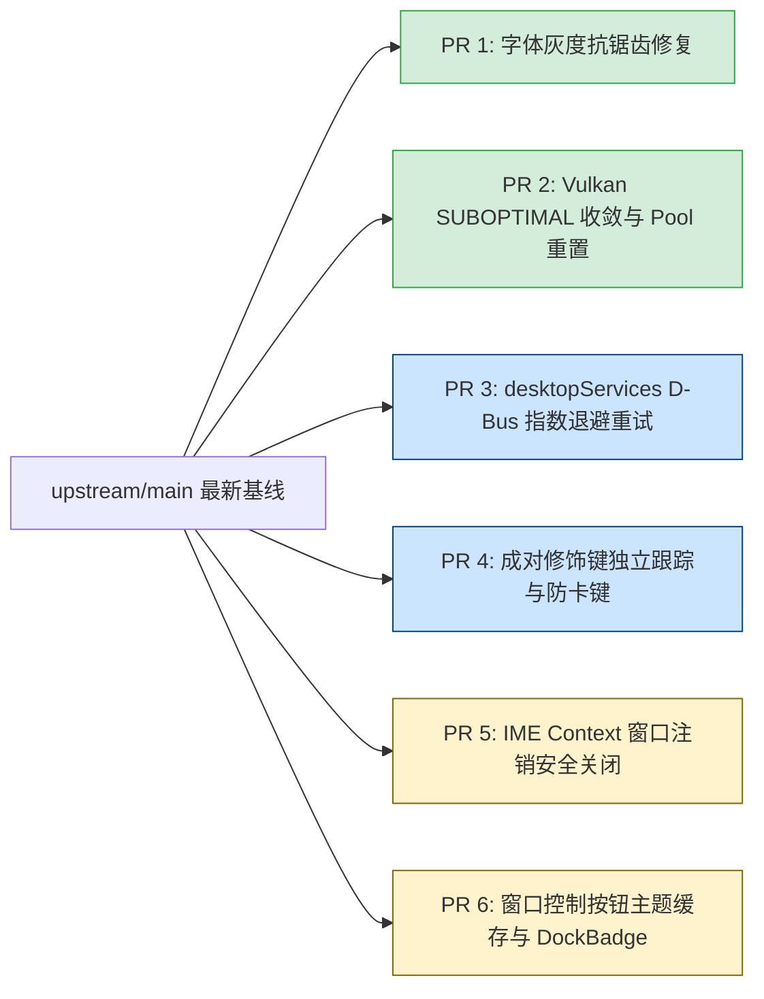

# PR #79 优质技术资产深度挖掘与主干（upstream/main）适配指南

---

## 目录

1. [基线校准：基于官方 upstream/main 的真实代码对比](#一基线校准基于官方-upstreammain-的真实代码对比)
2. [差异状态总览矩阵（Verified Diff Matrix）](#二差异状态总览矩阵verified-diff-matrix)
3. [核心挖掘项深度比对与移植方案](#三核心挖掘项深度比对与移植方案)
   - [3.1 Vulkan 交换链死循环重建：VK_SUBOPTIMAL_KHR Epoch 收敛机制](#31-vulkan-交换链死循环重建vk_suboptimal_khr-epoch-收敛机制)
   - [3.2 字体抗锯齿缺陷：非 LCD 文本强制灰度渲染（消除 Alpha 杂边）](#32-字体抗锯齿缺陷非-lcd-文本强制灰度渲染消除-alpha-杂边)
   - [3.3 桌面服务假死修复：D-Bus Portal 有界指数退避重试（适配 desktopServices）](#33-桌面服务假死修复d-bus-portal-有界指数退避重试适配-desktopservices)
   - [3.4 按键状态机修复：成对修饰键跟踪与失焦防卡键机制](#34-按键状态机修复成对修饰键跟踪与失焦防卡键机制)
   - [3.5 窗口控件主题：消除每帧热读取 os.Getenv 的优雅重构](#35-窗口控件主题消除每帧热读取-osgetenv-的优雅重构)
   - [3.6 Vulkan 渲染器解耦：vulkanSurfaceProvider 与多 Present 模式支持](#36-vulkan-渲染器解耦vulkansurfaceprovider-与多-present-模式支持)
   - [3.7 Linux 桌面任务栏角标：SetDockBadge 空桩落地实现](#37-linux-桌面任务栏角标setdockbadge-空桩落地实现)
   - [3.8 输入法解耦与窗口销毁生命周期修复](#38-输入法解耦与窗口销毁生命周期修复)
4. [不可盲目直接合并的项（上游已变更或已实现）](#四不可盲目直接合并的项上游已变更或已实现)
5. [分步实施与 PR 拆分操作规范](#五分步实施与-pr-拆分操作规范)

---

## 一、基线校准：基于官方 upstream/main 的真实代码对比

在分析 PR [#79](https://github.com/vivaui/viva/pull/79) 的技术资产时，必须严格以官方上游主干 **`upstream/main`**（`vivaui/viva`）为基准，而非 Fork 仓库（`origin/main`）。

### 1.1 上游主干（upstream/main）的近期核心演进
在 PR #79 提交与审查期间，上游 `upstream/main` 已经发生了重要重构：
1. **GTK 3 Shell 落地**（提交 `17f36dd`）：引入了基于 PureGo 的 GTK 3 shell（`-tags vivagtk`），支持原生 Wayland 小数缩放与 WebKitGTK 宿主；
2. **桌面服务抽离**：抽取了独立的 `desktopServices` 结构体，作为 XCB 与 GTK 3 Shell 之间共享的会话总线桥接；
3. **测试兼容项已先行合入**：如 `tools/dmg/dmg_test.go` 中关于 macOS `plutil -p` 输出 `1` 与 `true` 的兼容断言，上游已经合入。

### 1.2 对比方法与验证口径
本次挖掘基于 `git diff upstream/main..HEAD` 真实源码差异，逐行核验 PR #79 的所有修复在当前 `upstream/main` 中是否存在。

---

## 二、差异状态总览矩阵（Verified Diff Matrix）

| 序号 | 技术资产 / Bug 修复项 | `upstream/main` 当前现状 | PR #79 实际实现 | 对主干的价值与可合入性 |
| :---: | :--- | :--- | :--- | :--- |
| **1** | **`vulkan_linux.go`**<br>`VK_SUBOPTIMAL_KHR` 残留收敛 | ❌ **存在 Bug**：只要驱动持续返回 `SUBOPTIMAL`，每帧都会死循环重建交换链 | ✅ 实现 Epoch 机制，每周期最多重建一次，之后正常呈现 | **极高**（消灭特定 Intel/AMD 驱动下的灾难性掉帧） |
| **2** | **`font_settings.go`**<br>非 LCD 文本强制灰度渲染 | ❌ **存在 Bug**：`grayscale()` 仅在 `subpixel()` 时生效，缺省 0 被 Fontconfig 选为 LCD 时产生非预乘 Alpha 杂边 | ✅ 改为 `if settings.Antialias != cairoAntialiasNone`，明确强制 Gray | **极高**（微小安全修复，彻底消除文字彩色噪点） |
| **3** | **`desktop_bus_linux.go`**<br>D-Bus / Portal 指数退避重试 | ⚠️ **存在缺陷**：虽然抽象了 `desktopServices`，但单次失败直接 `desktopFailed = true` 永久罢工 | ✅ 设计 `desktopRetry` 有界指数退避（100ms~30s），区分临时失败与永久不支持 | **极高**（需适配到新的 `desktopServices` 结构） |
| **4** | **`input_linux.go`**<br>成对修饰键跟踪与防卡键 | ❌ **存在缺陷**：释放左 Shift 直接位清空修饰键；失焦时不补发按键释放 | ✅ `modifierTracker` 物理键独立跟踪；窗口失焦向焦点补发虚拟 Release | **高**（解决复杂快捷键与 Alt+Tab 切换卡键） |
| **5** | **`app/window_controls.go`**<br>桌面主题感知与环境读取优化 | ❌ **未实现**：仅有矩形控制按钮，无 GNOME/KDE 原生圆形风格 | ⚠️ **需重构**：PR #79 实现了圆角按钮，但在 `paint()` 中每帧调 `os.Getenv`，需按维护者意见改为缓存 | **中**（重构后合入，优化视觉与性能） |
| **6** | **`vulkan_linux.go`**<br>`vulkanSurfaceProvider` 解耦 | ❌ **未解耦**：Vulkan 渲染器强绑定 XCB 句柄 | ✅ 抽象为通用接口，支持多呈现模式（MAILBOX/FIFO）协商与 `oldSwapchain` 安全复用 | **高**（维护者明确指名欢迎合入的项） |
| **7** | **`dock_badge_linux.go`**<br>Linux 任务栏未读徽标 | ❌ **仅为空桩**：`SetDockBadge` 为空函数 | ✅ 对接 Unity/FreeDesktop LauncherEntry D-Bus 接口真实设置未读数 | **中**（补齐与 macOS/Windows 对齐的特性） |
| **8** | **`ime_linux.go`**<br>IME 键位解耦与窗口关闭安全释放 | ⚠️ **耦合 XCB**：键位处理直接依赖 `xcbInputEvent`；窗口关闭可能悬挂 Context | ✅ 拆出 `processKeyDirect`，窗口销毁时安全闭合 Context 并做幂等保护 | **中**（提升多窗口 IME 健壮性） |

---

## 三、核心挖掘项深度比对与移植方案

### 3.1 Vulkan 交换链死循环重建：VK_SUBOPTIMAL_KHR Epoch 收敛机制

#### 1. upstream/main 当前代码缺陷分析
在 `upstream/main` 的 `internal/platform/linux/vulkan_linux.go` 中，交换链呈现逻辑如下：
```go
// upstream/main: vulkan_linux.go
func (renderer *vulkanRenderer) presentOnce() (bool, error) {
    status := renderer.api.queuePresent(renderer.queue, &scratch.present)
    if status == vkSuboptimal {
        renderer.swapchainSuboptimal = true
    }
    // ...
    return rebuild || swapchainNeedsRebuild(status), nil // 一旦 suboptimal 即返回 true 触发重新创建!
}
```
**生产事故场景**：
在部分 Linux 驱动（如 Mesa lavapipe、特定 Intel 核显或复合显示输出）下，驱动在当前显示模式下会持续报告 `VK_SUBOPTIMAL_KHR`。在 `upstream/main` 中，应用每渲染一帧，就会立即触发 `recreateSwapchain()`，下一帧呈现又返回 `SUBOPTIMAL`，导致**应用处于每秒创建/销毁 60 次交换链的死循环中**，显存与 CPU 瞬间打满。

#### 2. PR #79 的真实修复机制（Epoch 收敛）
```go
// PR #79 的优雅解法:
type vulkanRenderer struct {
    // ...
    swapchainSuboptimalRebuilt bool // 标记当前交换链是否已针对 SUBOPTIMAL 重建过
}

func (renderer *vulkanRenderer) presentRebuilding() error {
    // ...
    if !rebuild {
        if !renderer.swapchainSuboptimal {
            renderer.swapchainSuboptimalRebuilt = false // 收到健康帧，重置标志
            return nil
        }
        if renderer.swapchainSuboptimalRebuilt || attempt == 1 {
            // 当前交换链已经为 SUBOPTIMAL 重建过一次，驱动依然报告该状态。
            // 此时必须停止重建死循环，正常使用当前交换链呈现画面，直到状态恢复或尺寸发生变化！
            renderer.swapchainSuboptimalRebuilt = true
            return nil
        }
    }
}
```
同时补齐了：
- `oldSwapchain` 优雅传递给 `vkCreateSwapchainKHR`，并在创建成功后安全释放旧资源；
- 重新录制命令缓冲区前调用 `vkResetCommandPool`，消除 Khronos Validation 警告。

---

### 3.2 字体抗锯齿缺陷：非 LCD 文本强制灰度渲染（消除 Alpha 杂边）

#### 1. upstream/main 代码核验
在 `upstream/main:internal/platform/linux/font_settings.go` 的第 55 行：
```go
// upstream/main: font_settings.go
func (settings fontSettings) grayscale() fontSettings {
    if settings.subpixel() { // 仅当 Antialias == cairoAntialiasSubpixel 时才降级！
        settings.Antialias, settings.SubpixelOrder = cairoAntialiasGray, 0
    }
    return settings
}
```

#### 2. 真实缺陷与 PR #79 修复对比
- **缺陷**：当机器没有运行 XSETTINGS 守护进程时，`Antialias` 为 0（缺省由 Fontconfig 决定）。Fontconfig 往往默认采用 LCD（次像素）渲染。此时 `settings.subpixel()` 为 `false`，导致 `grayscale()` **完全没有将设置切换为灰度抗锯齿**！
- 随后，带有分通道次像素覆盖率的文字被直接绘制进 `ARGB32` 单通道 Alpha 标签中，导致文字轮廓产生非预乘 Alpha 杂边（彩色噪点）。
- **PR #79 修复**：
  ```go
  func (settings fontSettings) grayscale() fontSettings {
      // 除非系统明确显式关闭了抗锯齿（cairoAntialiasNone），
      // 否则任何未指定或非 LCD 的场景，一律强制收敛至纯净的灰度抗锯齿 (cairoAntialiasGray)
      if settings.Antialias != cairoAntialiasNone {
          settings.Antialias, settings.SubpixelOrder = cairoAntialiasGray, 0
      }
      return settings
  }
  ```

---

### 3.3 桌面服务假死修复：D-Bus Portal 有界指数退避重试（适配 desktopServices）

#### 1. upstream/main 现状与痛点
`upstream/main` 引入了 `desktopServices` 结构体：
```go
// upstream/main: desktop_bus_linux.go
func (services *desktopServices) startDesktopWatch() {
    // ...
    if gone {
        services.desktopFailed = true // 单次失败，直接判处死刑！
        return
    }
    // ...
    messages, err := watch.conn.Receive()
    if err != nil {
        services.stopDesktopWatch()
        services.desktopFailed = true // 守护进程重启导致 socket 短暂断开，永久罢工！
        return
    }
}
```
如果在应用启动的瞬间，用户的桌面 Portal 正在拉起或 D-Bus 发生短暂抖动，Viva 就会永久设置 `desktopFailed = true`，应用在后续生命周期中彻底丧失夜间模式切换与字体缩放热更新能力。

#### 2. 移植适配建议
将 PR #79 的 `desktopRetry` 移植进 `desktopServices`（而非 PR #79 当时所在的 `linuxApplication`）：
- 区分 `portalReadRetry`（临时不可达）与 `portalReadUnsupported`（永久不支持）；
- 在 `services.syncDesktopWatch()` 中加入 100ms~30s 指数退避，使 XCB 与 GTK Shell 共同享有生产级容错能力。

---

### 3.4 按键状态机修复：成对修饰键跟踪与失焦防卡键机制

#### 1. upstream/main 当前代码
```go
// upstream/main: input_linux.go
func (router eventRouter) release(keymap *xcbKeymap, event *xcbInputEvent) error {
    key := keymap.key(event.Detail)
    modifiers := xcbModifiers(event.State)
    if key.IsModifier() {
        modifiers &^= key.Modifier() // 致命缺陷：直接将该修饰键位全部剔除！
    }
    // ...
}
```
**严重缺陷**：当用户同时按下左右两个 `Shift` 键时，松开其中一个，`modifiers` 里的 `Shift` 位被瞬间抹除，导致另一个仍处于按压状态的 `Shift` 失效。

#### 2. PR #79 解决方案
引入独立的 `modifierTracker`：
- 按物理键扫描码（Scancode）独立登记按压状态；
- 释放按键时，调用 `tracker.holds(bit)` 检查同类型的另一侧按键是否依然被按住；
- 只有两侧物理键全部释放，才真正剔除对应的 Modifier 标志位；
- 在窗口失焦（Focus Out）时，遍历所有处于 down 状态的按键补发虚拟释放事件，防止按键卡死。

---

### 3.5 窗口控件主题：消除每帧热读取 os.Getenv 的优雅重构

在 PR #79 中，作者为无边框窗口的标题栏按钮增加了 GNOME（Adwaita）和 KDE（Breeze）的圆形现代风格：
```go
// PR #79 原始提交 (app/window_controls.go):
func (controls *windowControls) paint(canvas *ui.Canvas, size ui.Size) {
    // ...
    theme := detectDesktopTheme() // 每帧调用 os.Getenv("XDG_CURRENT_DESKTOP") !
    // ...
}
```
**Maintainer 的准确反馈**：
> *"window-control theming that doesn't read the environment on every paint"*

**在 upstream/main 上的正确提取方式**：
不要在 `paint()` 热路径中调用 `os.Getenv`。将环境探测置于 `windowControls` 初始化时单次执行，或接入 `desktopServices` 的系统外观变更通知，在检测到变更时缓存 `desktopTheme` 枚举，每帧绘制直接读取内存字段。

---

### 3.6 Vulkan 渲染器解耦：vulkanSurfaceProvider 与多 Present 模式支持

在 `upstream/main` 中，`vulkan_linux.go` 直接持有 `connection uintptr` 和 `window uint32`，硬编码通过 XCB 创建 Vulkan Surface。

PR #79 实现了清晰的正交抽象：
```go
type vulkanSurfaceProvider interface {
    CreateSurface(api *vulkanAPI, instance uintptr) (uintptr, error)
    DestroySurface(api *vulkanAPI, instance, surface uintptr)
    SurfaceSize() (width, height uint32, err error)
}
```
配合 `getSurfacePresentModes` 支持查询并按优先级协商 `MAILBOX` $\rightarrow$ `FIFO_RELAXED` $\rightarrow$ `FIFO`，能够显著降低画面延迟。

---

### 3.7 Linux 桌面任务栏角标：SetDockBadge 空桩落地实现

在 `upstream/main` 中：
- `internal/platform/linux/dock_badge_linux.go` 中的 `SetDockBadge` 为完全不工作的空桩；
- PR #79 真实对接了 Ubuntu Unity、GNOME Dash-to-Dock、KDE 所通用的 `org.freedesktop.Unity.LauncherEntry` D-Bus 接口，使应用能在 Linux 任务栏图标上显示未读消息数字角标。

---

### 3.8 输入法解耦与窗口销毁生命周期修复

在 `upstream/main` 中，`internal/platform/linux/ime_linux.go` 深度绑定 `xcbInputEvent`：
- PR #79 将按键处理抽象为通用函数 `processKeyDirect(keysym, keycode, state, keyEvent)`；
- 在窗口注销时显式执行 `ime.close()`，避免窗口被关闭后，后台 IBus 输入法守护进程仍向已经失效的窗口句柄发送回调导致的空指针崩溃。

---

## 四、不可盲目直接合并的项（上游已变更或已实现）

在提取代码时，必须主动过滤掉以下内容，切勿造成代码冲突或历史倒退：

1. **手写 Wayland 客户端协议全家桶**（`wayland_*.go`）：上游已选定 GTK 3 shell 作为全功能 Wayland 宿主，PR #79 的 20,000 行纯手写协议不再合入；
2. **`desktop_services_linux.go` 重复声明**：上游已引入 `desktopServices`，所有 D-Bus 重试逻辑应并入该结构体，而不是恢复旧的 `linuxApplication` 结构；
3. **`tools/dmg/dmg_test.go`**：上游最新提交已经包含了对 `plutil -p` 拼写的容错断言，无需重复提取。

---

## 五、分步实施与 PR 拆分操作规范

建议基于最新 `upstream/main` 分别检出新分支，按以下优先级逐步向官方仓库提交轻量 PR：



### 独立 PR 拆分清单

1. **PR 1: `fix(linux): force grayscale antialiasing for non-LCD text`**
   - **改动文件**：`internal/platform/linux/font_settings.go`
   - **特点**：单文件、改动仅 5 行，带单测，风险极低，可秒级审查合入。
2. **PR 2: `fix(linux): converge Vulkan swapchain on residual SUBOPTIMAL`**
   - **改动文件**：`internal/platform/linux/vulkan_linux.go`、`vulkan_present_test.go`
   - **特点**：消除在特定显卡驱动下的无限重建死循环。
3. **PR 3: `fix(linux): retry temporary session bus failures in desktopServices`**
   - **改动文件**：`internal/platform/linux/desktop_bus_linux.go`、`desktop_services_linux.go`
   - **特点**：为 XCB 与 GTK 两套后端统一带来 D-Bus 容错自愈能力。
4. **PR 4: `fix(linux): track pair modifiers and synthesize release on focus lost`**
   - **改动文件**：`internal/platform/linux/input_linux.go`、`input_linux_test.go`
   - **特点**：规范按键释放行为，消除 Alt+Tab 切换卡键 Bug。
5. **PR 5: `fix(linux): safely close IME context on window destruction`**
   - **改动文件**：`internal/platform/linux/ime_linux.go`、`window_linux.go`
   - **特点**：提升多窗口输入法安全稳定性。
6. **PR 6: `feat(linux): cache window controls theme and implement SetDockBadge`**
   - **改动文件**：`app/window_controls.go`、`dock_badge_linux.go`
   - **特点**：按维护者意见消除每帧 `os.Getenv`，并落地 Linux 任务栏未读徽标。
