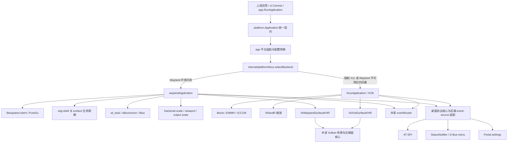
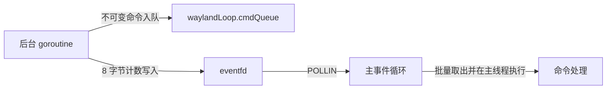
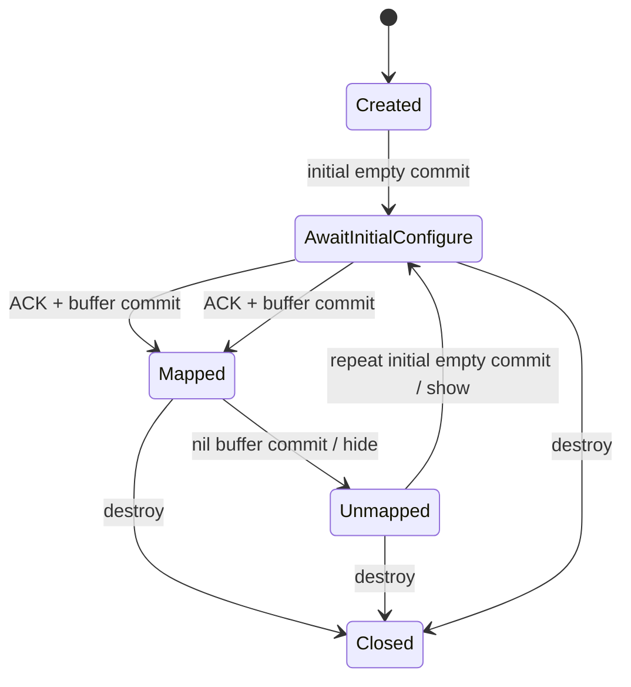

# Viva Linux/Wayland 架构：目标设计与实施契约

- 更新日期：2026-10-30
- 适用分支：`docs/linux-render-refresh-flicker`
- 文档性质：架构目标、协议约束和迁移方向；不代表全部能力已经实现或验收

## 1. 架构目标与判断原则

Viva Linux 后端采用 **Wayland 原生优先、X11 后备** 的双后端架构，目标是提供低延迟、按需渲染、跨高分屏一致且可长期维护的 GUI 运行时。

核心原则：

1. **Wayland-First**：在可用 Wayland 会话中优先使用原生后端；强制后端失败时不静默降级。
2. **X11-as-Fallback**：仅保留必要的 X11/XCB 适配差异，共享场景、文字、输入路由和桌面协议核心。
3. **Zero CGO / PureGo**：通过 `purego` 动态绑定系统库，保持纯 Go 交叉编译能力。
4. **单线程平台所有权**：Wayland proxy、窗口状态和 Vulkan 窗口操作由事件循环线程独占；后台 goroutine 只提交不可变命令或事件快照。
5. **协议状态优先于表面现象**：以 configure、commit、frame callback、swapchain 生命周期为依据设计，不用零散布尔补丁维持表面可用。
6. **按需而非无条件渲染**：内容不变不代表可以忽略 Show、resize、scale 或 swapchain 重建所要求的强制呈现。
7. **明确区分现状与目标**：所有“已实现”结论必须由源码和测试支持；真实 compositor、GPU 和桌面服务验收单独记录。

## 2. 总体分层



### 2.1 共享边界

| 模块 | Wayland 专属 | X11 专属 | 可共享部分 |
| :--- | :--- | :--- | :--- |
| 显示连接与事件分发 | libwayland-client、event queue | XCB connection、event queue | event-source 契约、命令队列思想 |
| 窗口协议 | xdg-shell、wl_surface | EWMH、ICCCM | `platform.Config`、逻辑窗口状态 |
| GPU surface | `VK_KHR_wayland_surface` | `VK_KHR_xcb_surface` | 场景、文字、裁剪、swapchain 资源管理 |
| 输入 | wl_pointer、wl_keyboard、data-device | XCB input、XDND | `eventRouter`、点击计数、文本状态 |
| 缩放 | fractional-scale、viewport、output scale | XRandR | 逻辑坐标、设备像素换算 |
| 桌面集成 | Wayland FD 注册与连接生命周期 | X11 FD 注册与连接生命周期 | AT-SPI、Portal、StatusNotifier 协议核心 |

桌面集成不是“100% 共享”。可复用的是协议核心和可抽取的重连状态机；FD 注册、显示连接和后端事件分发仍由各自适配层负责。修改一套生命周期实现时，必须审查另一套。

## 3. 后端选择契约

实际入口为 `internal/platform/linux/backend_select.go`。

### 3.1 当前行为

- `VIVA_LINUX_BACKEND=wayland`：只尝试 Wayland，失败直接返回错误。
- `VIVA_LINUX_BACKEND=x11`：要求 `DISPLAY` 非空，不尝试 Wayland。
- 未设置 override：
  1. `WAYLAND_DISPLAY` 非空，或 `$XDG_RUNTIME_DIR/wayland-0` 存在时，尝试 Wayland；
  2. Wayland 初始化失败后，如果 `DISPLAY` 非空则选择 X11；
  3. 两者均不可用时返回 `platform.ErrNoGraphics`。
- 其他 override 值返回配置错误。

X11 的 `selectBackend` 当前只完成环境检查和对象选择，真正的 XCB 连接可能在后续窗口创建时建立。因此，文档不能把“选择后端时已验证 X server 可连接”作为现有保证。

### 3.2 目标约束

- 探测阶段不创建窗口、不启动后台服务，也不留下全局 hook。
- 强制模式保留下层错误原因；自动后备可以保留诊断日志，但不能把配置错误误报为无显示。
- 图形设备/Vulkan 初始化失败与显示连接失败应保留可区分的错误链。

## 4. 单线程事件循环

### 4.1 所有权模型

目标是在 `Run` 锁定的 OS 线程上完成：

- Wayland display、proxy 和 event queue 操作；
- xdg/wl_surface 状态变更；
- Vulkan surface、swapchain 和窗口呈现；
- D-Bus/IBus/AT-SPI FD 的就绪分发；
- 窗口和应用错误状态推进。

后台 goroutine 不直接读取或修改窗口协议状态，只向命令队列提交不可变数据。`Frame` 等允许跨 goroutine 调用的只读 API 必须读取主线程发布的不可变快照，或通过明确同步获得同一几何代际。库加载和纯计算可以位于其他线程，但不能借此绕过 proxy 和 renderer 的所有权规则。

### 4.2 统一 event source

不要只用“FD + 无参数 callback”表示所有事件源。目标接口至少应表达：

```go
type eventSource interface {
    FD() int32
    Interest() uint16             // POLLIN、POLLOUT 等
    Dispatch(revents uint16) error // 包含 ERR、HUP、NVAL
}
```

实现可使用不同具体类型，但契约应满足：

- `POLLERR`、`POLLHUP`、`POLLNVAL` 必须进入对应服务的断开/清理路径，不能只处理 `POLLIN`；
- `POLLOUT` 用于 Wayland flush 背压恢复，恢复后及时取消监听，避免水平触发忙唤醒；
- 回调错误统一进入应用错误通道；
- FD 的注册、关闭和移除由同一 owner 管理，避免关闭后复用 FD 导致误分发；
- 不用平行切片隐式维护 FD 与 callback 的对应关系。

Calloop 的 `EventSource`、Generic FD source 和 Timer 是这一方向的成熟参考；Viva 不需要引入 Rust 或对应依赖，但应采用同样的职责划分。

### 4.3 libwayland 标准读取流程

目标事件循环采用 libwayland 推荐的 prepare/read 模式：

```text
dispatch pending commands
while true:
    dispatch wl_display_dispatch_pending()
    while wl_display_prepare_read() != 0:
        if errno != EAGAIN: return error
        if wl_display_dispatch_pending() failed: return error

    flush outgoing requests
    if flush would block: arm POLLOUT

    poll(Wayland FD, wake FD, service FDs, next timer deadline)

    if Wayland FD readable: wl_display_read_events()
    else:                  wl_display_cancel_read()

    dispatch service FDs and expired timers
    wl_display_dispatch_pending()
```

约束：

- `prepare_read` 成功返回 0 后，必须配对调用 `read_events` 或 `cancel_read`；
- `prepare_read` 返回 -1 时，只有 `errno == EAGAIN` 才能通过 `dispatch_pending` 排空事件后重试；其他错误必须终止本轮并进入统一错误路径；
- 进入 `poll` 前先排空已缓冲事件，避免内存队列非空却仍挂起等待 socket；
- `flush` 对 `EINTR` 重试，对 `EAGAIN` 启用 `POLLOUT`，其他错误终止事件循环；
- 持续的非 EINTR `poll` 错误必须返回，不能形成忙循环；
- 当前较简单的单线程 dispatch 实现不应被描述为已经具备完整的 prepare/read 契约。

### 4.4 eventfd 命令总线

Wayland 没有 X11 `send_event` 的等价物，跨 goroutine 操作通过应用级命令队列和 eventfd 唤醒主循环：



必须满足：

- 先入队再唤醒；主循环批量取出后在锁外执行；
- eventfd 使用 `EFD_CLOEXEC | EFD_NONBLOCK`；
- `write` 在写入前被 `EINTR` 打断时重试；
- 非阻塞写入的 `EAGAIN` 通常表示计数器已有未读值，FD 已经可读，不需要为每次 post 等待可写；
- 读取和关闭同样处理 `EINTR` 与所有权，关闭后的 post 不得写入可能已经复用的 FD；
- `stop` 必须能唤醒正在 `poll(-1)` 的主循环；
- 命令闭包执行前重新验证窗口代际或生命周期，入队前检查不能代替执行前检查。

### 4.5 定时器与键盘 repeat

键盘 repeat、延迟任务和超时不应各自创建轮询 goroutine。目标采用以下任一方式：

- 根据最近 deadline 计算本次 `poll` timeout；或
- 将 `timerfd` 注册为统一 event source。

主循环到期后向当前焦点窗口投递 repeat，并在执行时重新验证 key generation、焦点和窗口生命周期。这与 Calloop Timer 的统一调度实践一致，也能减少跨线程窗口状态读取。

## 5. Surface、Configure 与呈现事务

这是当前架构最需要优先收敛的部分。

### 5.1 显式 surface 生命周期

建议使用明确状态而不是多个布尔量自由组合：



规则：

- 创建 xdg_surface 和 role object 后，先进行不带 buffer 的初始 commit；
- 收到初始 `xdg_surface.configure` 前不附加用于映射的 buffer；
- 隐藏使用 nil buffer + commit；toplevel 因 nil buffer 变为 newly-unmapped 后，重新显示必须再次执行无 buffer 的 initial commit，等待新的 configure，再 ACK 并提交实际 buffer；
- 等待重新 configure 时不得提前 attach buffer，也不得制造没有对应 commit 的 `framePending`；
- 关闭后的异步命令、frame callback 和 repeat 均不得继续访问已销毁状态。

初始 configure 可以通过状态机异步等待，不应把阻塞 roundtrip 作为长期架构前提。

### 5.2 Configure 是事务，不是零散回调

每次 configure 至少关联：serial、逻辑尺寸、窗口状态、缩放和 geometry。实现可以合并连续 configure，但必须明确：

- 哪个对象持有最新 serial；
- 谁负责 `ack_configure`；
- 哪次 buffer commit 对应该 ACK；
- 准备场景或 Vulkan 失败时如何终止，避免报告已经成功的新几何。

ACK 应集中在提交事务中。xdg-shell 允许在 commit 前确认多个 configure，最后一次 ACK 决定该 commit 对应的配置；因此不应由 open、resize 和普通 redraw 多条路径各自猜测 ACK 时机。

### 5.3 Scene update 不等于 present/commit

`platform.Frame` 的内容 dirty 只表示场景是否变化，不能回答 surface 是否需要提交。目标拆分为：

```text
applyScene(frame) -> changed, error
commitSurface(reason) -> committed, error
```

`reason` 至少区分：

- content：普通内容更新；
- initial：初始映射；
- show/remap：重新 configure 后从 nil buffer 恢复；
- configure：尺寸、状态或 geometry 改变；
- scale：buffer scale、viewport 或文字比例改变；
- rebuild：swapchain/device/surface 重建；
- input：需要立即反馈的输入更新。

强制规则：

1. clean scene 只能在不存在强制提交原因时跳过 present；
2. 初始映射、重新 configure 后的 Show、swapchain 重建等场景即使内容不变，也必须重新呈现已有场景；
3. present 结果必须能区分“未变化、未提交”和“已提交”；
4. 只有确定执行实际 commit 时，才建立与该 commit 配对的 frame callback；
5. 先生成并准备帧，再进入 ACK、callback、present/commit 的单一事务，避免回调错误留下半成品状态。

### 5.4 Frame callback 背压

Wayland `wl_surface.frame` 对**下一次 commit**生效，callback 是 compositor 给出的绘制节流提示，不是可靠定时器。

- 持续动画：等待上一帧 callback，再绘制下一帧；
- 合并多次 Waker：只保留最新场景，避免无效排队；
- 不可见 surface 可能长期收不到 callback，不得让 Quit、输入状态、Show 或关键业务逻辑依赖它；
- 不为没有 commit 的 clean frame 留下 `framePending=true`；
- 隐藏/销毁时明确处理 callback proxy 和对应状态；
- 重新显示先重复 initial empty commit 并等待 configure，再在对应提交事务中强制呈现，而不是直接 remap 或等待一个可能永远不存在的 callback。

GTK FrameClock 和 Wayland Book 的 frame-callback 模型均体现了“按 compositor 节奏绘制、不可见时停止”的原则。

### 5.5 Vulkan WSI 与资源所有权

共享 Vulkan 核心应遵守：

- `VK_ERROR_OUT_OF_DATE_KHR`：当前帧不能按原路径继续，重建后再呈现；
- `VK_SUBOPTIMAL_KHR`：可以完成当前帧，但应记录并在受控边界安排重建，避免无限重建或永久忽略；
- resize 标记与 WSI 返回值共同驱动重建，不能只依赖驱动立即报告 out-of-date；
- acquire/submit/present 错误统一进入恢复或应用错误通道，并限制恢复次数；
- surface、swapchain、render pass、pipeline、framebuffer 和 command pool 的销毁顺序集中管理；
- `oldSwapchain` 在传入创建调用后即进入退休语义，**即使新 swapchain 创建失败也会退休**；应用仍负责销毁，但必须恰好一次；
- 不让局部错误分支和 deferred cleanup 同时拥有同一个 handle 的销毁责任；
- 初版可以使用 `vkDeviceWaitIdle` 换取简单正确性，后续再通过帧代际延迟销毁降低主线程停顿。

Vulkan WSI 的 acquire/present semaphore 和 fence 是当前同步基础。除非实现自行管理 wl_buffer 与 drm-syncobj，不把“硬件级显式同步协议已落地”作为既有能力宣称。

## 6. 高分屏与多输出缩放

缩放优先级：

1. **`wp_fractional_scale_v1`**：采用 compositor 的 `preferred_scale`，数值以 120 为分母；提交高分辨率 buffer，并配合 `wp_viewport` 设置逻辑 surface 尺寸；此路径 `wl_surface.set_buffer_scale` 保持 1。
2. **`wl_surface.preferred_buffer_scale`（v6）**：无 fractional-scale 时采用 compositor 给出的整数 buffer scale。
3. **`wl_output.scale` 回退**：旧 compositor 下跟踪 surface enter/leave 的输出集合和每个 output 的整数 scale；采用覆盖输出的最大 scale 是 GLFW 等成熟客户端使用的回退策略。

其他约束：

- 输入和窗口 API 使用逻辑坐标，buffer/swapchain 使用设备像素；
- 明确尺寸舍入规则，避免 scale 往返产生一像素漂移；
- scale 变化同时更新 renderer 文字比例、frame margin、viewport/geometry、input region 和 swapchain；
- scale 或输出集合变化后必须强制呈现，即使场景内容未变；
- 多输出切换期间保留可恢复的单一 scale 来源，避免 fractional 与 output fallback 相互覆盖；
- registry 在 application 生命周期内持续接收 `global/global_remove`，动态 output 增删与窗口 activeOutputs、scale 回退和 teardown 使用同一所有权模型。

## 7. 输入、IME 与桌面集成

### 7.1 输入和 IME

- 使用 xkbcommon keymap/state 解析 keysym 和 modifier；
- 传给 IBus 的 modifier 使用 X/IBus mask，不能直接复用 Viva 内部位集；
- key press 和 release 均按 IME 契约转发，release 带 `IBUS_RELEASE_MASK`；
- 异步 IME 回复需要处理顺序、超时、断开和焦点切换；
- repeat 由主循环定时器驱动，不直接访问后台窗口状态；
- 输入导致的画面更新也进入统一的场景/呈现错误通道。

### 7.2 拖放和剪贴板

- 只有确认 offer 包含文件 MIME 后才进入 FileDrop hover 状态；
- enter、motion、leave、drop 必须形成可终止的状态机；
- data offer、serial、action 和焦点生命周期在主线程维护；
- hover 高亮需要实际呈现，但 clean frame 仍不能破坏 frame callback 状态。

### 7.3 AT-SPI、Portal 与托盘

- 协议编解码、模型和通知逻辑尽量共享；
- FD event source、连接建立、断开清理和重连策略使用统一接口；
- watcher 注册失败后必须仍能被后续配置变化或新窗口触发恢复；
- 一个桌面服务的故障不应被静默转换为正常应用退出。

### 7.4 应用运行与托盘生命周期

不能只用 `hasWindows()` 表达所有应用生命周期。目标采用显式 keep-alive 契约，例如：

```text
运行条件 = 存在窗口 OR 存在注册的托盘项 OR 应用显式请求后台常驻
```

普通 Portal/AT-SPI watcher 不应无意中让应用永久存活；最后一个托盘项移除后是否退出应有一致规则。`Quit` 始终可跨 goroutine 唤醒并终止循环。

当前实现尚不支持该完整契约，不能在验收文档中把托盘常驻描述为已具备能力。

## 8. 错误处理与测试架构

### 8.1 统一错误通道

- 平台回调统一返回错误，或由统一 wrapper 调用 `fail`，避免每个监听者自行选择一种模式；
- 保存首个根因，后续清理错误可通过 `errors.Join` 附加但不能覆盖根因；
- compositor 断开、持续 poll 错误、Vulkan 不可恢复错误不能表现为正常 `nil` 退出；
- 局部服务允许降级时，要明确标记 degraded，而不是静默吞错；
- 失败后的清理仍执行，但不得重复销毁资源或继续 ACK/present。

### 8.2 测试 fake 应验证协议，而非只记录回调次数

Wayland fake 至少跟踪：

- attach、commit、nil buffer、ACK serial；
- frame request 与对应 commit；
- surface 是否 mapped；
- callback done 是否可能到达；
- proxy destroy 和输入 serial。

Vulkan fake 至少跟踪：

- 每个 handle 的创建、退休和销毁次数；
- OUT_OF_DATE、SUBOPTIMAL、device lost 和创建中途失败；
- 旧 swapchain 在成功与失败重建中的唯一销毁；
- clean scene 与强制 present 的组合。

### 8.3 验证分层

1. **Linux CI 单元测试**：实际执行 `internal/platform/linux`，不能只交叉编译或 vet；
2. **协议集成测试**：使用 headless compositor 验证初始 configure、Hide/Show、resize 和断开；
3. **Vulkan validation/lavapipe**：验证失败清理、swapchain 重建和同步；
4. **真实环境验收**：至少覆盖 GNOME、KDE、Sway/wlroots，以及分数/整数缩放、多屏、IBus、拖放和 AT-SPI；
5. **性能验收**：分别测量空闲唤醒、resize 延迟、frame 背压和 GPU wait，不以微基准替代实际体验。

## 9. 当前实现与目标差距

| 能力 | 当前状态 | 目标/缺口 |
| :--- | :--- | :--- |
| Wayland-First 与 X11 override | 已具备 | 保持文档与实际探测时机一致 |
| 后端探测副作用与错误链 | 目标未完整实现 | 自动后备保留下层诊断，探测不遗留全局 hook/服务，区分显示与设备错误 |
| PureGo 动态绑定 | 已具备 | 继续用 ABI/协议测试保护 |
| 共享 Vulkan 和 eventRouter | 已具备 | 收敛资源所有权和 present 契约 |
| eventfd 命令队列 | 已具备基础，EINTR 与关闭同步已修复 | 代际检查和长期错误模型仍需收敛 |
| flush POLLOUT 恢复 | 已具备 | 纳入统一 event-source 错误模型 |
| prepare/read 标准流程 | 尚未完整实现 | 按 libwayland 推荐流程收敛 |
| 键盘 repeat 与 IBus deadline 主循环调度 | 已实现 | 纳入统一 event-source 错误模型并保持回归测试 |
| 显式 surface/configure 状态机 | 首次/remap 门限已修复 | 继续集中 serial、ACK 和完整状态机 |
| configure/scale 几何所有权 | Task 1 当前 diff 已覆盖 serial 前、ACK 前及 hidden/frame-pending 交错 | 保持几何与 OnResize/ACK 回归测试并做真实 compositor 验收 |
| `Frame` 跨 goroutine 几何快照 | Task 2 当前 diff 已改为不可变原子快照 | 保持并发几何测试，原生 Linux race 验收列入 Task 8 |
| clean/forced present 区分 | 已实现 | 保留 clean/forced 回归测试并做实机验收 |
| frame callback 与 commit 配对 | 已实现 | 不为 clean frame 或失败提交留下孤立 pending，验证真实时序 |
| Vulkan oldSwapchain 唯一销毁 | 已修复 | 保持成功/失败路径销毁次数测试 |
| Vulkan SUBOPTIMAL 恢复 | 已修复 | 保持新交换链再次呈现与有界恢复测试，补真实驱动验收 |
| fractional/整数缩放 | 已具备主要路径 | 保持协议优先级并做实机验收 |
| 动态 output 热插拔 | Task 3 当前 diff 已保留 application 级 registry 并覆盖晚期增删 | 保持销毁计数与 scale 回退测试，补真实热插拔验收 |
| 桌面协议核心共享 | 部分共享 | 抽取可共享重连和 event-source 生命周期 |
| 托盘/后台常驻 | 未完整支持 | 先明确 keep-alive 产品契约 |
| Linux 平台测试持续执行 | 已具备 Ubuntu 原生测试任务 | 新增平台回归测试持续纳入原生执行，真实环境另行验收 |

## 10. 推荐迁移顺序

后续工作按以下顺序推进，不重复已经落地的呈现、输入调度、缩放往返、swapchain 和 CI 修复：

1. **收敛后端探测与错误链**：保留自动后备诊断，区分显示连接、配置和图形设备错误，清理探测副作用。
2. **收敛事件循环**：统一 event source，补齐 prepare/read/cancel，保持现有 ERR/HUP、POLLOUT、eventfd 和 deadline 行为。
3. **完善显式窗口状态机**：减少布尔组合，集中 configure 事务、ACK、frame callback 和 surface 映射状态。
4. **抽取桌面服务公共生命周期**：在不改变协议核心的前提下减少 X11/Wayland 分叉，并明确 keep-alive 产品契约。
5. **补验证体系**：在现有 Linux 原生单元测试之上，增加原生 race、headless compositor、Vulkan validation/lavapipe、真实桌面和性能验收。

该顺序保留现有后端调度、PureGo、共享渲染和协议核心，不要求推倒重写。

## 11. 业界参考

### Wayland 与协议

- [libwayland Client API：dispatch、prepare/read、flush 与 event queue](https://wayland.freedesktop.org/docs/html/apa.html)
- [Wayland core protocol：wl_surface、frame callback、preferred_buffer_scale、wl_output](https://wayland.app/protocols/wayland)
- [xdg-shell：初始 configure、ack_configure 与 commit](https://wayland.app/protocols/xdg-shell)
- [fractional-scale-v1：preferred_scale 与 120 分母](https://wayland.app/protocols/fractional-scale-v1)
- [viewporter：buffer 与 surface 坐标变换](https://wayland.app/protocols/viewporter)
- [Wayland Book：Frame callbacks](https://wayland-book.com/surfaces-in-depth/frame-callbacks.html)

### 成熟客户端和事件循环

- [GLFW Wayland 实现：fractional scale、viewport 与 output-scale 回退](https://github.com/glfw/glfw/blob/master/src/wl_window.c)
- [Calloop：统一 EventSource、FD 和 Timer 调度](https://docs.rs/calloop/latest/calloop/)
- [GTK 绘制模型与 FrameClock](https://docs.gtk.org/gtk4/drawing-model.html)

### Vulkan 与系统调用

- [VkSwapchainCreateInfoKHR：oldSwapchain 退休语义](https://docs.vulkan.org/spec/latest/man/html/VkSwapchainCreateInfoKHR.html)
- [Vulkan Tutorial：Swap chain recreation](https://docs.vulkan.org/tutorial/latest/04_Drawing_a_triangle/03_Drawing/03_Swap_chain_recreation.html)
- [eventfd(2)](https://man7.org/linux/man-pages/man2/eventfd.2.html)
- [write(2)：EINTR 与 EAGAIN](https://man7.org/linux/man-pages/man2/write.2.html)
- [poll(2)](https://man7.org/linux/man-pages/man2/poll.2.html)
