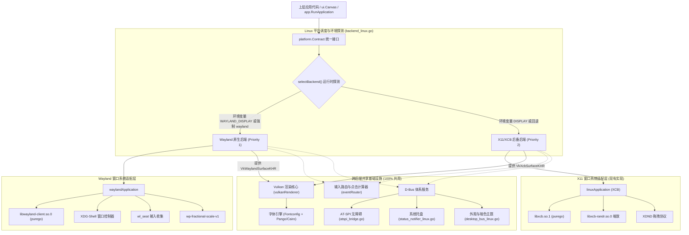
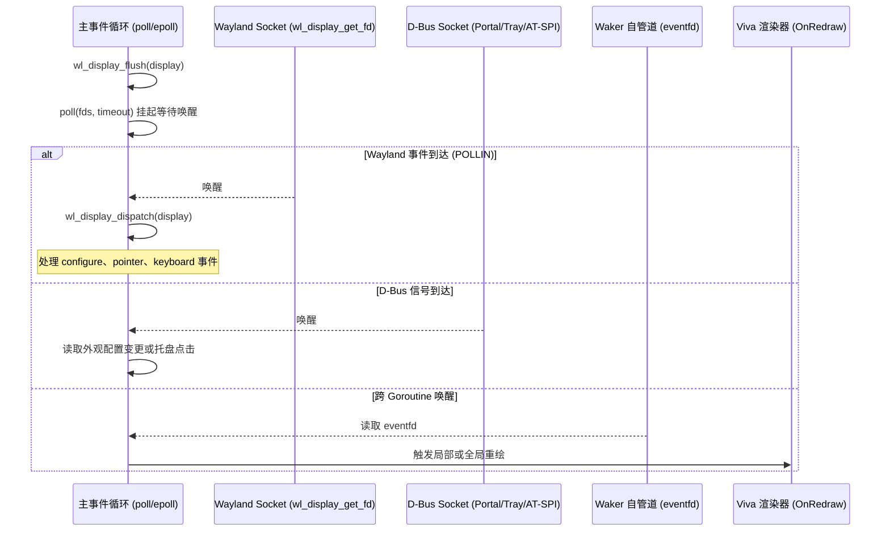
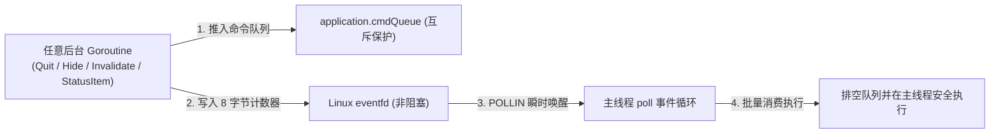

# Viva Linux 现代化架构总览：Wayland-First 与多后端调度机制

## 1. 架构目标与设计原则

Viva 在 Linux 平台的核心目标是提供一个高性能、零撕裂、低能耗、小体积的现代 GUI 运行时。为了彻底甩脱 X11 的历史包袱，同时兼顾老旧生产环境的连续性，Linux 后端采用 **“Wayland 原生优先，X11 弹性后备（Wayland-First, X11-as-Fallback）”** 的多后端双轨分层架构。

### 核心原则
1. **优先现代（Wayland-First）**：默认且优先检测现代 Wayland 会话，享受原子状态提交、无黑白闪烁过渡和硬件级显式同步；
2. **安全后备（X11-Fallback）**：在仅有纯 X11 环境（如老旧嵌入式、部分容器或轻量级 WM）下，自动无缝降级到现有的 XCB 管线；
3. **零编译期 C 依赖（Zero CGO / PureGo-Only）**：严格保持 Viva 的二进制纯粹性，无论是 Wayland 还是 X11，均通过 `purego` 运行时动态绑定底层共享库，支持纯 Go 交叉编译；
4. **最大化核心复用（Maximum Core Reuse）**：Vulkan 渲染命令管线、保留式场景比对、文本测量与 D-Bus 子系统在两套后端之间完全复用。

---

## 2. 总体架构分层图



---

## 3. 后端探测与调度机制

### 3.1 探测优先级规范

运行入口位于 [`app/backend_linux.go`](file:///Volumes/HIKSEMI/code/viva/app/backend_linux.go)。当 `app.RunApplication` 启动时，调用底层探测调度器 `selectBackend()`：

1. **显式环境变量覆盖（Override Check）**：
   - 若设置了 `VIVA_LINUX_BACKEND=wayland`，强制只初始化 Wayland 后端；失败则报错退出，不静默回退。
   - 若设置了 `VIVA_LINUX_BACKEND=x11`，直接跳过 Wayland 探测，强制使用 XCB 后端。
2. **Wayland 会话自适应探测（Wayland Probing）**：
   - 检查环境变量 `os.Getenv("WAYLAND_DISPLAY")`；
   - 检查 `os.Getenv("XDG_RUNTIME_DIR")` 下是否存在 Wayland 通信 Socket（默认为 `wayland-0`）；
   - 尝试通过 `purego.Dlopen("libwayland-client.so.0")` 加载 Wayland 客户端库并尝试建立连接 `wl_display_connect(nil)`；
   - 若上述均成功，选定 **Wayland 原生通道**。
3. **X11 弹性后备（Fallback to X11）**：
   - 若 Wayland 探测失败或未检测到环境，检测 `os.Getenv("DISPLAY")`；
   - 尝试通过 `loadXCB()` 初始化 XCB 连接；
   - 若成功，选定 **X11 后备通道**。
4. **无可用图形后端（No Display Failure）**：
   - 若两者均不可用，返回符合平台规范的 [`platform.ErrNoGraphics`](file:///Volumes/HIKSEMI/code/viva/internal/platform/contract.go#L164) 错误。

### 3.2 伪代码实现契约

```go
// internal/platform/linux/backend_select.go

type platformBackend interface {
    OpenWindow(config platform.Config) (platform.Window, error)
    AddStatusItem(config platform.StatusItemConfig) (platform.StatusItem, error)
    Quit()
    Run(start platform.ApplicationStart) error
}

func selectBackend() (platformBackend, error) {
    target := os.Getenv("VIVA_LINUX_BACKEND")
    
    // 1. 尝试 Wayland
    if target != "x11" {
        if waylandApp, err := newWaylandApplication(); err == nil {
            return waylandApp, nil
        } else if target == "wayland" {
            return nil, fmt.Errorf("linux: forced Wayland backend failed: %w", err)
        }
    }
    
    // 2. 尝试 X11 后备
    if x11App, err := newX11Application(); err == nil {
        return x11App, nil
    }
    
    return nil, platform.ErrNoGraphics
}
```

---

## 4. 统一的事件循环与异步 I/O 模型

无论是 Wayland 还是 X11，核心事件循环统一基于 Linux 内核的 `epoll` / `poll` 机制，实现统一的单线程主循环驱动：



### 关键设计优势
1. **完全零额外 Goroutine 轮询**：所有外部输入（Wayland、D-Bus、跨协程 Waker）全部转化为文件描述符注册在同一个 `pollFD` 集合中；
2. **线程独占安全（Thread Affinity）**：严格保持 `runtime.LockOSThread()`，所有直接操作 Wayland 代理、Vulkan 交换链与系统调用的逻辑都在同一个宿主线程上串行完成，杜绝多线程竞争与死锁。

### 4.1 跨 Goroutine 命令总线与 eventfd 唤醒管道

在 X11 下，Viva 依赖 `postClientMessage` 向每一个窗口的 X11 Socket 广播自定义客户端消息（参见 [`status_item_linux.go:216-223`](file:///Volumes/HIKSEMI/code/viva/internal/platform/linux/status_item_linux.go#L216-L223)），且必须防止“单个窗口在读取前关闭导致命令遗失”。

然而，**Wayland 协议在物理规范上不支持客户端向自己的 Socket 发送自定义事件（无 `send_event` 等价机制）**。

因此，Wayland 原生架构采用 Linux 内核级 **`eventfd` 集中式命令管道**：



#### 关键实现契约
1. **管道初始化**：
   - 应用程序初始化时创建应用级非阻塞描述符：
     ```go
     wakeFD, err := unix.Eventfd(0, unix.EFD_CLOEXEC|unix.EFD_NONBLOCK)
     ```
   - 将 `wakeFD` 以 `POLLIN` 标志常驻注册进主循环的 `pollFDs` 数组中。
2. **命令入队与唤醒**：
   - 任何后台协程调用跨线程操作时：
     ```go
     func (app *waylandApplication) post(cmd applicationCommand) {
         app.cmdMu.Lock()
         app.cmdQueue = append(app.cmdQueue, cmd)
         app.cmdMu.Unlock()
         
         // 写入 8 字节唤醒信号，瞬时打破主线程 poll 挂起
         var val [8]byte
         binary.NativeEndian.PutUint64(val[:], 1)
         unix.Write(app.wakeFD, val[:])
     }
     ```
3. **主线程排空执行**：
   - 主事件循环检测到 `wakeFD` 就绪时，读取清空计数器，锁定并 `take` 消费全部待决指令，在线程安全保障下执行窗口关闭、显隐或渲染刷新。
4. **核心优势**：
   - **解耦窗口生命周期**：即使当前无任何可见窗口（例如应用仅在系统托盘运行），`Quit()` 或配置变更依然 100% 可达，彻底根治 X11 下“窗口关闭导致命令丢包”的隐患；
   - **微秒级低延迟**：内核级 `eventfd` 零 IPC 往返开销，唤醒耗时在微秒级。


---

## 5. 跨后端公共抽象边界

为了防止代码膨胀与重复，对模块边界做清晰界定：

| 模块类别 | 属于 Wayland 专属 | 属于 X11 专属 | 跨后端 100% 共享 |
| :--- | :---: | :---: | :---: |
| **窗口连接与消息分发** | `libwayland-client` 封装 | `libxcb` 封装 | - |
| **几何拓扑与窗口模式** | `xdg-shell` 协议处理 | EWMH / ICCCM 属性 | `platform.Config` / `platform.Window` |
| **GPU 渲染管线** | `VK_KHR_wayland_surface` | `VK_KHR_xcb_surface` | **Instanced Rectangles、着色器、文字、裁剪** |
| **输入事件路由** | `wl_pointer` / `wl_keyboard` | `xcbInputEvent` 解码 | **`eventRouter`、点击计数、焦点状态** |
| **高分屏与缩放** | `wp-fractional-scale-v1` | `libxcb-randr` 探测 | **`ui.Point` / 逻辑像素坐标系统** |
| **系统桌面集成** | - | - | **AT-SPI 无障碍、D-Bus 托盘、Portal 外观** |
