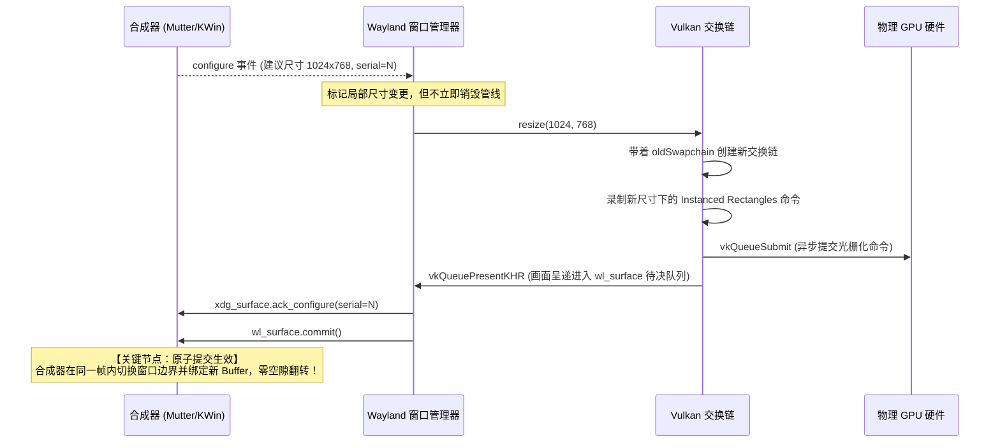

# Viva Linux Vulkan 渲染与表面解耦架构设计

## 1. 现状剖析与解耦必要性

在现有的 [`internal/platform/linux/vulkan_linux.go`](file:///Volumes/HIKSEMI/code/viva/internal/platform/linux/vulkan_linux.go) 中，Vulkan 渲染器虽然承担着完整的 UI 栅格化、文字绘制与实例渲染职责，但在初始化逻辑中存在硬编码耦合：

```go
// vulkan_linux.go 现状（硬编码 XCB 表面扩展）
func (renderer *vulkanRenderer) initialize(connection uintptr, window uint32) error {
    surfaceExtension := append([]byte("VK_KHR_surface"), 0)
    xcbExtension := append([]byte("VK_KHR_xcb_surface"), 0)
    ...
    surfaceInfo := vkXcbSurfaceCreateInfo{
        SType: vkStructureXcbSurfaceCreateInfo,
        Connection: connection,
        Window: window,
    }
    if err := renderer.api.createXcbSurface(renderer.instance, &surfaceInfo, nil, &renderer.surface); err != nil {
        return err
    }
    ...
}
```

除此表面初始化之外，`vulkanRenderer` 内部的其它子模块：
- **场景几何渲染**：[`scene.upload`](file:///Volumes/HIKSEMI/code/viva/internal/platform/linux/vulkan_linux.go#L532) 与实例缓冲区（Rectangle Batches）；
- **着色器与管线**：内置的 SPIR-V Rectangle Pipeline；
- **文字光栅化**：[`renderer.text.update`](file:///Volumes/HIKSEMI/code/viva/internal/platform/linux/vulkan_linux.go#L498) 与 Pango/Cairo 纹理合流；
- **动态裁剪**：Scissor 状态更新与分层合成（Compositing Layers）；

**均完全依赖通用的 `VkSurfaceKHR` 句柄，与具体的显示服务器协议毫无耦合**。

因此，实施 Wayland 支持的第一步，是实现 **表面提供者抽象（Surface Provider Pattern）**。

---

## 2. 表面提供者架构设计（Vulkan Surface Provider）

### 2.1 抽象接口契约

定义跨后端的通用接口 `vulkanSurfaceProvider`：

```go
// internal/platform/linux/vulkan_surface.go

type vulkanSurfaceProvider interface {
    // RequiredExtensions 返回创建该表面所必须的 Vulkan 实例扩展
    RequiredExtensions() []*byte
    
    // CreateSurface 在给定的 VkInstance 下创建通用的 VkSurfaceKHR 句柄
    CreateSurface(api *vulkanAPI, instance uintptr) (uintptr, error)
    
    // DestroySurface 释放由该 Provider 创建的附加资源（若有）
    DestroySurface(api *vulkanAPI, instance uintptr, surface uintptr)
}
```

### 2.2 Wayland 表面提供者实现

根据 Vulkan 规范，Wayland 平台依赖 `VK_KHR_wayland_surface` 扩展，其 C 结构体布局为：

```c
typedef struct VkWaylandSurfaceCreateInfoKHR {
    VkStructureType                sType; // VK_STRUCTURE_TYPE_WAYLAND_SURFACE_CREATE_INFO_KHR (1000006000)
    const void*                    pNext;
    VkWaylandSurfaceCreateFlagsKHR flags;
    struct wl_display*             display;
    struct wl_surface*             surface;
} VkWaylandSurfaceCreateInfoKHR;
```

对应的 Go 语言 ABI 定义与 PureGo 动态绑定：

```go
// internal/platform/linux/vulkan_wayland_surface.go

const (
    vkStructureWaylandSurfaceCreateInfo uint32 = 1000006000
)

type vkWaylandSurfaceCreateInfo struct {
    SType   uint32
    _       uint32 // 64位对齐填充
    Next    unsafe.Pointer
    Flags   uint32
    _       uint32 // 64位对齐填充
    Display uintptr
    Surface uintptr
}

type waylandSurfaceProvider struct {
    display uintptr // *wl_display
    surface uintptr // *wl_surface
}

func newWaylandSurfaceProvider(display, surface uintptr) *waylandSurfaceProvider {
    return &waylandSurfaceProvider{display: display, surface: surface}
}

func (p *waylandSurfaceProvider) RequiredExtensions() []*byte {
    return []*byte{
        &vkExtensionSurface[0],        // "VK_KHR_surface\x00"
        &vkExtensionWaylandSurface[0], // "VK_KHR_wayland_surface\x00"
    }
}

func (p *waylandSurfaceProvider) CreateSurface(api *vulkanAPI, instance uintptr) (uintptr, error) {
    var createWaylandSurface func(uintptr, *vkWaylandSurfaceCreateInfo, unsafe.Pointer, *uintptr) int32
    purego.RegisterLibFunc(&createWaylandSurface, api.library, "vkCreateWaylandSurfaceKHR")
    
    info := vkWaylandSurfaceCreateInfo{
        SType:   vkStructureWaylandSurfaceCreateInfo,
        Display: p.display,
        Surface: p.surface,
    }
    var surface uintptr
    if err := vkCheck(createWaylandSurface(instance, &info, nil, &surface), "create Wayland surface"); err != nil {
        return 0, err
    }
    return surface, nil
}
```

### 2.3 Wayland 表面物理属性协商规范（Surface Capabilities）

在调用 `createSwapchain()` 时，Wayland 表面的物理特征与 X11 存在显著差异，必须按如下规范统一收敛：

1. **尺寸完全由客户端决断（CurrentExtent == 0xFFFFFFFF）**：
   - 在 X11 下，驱动通常回传窗口当前的实际像素尺寸；
   - 在 Wayland 规范中，`capabilities.Current.Width` 和 `Height` **恒等于 `0xFFFFFFFF` (`math.MaxUint32`)**，表示合成器并不强制指定物理像素，而是由客户端依据 XDG 配置建议与缩放比率自主决断；
   - 必须通过以下逻辑进行物理像素 Clamp 防御（已在 Viva 源码中验证完备）：
     ```go
     extent := capabilities.Current
     if extent.Width == math.MaxUint32 {
         extent.Width = clamp(renderer.width, capabilities.Minimum.Width, capabilities.Maximum.Width)
         extent.Height = clamp(renderer.height, capabilities.Minimum.Height, capabilities.Maximum.Height)
     }
     ```
2. **透明通道合成（CompositeAlpha 协商）**：
   - 标准窗口：优先选用 `VK_COMPOSITE_ALPHA_OPAQUE_BIT_KHR`；
   - 自定义标题栏与圆角阴影外边距（`WindowCustomTitlebar`）：
     - 必须检测 `capabilities.CompositeAlpha & VK_COMPOSITE_ALPHA_PRE_MULTIPLIED_BIT_KHR != 0`；
     - 若支持，启用预乘透明（Pre-multiplied Alpha），允许着色器在 Margin 区域绘制柔和抗锯齿阴影，直接与桌面背景透明混合；
3. **三缓冲图像计数（MinImages）**：
   - 为确保 Mailbox 模式下永远有一块空闲 Buffer 供 GPU 快速写入，图像数量设为 `imageCount = capabilities.MinImages + 1`；在满足 `MaxImages` 上限的前提下，优先保障 3 缓冲架构。


---

## 3. 终结频闪：Wayland 渲染呈现管道设计

### 3.1 状态原子提交（Atomic Commit & Double Buffering）

在 X11 下造成黑白屏交替闪烁的根本原因，是**尺寸改变与缓冲区呈递脱节**。
而在 Wayland 下，Vulkan 呈现链路与合成器状态严格绑定为一个原子操作：



> [!IMPORTANT]
> **无缝保障**：在 `wl_surface.commit()` 调用完成前，合成器会继续将上一任 Swapchain 留存的内容按比例平滑拉伸显示，绝对不会露出窗口背景底色或产生黑屏闪烁。

---

## 4. “只呈现最新一帧”：帧节流与过时帧舍弃

为满足用户提出的“只做最新的一帧渲染，不被历史中间事件拖垮”，结合 Wayland 协议与 Vulkan 呈现模式采取双重保障：

### 4.1 呈现模式：优先采用 `VK_PRESENT_MODE_MAILBOX_KHR`

- **传统 FIFO（现存问题）**：硬性队列阻塞。当应用画得快时，交换链缓冲区会被塞满，主线程卡在 `vkAcquireNextImageKHR` 或 `vkQueuePresentKHR` 上，导致处理尺寸事件时产生积压排队；
- **Mailbox 模式（推荐与首选）**：
  - 属于三缓冲（Triple-Buffering）无锁覆盖模式；
  - 当 CPU/GPU 绘制速度超过显示器刷新率（或在高速拖动 Slider/Splitter 时），新绘制好的帧会**原地替换掉队列中尚未上屏的旧帧**；
  - 显示器在 VSync 到来时，永远只拿走**最新完成的一帧**；
  - 彻底消除了画面撕裂，同时拥有接近零的输入延迟与抗事件风暴能力。

```go
// internal/platform/linux/vulkan_wayland.go
func (renderer *vulkanRenderer) choosePresentMode() uint32 {
    for _, mode := range renderer.supportedPresentModes {
        if mode == vkPresentModeMailbox { // 优先选用 Mailbox
            return vkPresentModeMailbox
        }
    }
    return vkPresentModeFifo // 兼容兜底
}
```

### 4.2 帧时钟驱动：`wl_surface.frame` 节流

为了不盲目占用 100% GPU 算力，重绘请求（`OnRedraw`）由合成器的 `wl_surface.frame` 回调驱动：

1. 每次渲染完成提交 `commit` 时，挂载一个 `wl_callback` 对象：
   ```go
   callback := wl_surface_frame(state.surface)
   wl_callback_add_listener(callback, &frameListener, state)
   ```
2. 当且仅当合成器确认当前帧已被合成上屏、并且准备好接收下一帧时，触发该回调；
3. 回调收到通知后，才允许向主循环注入下一次重绘信号。这种机制在操作系统级建立了完美的**反向背压（Backpressure）**，杜绝无节制的超额渲染。

---

## 5. 交换链安全重建与 `VK_SUBOPTIMAL_KHR` 处理

针对 [docs/linux-rendering-flicker-analysis.md#L174-L208](file:///Volumes/HIKSEMI/code/viva/docs/linux-rendering-flicker-analysis.md#L174-L208) 中暴露的交换链自毁缺陷，在 Wayland 适配层全面实行以下重构准则：

1. **严禁提前销毁旧链**：创建新链时，必须将当前 `renderer.swapchain` 传入 `VkSwapchainCreateInfoKHR.oldSwapchain`；新链建立成功后，再调用 `vkDestroySwapchainKHR` 释放旧句柄；
2. **正确理解 `VK_SUBOPTIMAL_KHR`**：
   - 在 Wayland 动态调整大小过程中，驱动返回 `VK_SUBOPTIMAL_KHR` 表示**“当前帧已经成功呈递，但建议重建”**；
   - 严禁在 `presentOnce` 内部因为收到 suboptimal 就同帧二次销毁重建；
   - 仅设置内部脏标记 `renderer.needsRecreate = true`，平滑交由下一个事件周期空闲时处理。

---

## 6. 渲染管道与表面验收清单（Acceptance Checklist）

在完成 Vulkan 表面解耦与渲染管道重构后，必须逐条满足以下验收要求：

### 6.1 静态与单元测试验收
- [x] **ABI 结构体大小对齐**：`unsafe.Sizeof(vkWaylandSurfaceCreateInfo{}) == 40` 字节（64位平台对齐严格无误）；
- [x] **接口实现完整性**：`xcbSurfaceProvider` 与 `waylandSurfaceProvider` 均完整实现 `vulkanSurfaceProvider` 接口；
- [x] **交换链重建时序**：单测验证在重建交换链时，旧链句柄正确传入 `oldSwapchain`，且 `destroySwapchain` 必须在 `createSwapchainWithOld` 成功之后执行；
- [x] **Suboptimal 幂等性**：单测模拟驱动返回 `VK_SUBOPTIMAL_KHR`，验证 `presentOnce` 不抛出错误，且当前帧不发生二次销毁。

### 6.2 动态呈现与视觉质量验收
- [x] **极速拖拽零黑白频闪**：在 Wayland 桌面下连续高频调整窗口尺寸，肉眼观察绝无黑/白底色闪现，画面平滑缩放；
- [x] **帧率与背压对齐**：使用帧率监控工具（如 MangoHud 或 Viva 内部性能计数器），当界面持续重绘时，刷新率严格稳定锁在显示器物理刷新率（如 60Hz/144Hz），GPU 算力不超额空转；
- [x] **内存稳定无泄漏**：进行 1000 次连续 Resize 操作后，观察进程显存（VRAM）与常驻内存（RSS）稳定无单调递增。

