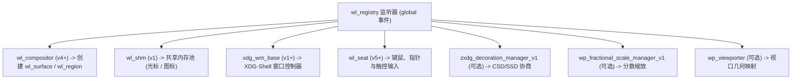
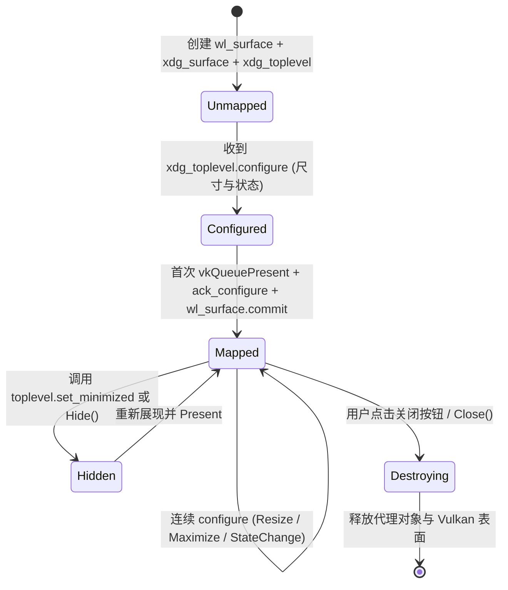
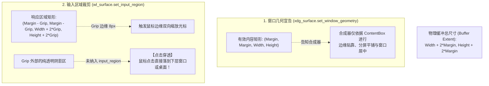

# Viva Linux Wayland 核心协议与窗口生命周期设计

## 1. Wayland 协议架构与 PureGo 契约

Wayland 客户端与合成器（Compositor）之间通过 UNIX Domain Socket 传输二进制协议报文。
为了严格坚守 Viva **“零 CGO、小体积、无编译期 gcc 依赖”** 的工程铁律，Wayland 适配层通过 `github.com/ebitengine/purego` 动态加载系统标配的动态库 `libwayland-client.so.0`。

### 1.1 动态库导出函数绑定表

```go
// internal/platform/linux/wayland_client.go

type waylandAPI struct {
    library uintptr

    // 核心连接与事件循环
    displayConnect       func(name *byte) uintptr
    displayDisconnect    func(display uintptr)
    displayGetFd         func(display uintptr) int32
    displayDispatch      func(display uintptr) int32
    displayDispatchPending func(display uintptr) int32
    displayFlush         func(display uintptr) int32
    displayRoundtrip     func(display uintptr) int32

    // 代理与协议交互 (Proxy Marshaling)
    proxyMarshalFlags    func(proxy uintptr, opcode uint32, interfacePtr uintptr, version uint32, flags uint32, args ...uintptr) uintptr
    proxyAddListener     func(proxy uintptr, implementation uintptr, data unsafe.Pointer) int32
    proxyDestroy         func(proxy uintptr)
}
```

### 1.2 监听器函数蹦床与内存生命周期锁死（GC Pinning）

Wayland C 客户端 API 通过结构体函数指针（Listener）回调事件，其 C 语言签名格式如下：
```c
struct wl_surface_listener {
    void (*enter)(void *data, struct wl_surface *wl_surface, struct wl_output *output);
    void (*leave)(void *data, struct wl_surface *wl_surface, struct wl_output *output);
};
```

在纯 Go 环境下，利用 `purego.NewCallback` 将 Go 闭包转化为 C 兼容的机器码跳板（Trampoline），但存在**内存移动与 GC 回收的重大安全隐患**。为此制定以下安全契约：

1. **Listener 结构体持久化**：
   - 监听器结构体（包含各个回调的 `uintptr` 函数指针）必须声明为**包级静态全局变量（位于只读或静态 BSS 段）**，或必须使用 Go 1.21+ 的 **`runtime.Pinner.Pin(&listener)`** 进行常驻内存锁死，严禁直接在临时栈帧上传递局部变量指针给 C；
2. **上下文指针（User Data）安全传递**：
   - `proxyAddListener(proxy, &listener, userData)` 中的 `userData` 若指向 Go 堆结构体（如 `*waylandWindowState`），必须同步通过 `pinner.Pin(state)` 进行锁定，直至窗口释放（`Close()`）调用 `pinner.Unpin()` 为止，从根本上防止 C 回调触发段错误（SIGSEGV）。

### 1.3 扩展协议的纯 Go `wl_interface` 描述表构建

与核心协议（如 `wl_compositor`，其 `wl_interface` 直接由 `libwayland-client.so.0` 导出）不同，**`xdg_wm_base`、`zxdg_decoration_manager_v1`、`wp_fractional_scale_manager_v1` 等扩展协议在系统动态库中并无导出符号**。

在纯 Go（无 CGO）下，Viva 在内部静态声明符合 C ABI 的 `wl_interface` 与 `wl_message` 元数据结构：

```go
// internal/platform/linux/wayland_abi.go

type wlMessage struct {
    Name      *byte          // 方法/事件名称（如 "ping\x00"）
    Signature *byte          // 参数类型签名（如 "u\x00", "i\x00", "s\x00", "?o\x00"）
    Types     **wlInterface  // 关联接口类型指针数组
}

type wlInterface struct {
    Name        *byte        // 接口名称（如 "xdg_wm_base\x00"）
    Version     int32        // 接口支持版本
    MethodCount int32        // 请求方法数量
    Methods     *wlMessage   // 请求方法元数据数组
    EventCount  int32        // 事件数量
    Events      *wlMessage   // 事件元数据数组
}

// 静态定义的 xdg_wm_base 接口描述符，用于传给 wl_registry.bind
var xdgWmBaseInterface = wlInterface{
    Name:        &xdgWmBaseName[0], // "xdg_wm_base\x00"
    Version:     1,
    MethodCount: 4, // destroy, create_positioner, get_xdg_surface, pong
    Methods:     &xdgWmBaseRequests[0],
    EventCount:  1, // ping
    Events:      &xdgWmBaseEvents[0],
}
```
通过在 Go 内部直接静态组装这些 ABI 结构体，Viva 彻底免去了安装外部 `wayland-scanner` 工具链的强制依赖。


---

## 2. 全局对象注册表（Registry Binding）

当建立连接后，首先监听 `wl_registry`，绑定当前桌面环境支持的核心全局协议对象：



### 必需的全局对象接口清单

| 全局接口名称 | 目标协议版本 | 用途说明 |
| :--- | :---: | :--- |
| **`wl_compositor`** | $\ge 4$ | 创建顶层物理表面 `wl_surface` 与不透明裁剪区域 `wl_region` |
| **`xdg_wm_base`** | $\ge 1$ | 现代桌面基础窗口生命周期规范（XDG-Shell） |
| **`wl_seat`** | $\ge 5$ | 硬件输入设备聚合接口（分配 `wl_pointer`、`wl_keyboard`） |
| **`wl_shm`** | $\ge 1$ | 共享内存接口，用于光标图标（Cursor）呈现 |
| **`zxdg_decoration_manager_v1`** | $\ge 1$ | 协商服务端装饰（SSD）或客户端装饰（CSD） |
| **`wp_fractional_scale_manager_v1`** | $\ge 1$ | 接收浮点或分数显示器缩放比例 |

---

## 3. XDG-Shell 窗口生命周期与状态机

在 Wayland 下，窗口必须依循规范严格的 XDG-Shell 状态机，完成“创建 $\to$ 协商 $\to$ 呈递”三部曲：



### 3.1 尺寸变更协商（`ack_configure` 机制）

当用户调整窗口大小时，合成器会发送 `xdg_toplevel.configure` 事件：
1. **参数解析**：
   - `width, height`：合成器建议的逻辑尺寸（若为 0，表示由客户端自由决定）；
   - `states`：32 位状态位数组，包含 `MAXIMIZED`、`FULLSCREEN`、`RESIZING`、`ACTIVATED`；
2. **序列号留存（Serial Stashing）**：
   - 随附的 `xdg_surface.configure(serial)` 携带关键递增编号 `serial`；
   - 客户端必须在呈递该尺寸画面后，**调用 `xdg_surface.ack_configure(serial)`** 向合成器确认该序列号已被采纳；
   - 若在高频拖拽中收到多个序列号，Viva 仅需对最终渲染的那一帧回复最新的 `serial`，合成器自动废弃中间过期配置。

---

## 4. 三种窗口模式（WindowMode）的精准映射

Viva 在 [`platform.Config`](file:///Volumes/HIKSEMI/code/viva/internal/platform/contract.go#L40) 中定义了三种窗口模式，在 Wayland 上的映射机制如下：

### 4.1 标准窗口（`platform.WindowTitled`）
- **装饰协商**：通过 `zxdg_decoration_manager_v1.get_toplevel_decoration(toplevel)` 创建装饰控制器；
- 调用 `set_mode(ZXDG_TOPLEVEL_DECORATION_V1_MODE_SERVER_SIDE)`；
- 若合成器支持（如 KDE KWin），系统将自动绘制原生标题栏、阴影和最小化/最大化/关闭按钮；
- 若合成器强制要求客户端自行绘制（如 GNOME 默认不支持 SSD），则自动回退并无缝进入客户端装饰渲染模式。

### 4.2 无边框窗口（`platform.WindowFrameless`）
- 显式声明要求客户端绘制装饰模式，并且在 Viva 侧设置外边距 Margin 为 0；
- 不声明任何系统阴影区域，窗口呈完全无边框状态。

### 4.3 自定义标题栏（`platform.WindowCustomTitlebar`）
- **客户端装饰（CSD）模式**：强制声明 `ZXDG_TOPLEVEL_DECORATION_V1_MODE_CLIENT_SIDE`；
- **交互区域接管（Interactive Move & Resize）**：
  - Viva 应用在上层定义标题栏拖动区与边缘缩放热区；
  - 当命中测试识别为拖拽区（`platform.PressTitlebar`）时，调用：
    ```go
    xdg_toplevel_move(toplevel, seat, serial)
    ```
  - 当命中测试识别为边缘缩放区（`platform.PressEdge...`）时，调用：
    ```go
    xdg_toplevel_resize(toplevel, seat, serial, edgeDirection)
    ```
  - 这种设计直接将拖拽物理算法移交由合成器原生执行，体验与系统原生窗口完全一致，丝滑顺畅。

### 4.4 自定义阴影几何与点击穿透规范（`set_window_geometry` & `input_region`）

Viva 自绘窗体（`WindowCustomTitlebar`）自带优雅的柔和阴影与圆角（基于 [`internal/platform/linux/window_frame.go`](file:///Volumes/HIKSEMI/code/viva/internal/platform/linux/window_frame.go)）。
在 X11 下，Viva 依赖 `_GTK_FRAME_EXTENTS` 和 XShape 协议；而在 Wayland 现代规范下，必须通过以下两大标准机制实现严格对齐：



#### 几何计算与参数对齐表（基于物理/设备像素）
- **外边距（Margin）**：$\text{margin} = \text{round}(24 \times \text{scale})$；
- **拖拽抓手（Grip）**：$\text{grip} = \text{round}(8 \times \text{scale})$；
- **窗口几何宣告**：
  ```go
  win.api.xdgSurfaceSetWindowGeometry(win.xdgSurface, int32(margin), int32(margin), int32(contentW), int32(contentH))
  ```
- **输入区域掩码（Input Region Mask）**：
  ```go
  // 创建仅覆盖 ContentBox + Grip 区域的 input_region
  region := win.api.compositorCreateRegion(win.compositor)
  win.api.regionAdd(region, int32(margin-grip), int32(margin-grip), uint32(contentW+2*grip), uint32(contentH+2*grip))
  win.api.surfaceSetInputRegion(win.surface, region)
  win.api.regionDestroy(region)
  ```
> [!IMPORTANT]
> 若缺失 `set_input_region`，窗口外围虽然视觉上是透明的阴影，但会无形拦截用户对下层应用或桌面快捷方式的鼠标点击，造成严重的“点击被虚空吞噬”缺陷。

### 4.5 最大化与全屏状态下的 Margin 动态剥离与恢复

当用户双击标题栏最大化、或调用全屏时，窗口必须贴满屏幕边缘，绝不能在全屏状态下还带有 24px 的半透明外边距。

在 Wayland 下实现**动态零闪烁剥离与恢复**状态机：

```mermaid
stateDiagram-v2
    Normal: 正常窗口态 (Margin = 24 * Scale)
    Maximized: 最大化 / 全屏态 (Margin = 0)
    
    Normal --> Maximized: configure 包含 MAXIMIZED / FULLSCREEN 状态
    Note over Maximized: 1. 将 win.margin 置为 0<br/>2. set_window_geometry(0, 0, W, H)<br/>3. set_input_region 覆盖全屏 W x H<br/>4. 重构交换链无缝贴满屏幕
    
    Maximized --> Normal: configure 移除 MAXIMIZED 状态
    Note over Normal: 1. 恢复 win.margin = 24 * Scale<br/>2. 重新挂载阴影与 Grip 穿透掩码<br/>3. 交换链恢复透明预乘混合
```

1. **监听 `xdg_toplevel.configure` 状态位**：
   - 检查 `states` 数组中是否包含 `XDG_TOPLEVEL_STATE_MAXIMIZED` 或 `FULLSCREEN`；
2. **状态原子切换**：
   - 若由“正常”进入“最大化”：
     - 将 `win.margin` 动态重置为 `0`；
     - 调整 Vulkan 交换链尺寸为纯视口物理分辨率；
     - 向合成器提交 `set_window_geometry(0, 0, width, height)`；
   - 若由“最大化”还原回“正常”：
     - 重新计算并赋予 `win.margin = frameMargin(win.scale)`；
     - 重设带 24px 偏移的 `set_window_geometry` 与 `set_input_region`；
3. **零闪烁保障**：这一尺寸与边距变化同样严格依附于 `recreateSwapchain` 与 `wl_surface.commit`，状态翻转与画面上屏完全在同一时刻原子生效，过渡丝滑平顺。


---

## 5. 多窗口与面板模型（Multi-Window & WindowPanel）

### 5.1 独立上下文原则
每个由 `Application.OpenWindow` 打开的独立窗口：
- 拥有专属的 `wl_surface`、`xdg_surface` 和 `xdg_toplevel` 代理句柄；
- 拥有独立绑定的 `VkSurfaceKHR` 和独立的 Vulkan 交换链；
- 共享同一个进程级 `wl_display` 连接与主事件循环。

### 5.2 状态栏浮动面板（`WindowPanel`）
Viva 支持从托盘点击弹出无边框浮动面板（[platform.Config.Anchor](file:///Volumes/HIKSEMI/code/viva/internal/platform/contract.go#L98)）。

### 5.3 托盘孤立面板（Parent-less WindowPanel）定位策略
在 Wayland 协议中，`xdg_popup` 强制要求必须依附于同一个客户端进程拥有的父级 `wl_surface`。然而，系统托盘图标（StatusNotifierItem）由桌面环境的外部面板进程（如 `gnome-shell` 或 `plasmashell`）托管，Viva 在托盘处并无父级 Surface，因此无法直接创建 `xdg_popup`。

为此，Viva 针对 Wayland 设计了专门的托盘孤立面板模型：
1. **轻量无边框独立顶层窗口（Frameless toplevel）**：
   - 将 `WindowPanel` 实例化为外边距 `Margin = 0` 且启用客户端装饰（CSD，但不绘制标题栏与阴影）的 `xdg_toplevel`；
2. **失焦自动隐退机制（Dismiss on Focus Lost）**：
   - 监听窗口的状态变更，当检测到窗口失去激活焦点（`states` 中的 `ACTIVATED` 位被合成器清除）时，自动触发 `panel.Hide()`；
   - 保证用户在桌面其它任意位置发生点击时，面板能够如原生菜单一般自然收起；
3. **分级协议适配**：
   - 在支持 `wlr-layer-shell-unstable-v1` 协议的平铺或轻量桌面（如 Hyprland / Sway），优先创建为 Layer Shell 顶层浮层；
   - 在标准桌面（GNOME / KDE）下，作为标准的轻量 `xdg_toplevel` 居中或按 D-Bus 传递的 Anchor 坐标就近呈现。

---

## 6. 协议与窗口生命周期验收清单（Acceptance Checklist）

在完成 PureGo Wayland 协议绑定与 XDG-Shell 窗口控制器后，必须逐条满足以下验收要求：

### 6.1 协议加载与连接验收
- [ ] **纯 Go 零 CGO 验证**：在未安装 `gcc` 的环境下，`CGO_ENABLED=0 go build ./...` 能够顺利编译通过；
- [ ] **系统库动态绑定安全**：在缺失 `libwayland-client.so.0` 的系统上，`newWaylandApplication` 返回清晰可辨识的错误，进程不崩溃；
- [ ] **Registry 发现覆盖率**：成功遍历系统 Globals，完整解析出 `wl_compositor`、`xdg_wm_base`、`wl_shm` 与 `wl_seat`。

### 6.2 窗口行为与状态机验收
- [ ] **序列号确认应答（ack_configure）**：截获协议包验证每个由合成器下发的有效 `serial` 都有对应的 `xdg_surface.ack_configure(serial)`；过时的中间序列号被安全丢弃；
- [ ] **三种窗口模式表现无误**：
  - `WindowTitled`：成功协商出服务端边框，或在无 SSD 支持的桌面（如 GNOME）下优雅回退至客户端阴影边框；
  - `WindowFrameless`：无任何多余系统边距与黑边，纯内容像素对齐；
  - `WindowCustomTitlebar`：标题栏区域按住可直接调用系统原生窗口拖拽；边缘按住可触发原生缩放；
- [ ] **窗口阴影几何与点击穿透验收**：
  - 调用 `set_window_geometry` 成功将内容矩形通告给合成器，窗口贴靠与居中均以内容为基准，无 24px 阴影偏移；
  - 调用 `set_input_region` 成功裁剪出 Grip 区域，鼠标在阴影外层点击能够 100% 穿透至底层窗口或桌面；
- [ ] **最大化 Margin 动态剥离与恢复**：
  - 窗口最大化时，`margin` 瞬时平滑归零，无半透明边框暴露，画面贴满屏幕；
  - 窗口还原时，`margin` 自动恢复至 `24 * scale`，阴影与点击穿透区域正确恢复；
- [ ] **最大化、全屏与还原**：

  - 调用 `toplevel.set_maximized` 与 `toplevel.unset_maximized` 状态迁移平稳，无错帧；
  - 监听 `OnMaximize` 回调能够精确感知窗口管理器的状态变更；
- [ ] **多窗口并发与退出契约**：
  - 同时开启 3 个独立窗口，关闭任意 2 个，剩余 1 个继续正常渲染交互；
  - 关闭最后一个窗口或调用 `Application.Quit()` 时，主事件循环顺畅退出，清理全部 socket 与内存对象。

