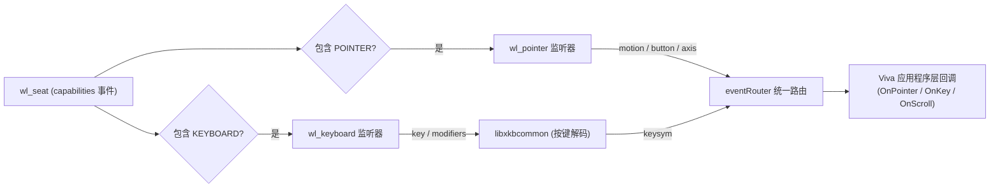
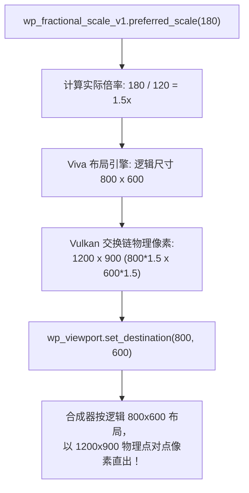
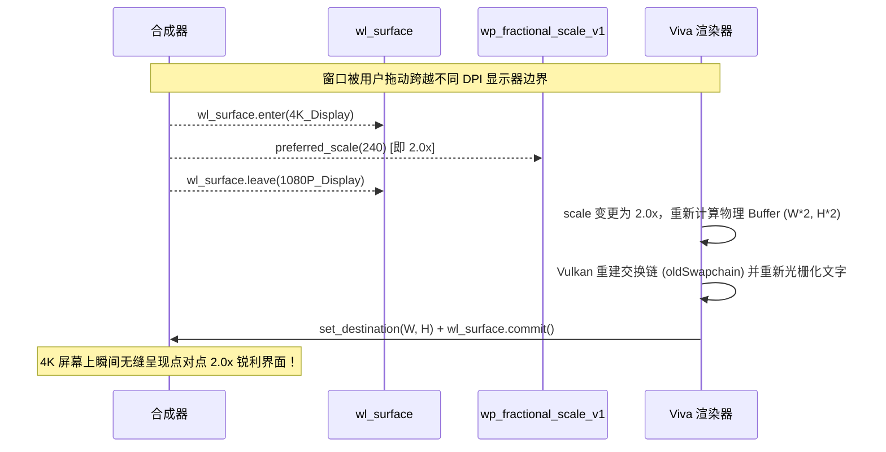

# Viva Linux Wayland 输入、分数缩放与桌面集成设计

## 1. 输入子系统架构（`wl_seat` 与 `eventRouter`）

Viva 拥有一套跨平台的事件路由核心 [`internal/platform/linux/input_linux.go`](file:///Volumes/HIKSEMI/code/viva/internal/platform/linux/input_linux.go)（`eventRouter`），负责将底层平台事件转换为统一的 `OnPointer`、`OnKey`、`OnScroll` 和 `OnClick`。
在 Wayland 下，物理输入设备通过 `wl_seat` 聚合管理。



### 1.1 指针事件（`wl_pointer`）
`wl_pointer` 协议提供细粒度的鼠标状态推送：
- **`enter` / `leave`**：捕获鼠标移入/移出窗口表面，记录当前表面焦点；
- **`motion`**：以 `wl_fixed_t`（24.8 定点数）提供亚像素级的相对表面坐标 $(x, y)$；
- **`button`**：按键动作（Linux 输入子系统标准按键码，如 `BTN_LEFT=0x110`、`BTN_RIGHT=0x111`），直接映射为 Viva 的 `ui.PointerButton`；
- **`axis` / `axis_discrete`**：滚轮与触控板滚动。对于高精度滚轮，支持 `axis_v120`（120 单位步进），带来类似 macOS 触控板的高帧率平滑滚动体验。

### 1.2 键盘事件与 XKB 解码（`wl_keyboard`）
1. **键盘映射文件描述符（Keymap FD）**：
   - 当连接建立时，合成器发送 `keymap` 事件，附带一个 `shm` 文件描述符及大小；
   - 动态加载 `libxkbcommon.so.0`（同样基于 `purego`），调用 `xkb_keymap_new_from_string` 解析当前系统的按键映射；
2. **修饰键状态（Modifiers）**：
   - 监听 `modifiers` 事件，同步更新 `Shift`、`Control`、`Alt`、`Super` 的全局状态；
3. **按键事件分发**：
   - 收到 `key` 事件时，调用 `xkb_state_key_get_one_sym` 得到 32 位 XKB 键符（Keysym）；
   - 该 Keysym 直接复用 Viva 已有的 [`keysym.go`](file:///Volumes/HIKSEMI/code/viva/internal/platform/linux/keysym.go) 与 [`keysym_unicode.go`](file:///Volumes/HIKSEMI/code/viva/internal/platform/linux/keysym_unicode.go) 进行字符解码与快捷键触发。

---

## 2. 现代高精度分数缩放（Fractional Scaling）

在高分屏（如 4K 屏幕、2K 笔记本）下，125%、150% 等非整数缩放倍率是 Linux 用户的日常需求。
X11 因缺乏多屏独立缩放与分数缩放协议，常年在高分屏下出现全屏模糊。

Wayland 原生解决方案由两个标准扩展协同完成：
1. **`wp_fractional_scale_v1`**：负责缩放比率协商；
2. **`wp_viewporter`**：负责视口与物理像素映射。

### 2.1 像素计算与映射模型



### 2.2 核心算法与代码规范

```go
// internal/platform/linux/wayland_scale.go

func (win *waylandWindow) handlePreferredScale(numerator uint32) {
    // 协议定义：以 120 为基准分母
    scale := float32(numerator) / 120.0
    if scale <= 0 {
        scale = 1.0
    }
    
    // 更新窗口状态
    win.scale = scale
    
    // 计算物理像素大小
    physW := uint32(math.Round(float64(win.logicalWidth * scale)))
    physH := uint32(math.Round(float64(win.logicalHeight * scale)))
    
    // 告知 Vulkan 交换链准备新尺寸
    win.renderer.resize(physW, physH)
    
    // 设置视口逻辑尺寸
    if win.viewport != 0 {
        win.api.viewportSetDestination(win.viewport, int32(win.logicalWidth), int32(win.logicalHeight))
    }
}
```

> [!TIP]
> 这种点对点渲染（Pixel-Perfect Rendering）让文字、矢量路径（DrawPath）与边框羽化完全按照实际物理点光栅化，**从根本上彻底消除了跨屏移动和分数缩放时的模糊与重采样失真**。

### 2.3 跨显示器动态迁移与多屏输出感知（`wl_surface.enter/leave` vs XRandR）

在 X11 下，Viva 必须通过 `xcb_translate_coordinates` 同步阻塞查询窗口绝对坐标，并与 XRandR 枚举的显示器拓扑做几何碰撞计算（参见 [`scale_x11_linux.go`](file:///Volumes/HIKSEMI/code/viva/internal/platform/linux/scale_x11_linux.go)），这不仅频繁挂起主事件循环，而且在跨屏拖动过程中极易因 IPC 延迟产生缩放闪烁与误判。

在 Wayland 下，多显示器感知彻底转为**合成器主导的纯异步事件推送模型**：



1. **多屏幕输出追踪**：
   - 监听 `wl_surface.enter(output)` 与 `wl_surface.leave(output)` 事件；
   - 窗口可维护当前所驻留的 `activeOutputs` 集合；
2. **缩放决策精准收敛**：
   - 现代合成器下：直接监听 `wp_fractional_scale_v1.preferred_scale`，合成器根据窗口在各屏幕的像素占比计算并下发最优推荐值，Viva 直接采纳；
   - 兼容老旧合成器：在没有 fractional scale 扩展时，读取 `activeOutputs` 中最高的 `output.scale`（整数倍），保证窗口在密度最高的屏幕上绝对不发虚；
3. **零 IPC 阻塞开销**：
   - 窗口拖动跨屏期间，Viva 内部**不产生任何同步阻塞 IPC 查询**，彻底告别 X11 下拖动跨屏时的主线程卡顿现象。


---

## 3. 剪贴板与原生拖放（Data Device）

Wayland 将剪贴板和拖放整合在 `wl_data_device_manager` 协议中：

### 3.1 剪贴板（Selection & Clipboard）
- **复制（Copy）**：
  - Viva 调用 `create_data_source`；
  - 声明支持的 MIME 类型（如 `text/plain;charset=utf-8`、`image/png`）；
  - 调用 `wl_data_device.set_selection(source, serial)`；
  - 当外部程序粘贴时，Wayland 会回调 `send` 事件，提供一个管道 FD，Viva 将数据写入管道即可。
- **粘贴（Paste）**：
  - 监听 `selection` 事件，检查 `wl_data_offer` 支持的 MIME 类型；
  - 创建管道并调用 `wl_data_offer.receive(mime, writeFd)`，从管道读取数据。

#### 3.1.1 异步非阻塞写管道机制（防止 UI 线程死锁）
当外部应用程序尝试向 Viva 获取剪贴板数据时，Wayland 会通过 `wl_data_source.send(mime, fd)` 提供一个 UNIX 写入管道描述符。
如果外部应用读取迟缓甚至异常挂起，若 Viva 在主线程中同步执行 `syscall.Write(fd, data)`，一旦数据量超过内核管道缓冲区（Linux 通常为 64KB），**将导致 Viva 主事件循环彻底阻塞挂死**！

为此，必须实施以下异步非阻塞写入契约：
1. **独立 Goroutine 写入**：主事件循环在收到 `send` 时，仅进行快照取数，将 `fd` 和字节流丢入独立的短生命周期 Goroutine 执行传输；
2. **自动关闭防泄漏**：写入任务使用 `defer syscall.Close(fd)`，在写入完毕或发生异常时立即关闭管道；
3. **主线程绝对零等待**：保证外部软件的卡顿绝对无法反向污染 Viva 界面渲染与响应。

### 3.2 拖放（Drag and Drop）
- 监听 `wl_data_device` 的 `enter`、`motion`、`leave`、`drop` 事件；
- 收到 `drop` 时，接收数据并触发应用层的 [`platform.Config.OnFileDrop`](file:///Volumes/HIKSEMI/code/viva/internal/platform/contract.go#L78) 回调。

---

## 4. 共享 D-Bus 基础设施与现代 IME 协同

### 4.1 现代输入法（IME）的多层级协同策略
对于中文、日文、韩文等复杂文字输入：
1. **第一层级（Wayland 原生标准）：`zwp_text_input_manager_v3`**
   - 向合成器汇报当前聚集文本框的光标绝对视口区域（Cursor Scissor Rectangle）；
   - 合成器自动驱动系统输入法候选窗口悬浮在光标正下方，彻底终结多屏幕混合缩放下的输入法候选框乱跳；
2. **第二层级（D-Bus 直连）：IBus Direct 与 Fcitx5**
   - 若合成器不支持 text-input-v3 扩展（如某些轻量平铺桌面），自动无缝平移复用 Viva 已有的 D-Bus 桥接器（[`internal/platform/linux/ime_linux.go`](file:///Volumes/HIKSEMI/code/viva/internal/platform/linux/ime_linux.go)），确保输入法在任何环境均可呼出。

### 4.2 现有 D-Bus 基础设施 100% 无缝复用
令人欣喜的是，Viva 现有 Linux 后端在桌面集成上的大部分高级特性是基于 **D-Bus** 编写的，它们与 X11/Wayland 协议本身无关，可以 **100% 直接复用**：


| 特性模块 | 现有源码位置 | 桥接方式与状态 |
| :--- | :--- | :--- |
| **无障碍语义树（AT-SPI）** | [`atspi_bridge.go`](file:///Volumes/HIKSEMI/code/viva/internal/platform/linux/atspi_bridge.go) | 100% 复用，通过 Session Bus 直接向屏幕阅读器发布树状变更 |
| **系统托盘图标（StatusItem）** | [`status_notifier_linux.go`](file:///Volumes/HIKSEMI/code/viva/internal/platform/linux/) | 100% 复用，基于 `org.kde.StatusNotifierItem` 规范，Wayland 首选 |
| **暗色模式与系统主题** | [`desktop_bus_linux.go`](file:///Volumes/HIKSEMI/code/viva/internal/platform/linux/desktop_bus_linux.go) | 100% 复用，监听 XDG Desktop Portal `org.freedesktop.portal.Settings` |
| **系统凭证保险箱（Secrets）** | [`portal_unix.go`](file:///Volumes/HIKSEMI/code/viva/internal/platform/linux/portal_unix.go) | 100% 复用，调用 FreeDesktop Secret Service / Portal |
| **系统光标管理** | [`cursor_linux.go`](file:///Volumes/HIKSEMI/code/viva/internal/platform/linux/cursor_linux.go) | 从 XCB-Cursor 替换为 `libwayland-cursor`，加载系统图标并通过 `wl_pointer.set_cursor` 绑定 |
| **现代输入法（IME）** | [`ime_linux.go`](file:///Volumes/HIKSEMI/code/viva/internal/platform/linux/ime_linux.go) | 优先接入 `zwp_text_input_v3`，并保留现有 IBus D-Bus 直连通道 |

---

## 5. 输入、缩放与桌面集成验收清单（Acceptance Checklist）

在完成输入设备监听、分数缩放视口绑定与桌面集成后，必须逐条满足以下验收要求：

### 5.1 指针与按键验收
- [ ] **高精度亚像素指针映射**：鼠标在逻辑坐标系统中的位置与界面元素命中区域绝对一致，无偏移；
- [ ] **平滑滚动体验**：支持高精度触控板平滑滚动（`axis_v120`）；单次滚动步长与系统原生应用体感一致；
- [ ] **键盘 XKB 映射精确性**：标准按键、修饰键（Shift/Ctrl/Alt/Super）、功能键（F1-F12）、方向键与退格键均能正确解码；
- [ ] **输入法（IME）光标跟随**：当焦点处于文本输入框时，输入法候选框精确悬浮在光标插入点下方。

### 5.2 现代分数缩放验收
- [ ] **多倍率渲染测试**：分别在 1.0x、1.25x、1.5x、1.75x、2.0x 缩放下启动应用；
  - 观察文本与图标：完全点对点物理光栅化，**绝对无双线性模糊或重采样虚影**；
  - 视口尺寸：`wp_viewport.set_destination` 严格与逻辑窗口尺寸相等。
- [ ] **跨多显示器拖拽切换**：将窗口从 1.0x 显示器拖动到 2.0x 4K 显示器：
  - 合成器下发新的 `preferred_scale` 时，窗口平滑过渡并切换至新清晰度，无卡死或跳变。

### 5.3 桌面集成能力验收
- [ ] **无障碍（AT-SPI）读屏**：启动 Orca 屏幕阅读器，焦点切换时能够准确朗读按钮标题与输入框文本；
- [ ] **系统托盘（StatusItem）**：在 KDE / GNOME 托盘区域正常出现图标；右键弹出菜单，左键激活事件；
- [ ] **暗色主题自适应感知**：在系统设置中切换“深色/浅色”主题，Viva 应用在 $\le 100\text{ms}$ 内收到 Portal 信号并自动刷新界面色彩。

