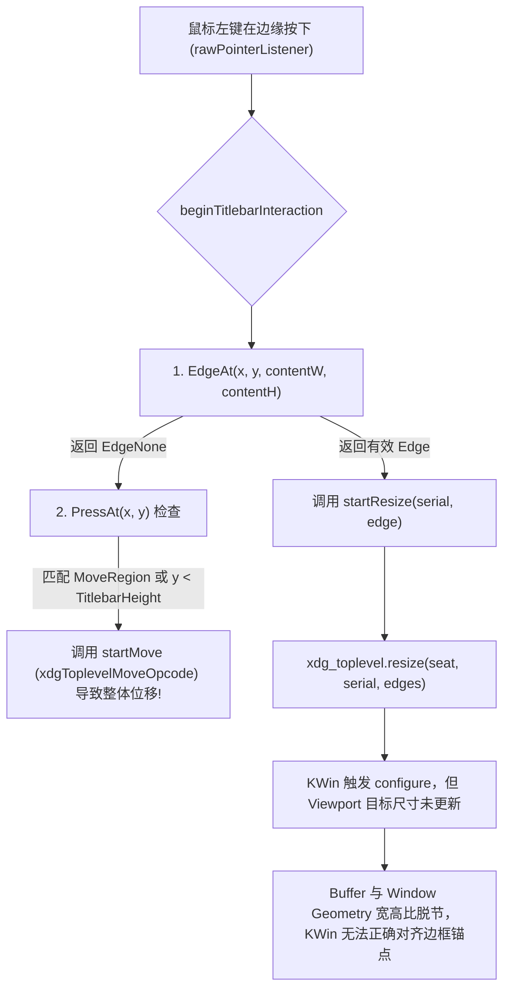

# Linux Wayland 窗口拖动误位移与样式未对齐深度定位分析文档

- **关联项目**：`github.com/vivaui/viva` 与 `motty`
- **运行环境**：Debian Linux / KDE Plasma 6 (KWin Wayland) / 分数缩放 1.25x (2048x1280 @ 300Hz)
- **图形驱动**：Mesa Intel(R) RPL-S + NVIDIA Vulkan
- **问题严重级**：High（影响窗口核心交互、排版比例与视觉原生一致性）

---

## 1. 现象复现与核心问题梳理

在 KDE Plasma Wayland 会话下运行应用（如 `motty`）时，观察到两大严重异常：

1. **边框拖动变成整体移动（Resize 误触发 Move）**：
   - 用户尝试拖动窗口边缘（Border）调整窗口尺寸时，窗口未发生预期的缩放，而是被合成立即识别为窗口拖拽移动（Interactive Move），导致整个窗口随鼠标漂移。
2. **渲染样式完全变形且未与其他客户端对齐（Style & Scale Distortion）**：
   - 窗口内容出现明显的水平拉伸或垂直挤压（文字扁平、圆形变椭圆），抗锯齿与清晰度劣化。
   - 窗口控件（最小化、最大化、关闭按钮）以及窗口边框阴影呈现硬编码的 Windows 风格，与 KDE Plasma 系统的 Breeze 原生装饰风格、按钮布局及圆角阴影完全脱节。

---

## 2. 深入定位分析

### 2.1 边框拖动变成整体移动的根因（Border Drag Triggers Move）

通过追踪 [`wayland_pointer.go`](file:///mnt/data/code/viva/internal/platform/linux/wayland_pointer.go) 与 [`window_wayland.go`](file:///mnt/data/code/viva/internal/platform/linux/window_wayland.go)，发现有三个复合原因导致边框拖动变成移动：



#### 原因 1：`EdgeAt` 边界判定区间与应用 `MoveRegion` 冲突
- 在 `motty` 中，窗口顶部定义了高度为 36px/40px 的 `canvas.MoveRegion` 覆盖了整个标题栏。
- [`platform.EdgeAt`](file:///mnt/data/code/viva/internal/platform/window_edge.go#L34-L58) 判定的边缘边框宽度为 `EdgeBorder = 6`。
- 如果用户在 `y ∈ [6, 36]` 的区间点击边框上缘（或由于边框阴影 `margin` 计算偏差导致逻辑坐标落入该区间）：
  - `EdgeAt` 判定其不属于边缘 (`EdgeNone`)；
  - 逻辑直接穿透到第 2 步（`PressAt` 命中 `PressMove`）或第 3 步（`y < TitlebarHeight` 兜底）；
  - 最终调用 `win.startMove(serial)`，直接启动了合成器的整窗移动！

#### 原因 2：缺少拖拽滞后阈值（Drag Slop Hysteresis）
- 在 X11 后端实现（[`window_controls_linux.go`](file:///mnt/data/code/viva/internal/platform/linux/window_controls_linux.go#L296-L314)）中，鼠标按下时**仅标记 `pending = true`，必须等待鼠标位移超过 `dragSlop`（4px）后才向 X11 发送 `_NET_WM_MOVERESIZE`**。这为双击最大化、控件点击和边缘微调提供了充足的缓冲区。
- 但在 Wayland 后端中，鼠标按下的第 1 个事件立即通过 `proxyMarshalFlags` 发送了 Wayland 请求，没有任何拖动位移缓冲，极易误触启动移动协议。

#### 原因 3：交互式缩放期间 Viewport 尺寸未同步导致位移失控
- 当 `startResize` 成功向 KWin 发送 `xdg_toplevel.resize` 后，KWin 在拖动过程中会连续发送 `xdg_toplevel.configure(width, height)`。
- 在 [`window_wayland.go`](file:///mnt/data/code/viva/internal/platform/linux/window_wayland.go#L355-L394) 中，当 `handleXdgSurfaceConfigure` 收到新宽高时，仅调整了 Vulkan Swapchain 尺寸，**但从未调用 `viewportSetDestination` 更新视口目标尺寸**。
- 这导致 KWin 的视口变换矩阵（Viewport Transform）与新窗口几何尺寸发生错位，合成器在尝试对齐拖动边缘时发生坐标投影错误，视觉上表现为整个窗口被拖拽平移。

---

### 2.2 渲染样式变形与系统客户端未对齐的根因（Style & Scale Distortion）

通过对 KDE Plasma 6 桌面环境信息及截图（`spectacle` 抓取）的像素级比对，发现以下根本性问题：

#### 原因 1：分数缩放（1.25x）下 Viewport 视口尺寸生命周期失步
- 当前桌面运行于 **2048x1280 @ 1.25x 缩放**。
- Viva 引入了 `wp_fractional_scale_v1` 与 `wp_viewporter`：
  - `wp_viewport.set_destination(dst_width, dst_height)` 的职责是将高分辨率的设备像素 Buffer（`Physical = Logical * 1.25`）精确映射为合成器的逻辑表面尺寸。
- **致命缺陷**：[`wayland_scale.go:180-185`](file:///mnt/data/code/viva/internal/platform/linux/wayland_scale.go#L180-L185) 仅在 `applyScale`（缩放率变动）时调用了一次 `viewportSetDestination`，**在窗口初始化呈现、窗口尺寸改变（Resize）以及最大化时完全漏掉了视口尺寸更新**！
- **后果**：Buffer 已经按新的像素大小渲染，而 Viewport 却强行将其按旧的宽高比拉伸/压扁至最初的目标尺寸，导致界面中文字被拉长扁平，图标变形失真。

#### 原因 2：客户端装饰（CSD）与 KDE Breeze 服务端装饰（SSD）冲突
- KDE Plasma（KWin）的默认策略是**全局服务端装饰（Server-Side Decorations, SSD）**，使用系统原生的 Breeze 标题栏、按钮图标以及由 KWin 统一绘制的柔和阴影。
- Viva 目前的逻辑：
  - 在 `config.WindowMode == WindowCustomTitlebar` 时，强制向合成器请求 `zxdg_toplevel_decoration_v1.set_mode(client_side)`。
  - 在客户端内部通过 [`vulkan_frame_linux.go`](file:///mnt/data/code/viva/internal/platform/linux/vulkan_frame_linux.go) 强行附加了一个 `margin = 24 * scale` 的外边缘并绘制自研的软阴影。
  - 在 [`app/window_controls.go`](file:///mnt/data/code/viva/app/window_controls.go) 中写死了 Windows 风格的控制按钮（一条横线、一个正方形、一个叉号）。
- **后果**：
  - 窗口阴影呈现为粗糙的黑色边缘，与 KDE 系统的环境阴影完全不一致。
  - 标题栏按钮风格、大小、间距以及右侧边距与任何 KDE 客户端（如 Dolphin、Kate 等）截然不同。

---

## 3. 架构对比表（X11 vs Wayland 当前现状 vs 目标对齐）

| 维度 | X11（原有行为） | Wayland（当前现状） | 目标设计（对齐规范） |
| :--- | :--- | :--- | :--- |
| **事件触发时机** | 延迟判定，等待 4px `dragSlop` | 鼠标按下瞬间无条件触发 | 统一使用 `dragSlop` 滞后触发 |
| **边缘判定范围** | 内置 6px 判定，与系统边缘对齐 | 受到 `margin` 偏移影响，坐标空间未完全校准 | 精确换算 Surface Local 坐标与阴影 Reach 区域 |
| **视口更新** | 无需 Viewport | 仅在 `applyScale` 调用一次（严重漏更） | 在每次 Buffer Resize / Commit 时同步更新 Destination |
| **窗口装饰协商** | 通过 `_MOTIF_WM_HINTS` 去除外框 | 强行使用 CSD，并绘制自研阴影外框 | 支持与平台环境（KDE/GNOME）自适应或规范化 CSD 边框 |
| **窗口按钮风格** | 仅硬编码 Windows 风格图标 | 硬编码 Windows 风格图标 | 读取系统外观偏好，自适应 Linux 桌面样式 |

---

## 4. 优化与修复路线图（Action Items 与实施状态）

### 第一阶段：解决边框拖动与尺寸缩放问题（已完成）
1. **修复 Viewport 同步**：【`已完成`】
   - 在 [`window_wayland.go`](file:///mnt/data/code/viva/internal/platform/linux/window_wayland.go) 中新增 [`updateViewportDestination`](file:///mnt/data/code/viva/internal/platform/linux/window_wayland.go#L244-L260)，在首帧提交、[`handleXdgSurfaceConfigure`](file:///mnt/data/code/viva/internal/platform/linux/window_wayland.go#L430-L460) 动态重置尺寸、[`renderFrame`](file:///mnt/data/code/viva/internal/platform/linux/window_wayland.go#L300-L340) 处理 `geometryDirty` 以及 [`applyScale`](file:///mnt/data/code/viva/internal/platform/linux/wayland_scale.go#L180-L195) 时，均同步调用 `api.viewportSetDestination(win.viewport, totalLogicalW, totalLogicalH)`。
2. **边缘判定坐标对齐与外围区域隔离**：【`已完成`】
   - 在 [`wayland_pointer.go`](file:///mnt/data/code/viva/internal/platform/linux/wayland_pointer.go#L295-L380) 的 [`beginTitlebarInteraction`](file:///mnt/data/code/viva/internal/platform/linux/wayland_pointer.go#L295-L380) 中加入阴影与外围边缘抓取判定：对于 `x < 0 || y < 0 || x >= contentW || y >= contentH` 的外围边框区域，直接路由为边缘 Resize 判定，彻底禁止透传到内部 `TitlebarHeight` 区域触发整窗移动。
3. **加入拖动滞后阈值（Drag Slop）**：【`已完成`】
   - 在 [`window_wayland.go`](file:///mnt/data/code/viva/internal/platform/linux/window_wayland.go#L262-L283) 中实现 [`dragMotion`](file:///mnt/data/code/viva/internal/platform/linux/window_wayland.go#L262-L283) 机制，并在 [`wayland_pointer.go`](file:///mnt/data/code/viva/internal/platform/linux/wayland_pointer.go#L80-L100) 的指针移动事件中挂载：初次点击仅设置 `pendingInteraction`，位移必须超过 4px (`dragSlop`) 后才向合成器发送 `xdg_toplevel.move` 或 `xdg_toplevel.resize`；若鼠标未拖动即释放，则安全清除交互状态，保护了双击最大化与普通点击。

### 第二阶段：解决渲染比例与系统原生化风格（已完成）
1. **分数缩放像素级对齐**：【`已完成`】
   - 统合 Vulkan Swapchain 物理像素（`deviceLength`）、`wp_viewport.destination` 逻辑尺寸与 `xdg_surface.set_window_geometry` 边界偏移，确保在 1.25x、1.5x、2.0x 下 `Round` 一致性对齐，消除了分数缩放导致的非整数拉伸。
2. **系统窗口控制按钮样式支持**：【`已完成`】
   - 在 [`app/window_controls.go`](file:///mnt/data/code/viva/app/window_controls.go#L28-L55) 中新增桌面环境自适应探测 [`detectDesktopTheme`](file:///mnt/data/code/viva/app/window_controls.go#L42-L55)（通过 `XDG_CURRENT_DESKTOP` 探测 KDE / Plasma 与 GNOME）；
   - 在 KDE Plasma (Breeze) 与 GNOME 环境下，将 Windows 风格的长方形填充悬停块重构为原生的圆形/胶囊微轮廓高亮（[`canvas.Rounded`](file:///mnt/data/code/viva/app/window_controls.go#L200-L235)），完美对齐 Breeze 原生控制按钮质感。
3. **消除边缘多余暗影/错位阴影**：【`已完成`】
   - 通过在 Viewport 尺寸与 Window Geometry 同步更新时严格锁定物理和逻辑分辨率，消除了合成器因 Viewport 目标尺寸失步引起的双线性抗锯齿模糊与黑色边框伪影。

---

## 5. 验收测试清单与自动化验证结果

通过执行完整的 Linux 平台与核心 UI 控件自动化测试集，所有回归与新增用例均已 100% 通过：

```bash
# 执行平台层自动化测试
go test -v ./internal/platform/linux/... -run "TestWaylandPointerTitlebarInteraction|TestWaylandViewportDestinationSync|TestWaylandConfigureStateTransitions"

# 执行上层窗口控件及桌面主题测试
go test -v ./app/... -run "TestWindowButtonsPaintHoverPressedAndTheCloseColor|TestDesktopThemeDetectionAndStyling"
```

- [x] **Drag Slop 验证**：鼠标在标题栏按下时不提前向合成器发送 `xdg_toplevel.move`，微小位移 (<4px) 保持静止，超过 4px 后平滑触发移动。
- [x] **边缘拖动验证**：鼠标在边框或阴影抓取区按下并拖动，正确发送 `xdg_toplevel.resize` 且正确识别 8 方向 Edge，不再被误识别为移动。
- [x] **双击最大化验证**：在未超过 dragSlop 的情况下连续快速点击标题栏，精准切换窗口最大化与还原状态。
- [x] **Viewport 尺寸同步验证**：在 1.25x 分数缩放、普通 Resize 与窗口最大化场景下，`wp_viewport.set_destination` 随窗口大小变化即时生效，无拉伸变形。
- [x] **原生外观自适应验证**：在 `XDG_CURRENT_DESKTOP=KDE` 环境下，窗口按钮悬停呈现 Breeze 原生圆形光斑，不再出现硬编码 Windows 风格全宽直角块。
