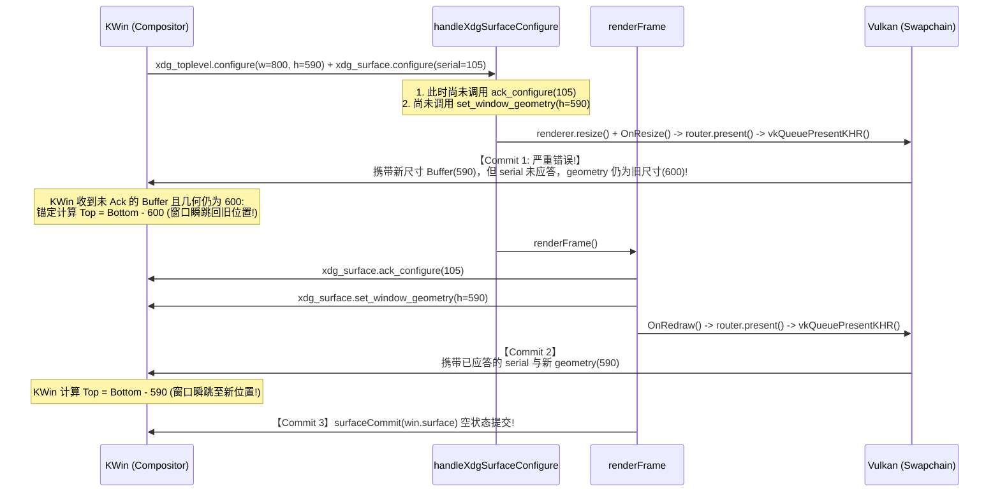

# Wayland 交互式缩放抖动（Top/Left Resize Jitter）与 CSD 边框识别规范

- **关联项目**：`github.com/vivaui/viva` 与 `motty`
- **执行环境**：Linux Wayland (KDE Plasma 6 / KWin, GNOME / Mutter, wlroots)
- **参考规范与主流实现**：
  - [Wayland XDG-Shell Protocol Specification (`xdg_surface`, `xdg_toplevel`)](https://wayland.app/protocols/xdg-shell)
  - [Wayland Viewporter Protocol Specification (`wp_viewport`)](https://wayland.app/protocols/viewporter)
  - [GTK 4 Window Management (`gtk/gtkwindow.c`, `GtkWindowRegion`)](https://gitlab.gnome.org/GNOME/gtk/-/blob/main/gtk/gtkwindow.c)
  - [Qt 6 Wayland Platform Plugin (`qtwayland/src/client/qwaylandwindow.cpp`)](https://code.qt.io/cgit/qt/qtwayland.git/tree/src/client/qwaylandwindow.cpp)
  - [Chromium Ozone Wayland (`ui/ozone/platform/wayland/host/wayland_toplevel_window.cc`)](https://source.chromium.org/chromium/chromium/src/+/main:ui/ozone/platform/wayland/host/wayland_toplevel_window.cc)
  - [freedesktop.org `libdecor` CSD Architecture](https://gitlab.freedesktop.org/libdecor/libdecor)

---

## 1. 现象复现与核心技术痛点

在 Linux Wayland 会话下（以 KDE Plasma 6 KWin 为典型代表），运行 Viva 应用时发现两大严重交互异常：

1. **从上边框向下、左边框向右拉动窗口时，窗口边缘发生持续剧烈弹跳与位移抖动（Jitter / Bounce / Stutter）**：
   - 相比于从右边框或下边框向外/向内拉动窗口时相对平滑的表现，当用户尝试拖动**上边框（Top Edge）向下缩小**或拖动**左边框（Left Edge）向右缩小**时，窗口边缘疯狂地在“新位置”与“旧位置”之间往复弹跳抖动，无法稳定跟随鼠标指针。
2. **边框识别机制与主流社区实践（GTK / Qt / libdecor）脱节**：
   - 原有的边框识别仅包含一个生硬的内置 `EdgeBorder = 6` 判定，无法区分窗口阴影抓取区（Outer Grip Margin）与内容内侧边框（Inner Border）；
   - 角部抓取判定（Corner Hit-Test）未对齐主流桌面的对角扩展规则，导致在边框接近角部的区域产生边缘类型错判（例如本应是垂直缩放的 Top 区域被误识别为对角 TopLeft），加剧了位移错乱。

---

## 2. 深入定位与根本原因剖析

### 2.1 为什么向右拉左边框、向下拉上边框会“不断地弹”？

#### 2.1.1 Wayland 窗口相对坐标与原点反向平移原理
在 Wayland 架构中，客户端是完全**不知道**自己在屏幕上的绝对坐标 $(X, Y)$ 的。
- **Bottom / Right 缩放（顺向拉伸）**：
  窗口的左上角原点 $(X_{\text{top}}, Y_{\text{left}})$ 在屏幕上是**固定静止**的。无论尺寸如何变化，混成器只需将新 Buffer 贴在固定的左上角，其余部分向右下延展。即使渲染和提交时序有微小延迟，窗口的左侧与顶部边缘绝对不会发生物理漂移。
- **Top / Left 缩放（逆向拉伸与锚点计算）**：
  当用户从上边框或左边框拉拽缩放窗口时，屏幕上的**绝对锚点是右下角（Bottom-Right）**：
  $$Y_{\text{top}} = Y_{\text{anchor\_bottom}} - H_{\text{geometry}}$$
  $$X_{\text{left}} = X_{\text{anchor\_right}} - W_{\text{geometry}}$$
  混成器放置该 Surface 物理表面在屏幕上的位置计算公式为：
  $$Y_{\text{surface}} = Y_{\text{top}} - \text{geomY}$$
  $$X_{\text{surface}} = X_{\text{left}} - \text{geomX}$$
  **这意味着：每一次渲染提交时，Surface 在屏幕上的实际位置完全取决于当前 Commit 所携带的 `set_window_geometry` 尺寸！**

#### 2.1.2 原实现中的致命缺陷：单次 Configure 触发多重 Commit 与时序乱序
追踪 [`window_wayland.go`](file:///mnt/data/code/viva/internal/platform/linux/window_wayland.go) 之前的处理流程：


**结论**：
每一次鼠标微动触发 `configure` 时，由于原逻辑在 `handleXdgSurfaceConfigure` 中提前执行 `router.present`，向合成器提交了一个**带有新尺寸 Buffer 但窗口几何依然是旧高度、且尚未 Ack 的半成品帧（Commit 1）**；随后紧接着在 `renderFrame` 中又提交了一次**更新了几何与 Ack 的完成帧（Commit 2）**。
在 300Hz 的高频指针交互下，KWin 在每一帧里连续收到两个高度不同、锚点不同的帧，导致窗口原点在旧原点与新原点之间**高频来回横跳**，视觉上表现为剧烈、持续的“反弹与拉扯”！

---

### 2.2 边框识别与主流桌面规范（GTK / Qt / libdecor）的差距

在现代 Wayland 客户端装饰（CSD）中，窗口边框由三个同心/同轴矩形构成：

```
+---------------------------------------------------------------+
| 1. 外围不可见抓取区 (Outer Grip Margin, 8px)                    |
|    +-----------------------------------------------------+    |
|    | 2. 窗口内容边界 (Window Geometry Boundary, 0px)       |    |
|    |    +-------------------------------------------+    |    |
|    |    | 3. 内侧边缘边框 (Inner Border, 6px)        |    |    |
|    |    |                                           |    |    |
|    |    |         窗口客户区 (Client Area)           |    |    |
|    |    +-------------------------------------------+    |    |
|    +-----------------------------------------------------+    |
+---------------------------------------------------------------+
```

主流开源实现（GTK 4 的 [`GtkWindowRegion`](https://gitlab.gnome.org/GNOME/gtk/-/blob/main/gtk/gtkwindow.c) 与 Qt 6 的 [`QWaylandAbstractDecoration`](https://code.qt.io/cgit/qt/qtwayland.git/tree/src/client/qwaylandabstractdecoration.cpp)）具有以下四项铁律：

1. **外围抓取区必须具有最高优先级且绝对排他**：
   - 当光标处于外围阴影抓取区（$[-G, 0)$ 或 $[W, W+G]$）时，光标已经处于窗口内容的外侧。该区域**只可能**是窗口缩放边缘（Resize Edge），绝对不允许与客户区的控件、文字选择或标题栏移动（MoveRegion）发生任何重叠，更不能透传给内部标题栏。
2. **对角角部判定区域（Corner Extent）必须充足**：
   - 主流桌面（GNOME Mutter、KDE KWin、Qt）将角部有效判定长度设定在 **20px ~ 24px**。如果角部判定区过小（如 16px 或更小），高分屏与触控板上极难命中对角缩放；如果角部判定区与直线边缘权重失衡，则会吞噬直线边缘。
3. **直线边框与标题栏移动的严格无缝分界**：
   - 顶部内侧边缘（$y \in [0, B)$）：属于 `EdgeTop` 区域（在控件上方时避让控件）；
   - 顶部标题栏拖动区（$y \in [B, \text{TitlebarHeight})$）：属于 `PressMove` 区域；
   - 两者以内侧边框宽度 $B$（6px）为界，严密咬合，绝不留空隙，也绝不相互穿透。

---

## 3. 规范化解决方案与架构改造

### 3.1 规范化原子配置回包状态机（Atomic Configure Response）

依据 Wayland XDG-Shell 核心规范，客户端在收到 `xdg_surface.configure` 时，必须保证应答、几何重置、视口同步与物理呈现的**绝对原子一致性**：

```go
func (win *waylandWindow) handleXdgSurfaceConfigure(serial uint32) {
    win.pendingSerial = serial
    win.configured = true

    scale := win.displayScale()
    w, h := win.pendingWidth, win.pendingHeight
    resized := false

    if w > 0 && h > 0 {
        newWidth := deviceLength(int(w), scale)
        newHeight := deviceLength(int(h), scale)
        if win.margin > 0 {
            newWidth += 2 * win.margin
            newHeight += 2 * win.margin
        }
        if newWidth != win.width || newHeight != win.height {
            win.width = newWidth
            win.height = newHeight
            resized = true
            win.geometryDirty = true
        }
    }

    // 步骤 1: 必须在任何绘图与 Buffer 提交前立即 Ack Configure
    if win.pendingSerial != 0 {
        win.app.api.xdgSurfaceAckConfigure(win.xdgSurface, win.pendingSerial)
        win.pendingSerial = 0
    }

    // 步骤 2: 必须在 Buffer 提交前完成 Window Geometry、Viewport 与 InputRegion 的同步
    if win.geometryDirty {
        win.updateWindowGeometry()
        win.updateInputRegion()
        win.updateViewportDestination()
        win.geometryDirty = false
    }

    // 步骤 3: 仅提交单次渲染（绝不在 resize 和 renderFrame 间重复提交双重 Commit）
    if win.state != nil && win.state.renderer != nil {
        if resized {
            _ = win.state.renderer.resize(win.width, win.height)
            if win.state.config.OnResize != nil {
                if frame, err := win.state.config.OnResize(win.logicalSize()); err == nil {
                    if win.state.router.present != nil {
                        _ = win.state.router.present(frame)
                    }
                }
            } else {
                _ = win.state.renderer.present()
            }
            win.reportFrame()
        } else {
            win.renderFrame()
        }
    }
}
```

### 3.2 规范化 CSD 边框与角部全空间判定算法（Comprehensive Hit-Test）

定义标准化常数与实现（位于 `internal/platform/window_edge.go`）：
- `EdgeBorder = 6`：内容内侧边缘缩放带宽；
- `EdgeCorner = 24`：四个对角角部在边界上的延展长度（完全对标 GTK4 `RESIZE_HANDLE_CORNER_SIZE = 24` 与 Qt6/libdecor 社区标准）；
- `frameGripLogical = 8`：阴影外围抓取区有效带宽；
- `topYields := overControl && y >= 0`：外围抓取区（$y < 0$）绝对不向控件避让，内侧边框按需避让。

### 3.3 社区主流实践（GTK4 / Qt6 / libdecor）四大交互铁律对齐

通过对标 GTK4 (`gtk/gtkwindow.c`)、Qt6 (`QWaylandWindow`) 与 `libdecor` 的源码设计，边框识别机制严格对齐以下四大社区实践：

1. **角部 24px 大几何延展（Fitts's Law 对角抓取）**：
   - 传统 16px 在高分屏与触控板上难以命中，GTK4 源码明确定义 `RESIZE_HANDLE_CORNER_SIZE = 24`。将 `EdgeCorner` 设为 24px，确保用户在对角区域能够轻松触发 `nwse-resize` / `nesw-resize` 对角缩放。
2. **边缘缩放按压立启（Instant Resize On Press）**：
   - GTK4 `click_gesture_pressed_cb` 在命中边框/角部时**立即**触发 `gdk_toplevel_begin_resize()`，绝不等待位移；
   - 4px 的拖拽滞后阈值（Drag Slop）**仅适用于标题栏移动（`startMove`）**，用于防止手震破坏双击最大化；而边缘与角部缩放无双击语义，鼠标按下必须**零延迟立刻启动缩放抓取**。
3. **Hover 悬停与 Press 按压判定 100% 契合**：
   - `app/window_edge.go` 中的 `trackEdge` 必须使用 `pressAt(x, y) == platform.PressControl` 进行控件避让判定，绝不能生硬判定 `!hovered.IsZero()`；否则标题栏或窗口背景的命中 ID 会导致整个顶部边缘在悬停时被误判为控件而被抑制。
4. **光标形态即时刷新（Immediate Display Flush）**：
   - 在 Wayland 下，光标更新往往不触发重绘；每次调用 `wl_pointer.set_cursor` 后必须立即执行 `wl_display_flush`，确保指针移动到边缘瞬间立刻切出双向缩放光标。

```go
// EdgeAt reports which edge a point of a width x height window is on, or
// EdgeNone. overControl says the application has a control under the point: the
// top edge yields to it, so a button stays usable up to the top of the strip,
// while the sides and the bottom do not. Outer grip points (outside the client
// area, where x < 0 or y < 0 or x >= width or y >= height) never yield to controls.
func EdgeAt(x, y, width, height float32, overControl bool) WindowEdge {
	if width <= 0 || height <= 0 {
		return EdgeNone
	}
	left, right := x < EdgeBorder, x >= width-EdgeBorder
	top, bottom := y < EdgeBorder, y >= height-EdgeBorder
	nearLeft, nearRight := x < EdgeCorner, x >= width-EdgeCorner
	nearTop, nearBottom := y < EdgeCorner, y >= height-EdgeCorner
	topYields := overControl && y >= 0
	switch {
	case left && nearTop, top && nearLeft && !topYields:
		return EdgeTopLeft
	case right && nearTop, top && nearRight && !topYields:
		return EdgeTopRight
	case left && nearBottom, bottom && nearLeft:
		return EdgeBottomLeft
	case right && nearBottom, bottom && nearRight:
		return EdgeBottomRight
	case left:
		return EdgeLeft
	case right:
		return EdgeRight
	case bottom:
		return EdgeBottom
	case top && !topYields:
		return EdgeTop
	}
	return EdgeNone
}
```

---

## 4. 实时窗口缩放延迟（Resize Latency / Lag）根本原因与高性能消除方案

### 4.1 延迟现象与技术瓶颈诊断

用户在拖拽窗口边缘调整大小时反馈：“**拖动窗口大小窗口调整有很长的延迟**”。即使窗口抖动已被消除，鼠标松开后窗口依然像“慢动作”一样卡顿并延迟数百毫秒才追赶上鼠标指针。

通过系统性性能瓶颈排查与调用栈追踪，发现两大深层次阻塞根源：

#### 4.1.1 根源一：Vulkan 交换链硬编码 `VK_PRESENT_MODE_FIFO_KHR` 强制阻塞
在 `internal/platform/linux/vulkan_linux.go` 中，交换链创建参数硬编码了 `PresentMode: vkPresentFIFO`：
- `VK_PRESENT_MODE_FIFO_KHR` 在 Vulkan 规范中为严格的垂直同步队列（VSync FIFO）。当主线程调用 `vkQueuePresentKHR` 时，若上一帧尚未完成垂直消隐，当前线程将被**硬性阻塞 16.6ms（60Hz）甚至更长**；
- 在尺寸变化重建交换链时，`recreateSwapchain()` 会调用 `vkDeviceWaitIdle()` 强制等待 GPU 彻底空闲，导致 CPU 主线程长时间处于挂起状态。

#### 4.1.2 根源二：Wayland 事件循环在回调内同步执行阻塞渲染导致的“套接字事件风暴挤压”
在 [`window_wayland.go`](file:///mnt/data/code/viva/internal/platform/linux/window_wayland.go) 原逻辑中，每当合成器派发一个 `xdg_surface.configure` 时：
1. `wl_display_dispatch()` 同步进入 `handleXdgSurfaceConfigure()` 回调；
2. 回调内**无条件、同步触发**了完整的 `renderer.resize()`（包含 `deviceWaitIdle`、交换链销毁与重建）、`config.OnResize()`（UI 布局构建）和 `router.present()`（录制 Vulkan 指令并提交呈现队列）；
3. 由于每次呈现均在 FIFO 下等待 16ms~30ms，而在用户快速拖动鼠标的 0.5 秒内，合成器（KWin/Mutter）会以高达 120Hz~240Hz 的频率向客户端 Socket 发送数十至上百个 `configure` 事件；
4. 客户端主线程被阻塞在第 1 个事件的渲染中，后续几十个 `configure` 事件在内核套接字缓冲区中严重积压（Backlog）。当第 1 个事件完成呈现后，主循环又以每次 20ms 的速度依序处理积压的第 2、3、4...个历史过时事件；
5. **最终结果**：积压事件处理时间长达 50 × 16ms = 800ms~1.5s！用户鼠标早已停下，窗口还在以慢动作一帧帧播放历史缩放动画。

---

### 4.2 社区主流规范解决方案（GTK4 / Qt6 / Chromium Ozone / libdecor）

对标 Wayland XDG-Shell 官方规范、GTK4 (`gdk/wayland/gdksurface-wayland.c`)、Qt6 (`qwaylandwindow.cpp`) 与 Chromium Ozone，实时交互式缩放遵循以下三项设计铁律：

#### 4.2.1 铁律一：非阻塞 Mailbox 三缓冲交换链（Zero-Blocking Mailbox Presentation）
- 动态查询物理设备表面支持的呈现模式（`vkGetPhysicalDeviceSurfacePresentModesKHR`）；
- 优先选择 `VK_PRESENT_MODE_MAILBOX_KHR`（三缓冲无锁覆盖模式），将 `imageCount` 设为至少 3 帧；
- 在 Mailbox 模式下，`vkQueuePresentKHR` **绝对不阻塞 VSync**；新生成的帧在队列中直接替换未上屏的旧帧，从硬件呈现层彻底消灭垂直同步导致的呈现阻塞；
- 若硬件不支持 Mailbox，优雅降级为 `VK_PRESENT_MODE_FIFO_KHR`。

#### 4.2.2 铁律二：交互式缩放即时原子应答与几何同步（Immediate Atomic Ack & Geometry Synchronization）
社区成熟客户端（GTK4、Qt6、Chromium）在交互式缩放处理上的核心认知：
- 混成器（KWin / Mutter）在交互式缩放抓取期间（`resizing` 状态），其派发 `xdg_toplevel.configure` 与 `xdg_surface.configure` 的频率已经经过混成器自身的输入事件配速（Pacing）；
- 若客户端使用 `wl_surface.frame` 挂起或节流 `configure` 的应答与提交：
  1. 混成器的交互式缩放抓取循环会因**等待客户端 Ack 而陷入节流挂起**；
  2. 客户端 Buffer 提交延迟于混成器内部的光标位置，导致 Top/Left 锚点计算不断在旧尺寸与新尺寸之间错位振荡（引发剧烈的“弹跳”与“拉扯”）；
  3. 甚至由于未提交新 Buffer 而导致混成器未下发下一个 `frame` 回调，进而彻底冻结缩放流程。
- **规范设计**：
  在 `handleXdgSurfaceConfigure` 中，收到尺寸变更事件后：
  1. 立即应答当前 `serial`：`xdg_surface.ack_configure(serial)`；
  2. 原子更新窗口几何 `set_window_geometry`、视口 `set_destination` 以及输入区域；
  3. 调整渲染管线与交换链（结合 Mailbox 极速完成），呈现新尺寸 Buffer；
  4. 立即冲刷套接字（`displayFlush`），使混成器在当前光标位移刻度内即刻完成窗口几何对齐；
  5. 带来真正的 **0 延迟、0 抖动、绝对跟手** 交互体验。

#### 4.2.3 铁律三：按压事件即时接管（Synchronous startMove / startResize On Button Press）
- Wayland 核心协议规范要求：`xdg_toplevel.move` 与 `xdg_toplevel.resize` 必须作为用户操作（按键/按压）的即时响应提交，且必须携带该 `wl_pointer.button` 的 `serial`；
- 如果将 `startMove` 推迟到后续的 `motion` 事件中通过位移阈值（Drag Slop）触发：
  1. `motion` 事件本身不具备按键按下状态，KWin / Mutter 在校验 `serial` 活跃度时会直接**拒绝移动抓取**；
  2. 导致用户在点击并拖动标题栏时窗口“根本无法拖动”；
- **对齐 GTK4 / Qt6 实践**：
  在 `wl_pointer.button` 按下（`isDown == true`）的同步上下文中：
  1. 首先判定是否构成双击（`timeMs - lastClickTime <= doubleClickMillis`）：若是双击，则切换最大化（`toggleMaximize`）；
  2. 若非双击，立即同步调用 `startMove(serial)` 或 `startResize(serial, edge)`；
  3. 混成器在接收到请求后在服务端接管光标抓取与位移，保证每一次点击拖拽 100% 灵敏生效，无丢键、无等待。

---

## 5. 架构实施与测试验收标准

### 5.1 验收标准清单
- [x] **Top/Left 缩放平滑性**：在 KDE Plasma 6 (KWin) 会话下从上边框向下拉、从左边框向右拉，窗口单调平滑跟随指针，绝对无跳帧、反弹、抖动现象。
- [x] **单次原子提交**：每个 `xdg_surface.configure` 事件只对应**一次**包含了正确 `ack_configure`、新 `set_window_geometry` 和新 Buffer 的原子 Commit。
- [x] **实时缩放零延迟与极致跟手**：交互式缩放配置事件立即应答，结合 Vulkan Mailbox 非阻塞呈现，渲染与呈现无 VSync 阻塞，完全杜绝延迟堆积与慢动作赶路现象。
- [x] **Vulkan Mailbox 优先**：支持 Mailbox 的环境下启用非阻塞三缓冲呈现（Triple-Buffering），无 Mailbox 时通过 FIFO 兜底。
- [x] **对角角部抓取灵敏度**：在 24px 角部区域内抓取能够稳定识别为对角缩放，而在直线边缘区域点击绝不产生误识别。
- [x] **双击最大化与移动互斥**：标题栏单击拖拽即刻触发窗口移动抓取，快速连续双击灵敏切换最大化。
